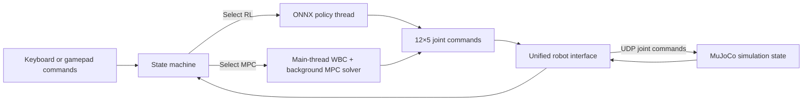
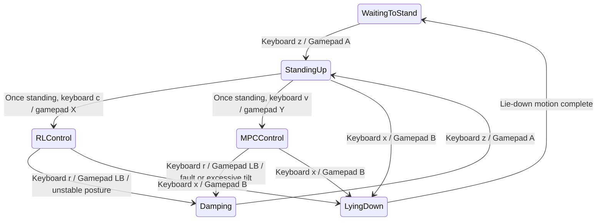

# Quadruped Locomotion Control with MPC+WBC (Validated on Lite3)

[](README_ZH.md)

A flat-ground locomotion control project for the Deep Robotics Lite3 quadruped. **MPC+WBC** provides forward and backward motion, lateral motion, turning in place, and combined velocity commands, with closed-loop validation in **MuJoCo** simulation. This project runs in simulation only. The original ONNX reinforcement learning control pipeline is retained for future comparisons using the same robot model, user commands, and joint interface.

## 1. Motion Demos

| Forward and Backward | Lateral Motion | Turning in Place |
| :---: | :---: | :---: |
|  |  |  |

Demo files: [Forward / backward](docs/video/01_前进-后退.gif) · [Lateral motion](docs/video/02_左右平移.gif) · [Turning in place](docs/video/03_原地旋转.gif).

## 2. Control Pipeline



`build/mpc_control` and `build/rl_control` share the same state machine, user input, and joint command interface. Once the robot has finished standing up, press `v` on the keyboard or `Y` on the gamepad to enter MPC+WBC, or press `c` on the keyboard or `X` on the gamepad to select RL. The RL policy is loaded when first selected.

## 3. Project Structure

```text
Lite3_MPC-WBC_project/
├── CMakeLists.txt                 C++ build configuration
├── main.cpp                       Program entry point
├── README.md                      English project guide
├── README_ZH.md                   Chinese project guide
├── onnx/                          ONNX inference and policy models
│   ├── run_policy/                Inference interfaces and implementation
│   └── policy/                    ONNX models and conversion examples
├── state_machine/                 State machine and control states
│   └── parameters/                Lite3 control parameters
├── robot_models/                  Robot models and flat-ground environment
├── interface/                     Simulation communication and user input
│   ├── robot/
│   └── user_command/
├── mpc_wbc/                       MPC+WBC algorithms
├── support/                       Shared utilities and external dependencies
│   ├── types/                     Shared data types
│   ├── utils/                     Math utilities and telemetry
│   └── third_party/               Eigen, ONNX Runtime, and other dependencies
└── docs/                          Project structure and maintenance documentation
```

## 4. Running the MuJoCo Simulation

Install the build dependencies:

```bash
sudo apt install build-essential cmake libdw-dev
```

Install the Python simulation dependencies:

```bash
python3 -m pip install mujoco colorama "numpy<2"
```

Build the simulation controllers from the project root:

```bash
cmake -S . -B build
cmake --build build -j2
```

Run the simulation and controller in separate terminals:

```bash
# Terminal 1: launch MuJoCo from the project root
python3 interface/robot/simulation/mujoco_simulation.py
```

```bash
# Terminal 2: enter build from the project root; keyboard input is the default
cd build
./mpc_control

# Alternatively, use a USB gamepad: press A to stand up, then Y to enter MPC+WBC
LITE3_USER_INPUT=usb ./mpc_control
```

## 5. Keyboard and USB Gamepad Controls

### 5.1 Key and Stick Mapping

| Action | Keyboard | Gamepad |
| --- | --- | --- |
| Stand up; stand up again from damping mode | `z` | `A` |
| Lie down | `x` | `B` |
| Select RL control | `c` after standing up | `X` after standing up |
| Select MPC+WBC control | `v` after standing up | `Y` after standing up |
| Enter joint damping mode | `r` | `LB` during RL/MPC control |
| Move forward / backward | `w` / `s` | Left stick up / down |
| Move left / right | `a` / `d` | Left stick left / right |
| Turn left / right | `q` / `e` | Right stick left / right |

### 5.2 State Transitions



## 6. References and Licensing

- [OCS2-based legged control framework](https://github.com/qiayuanl/legged_control)
- [Deep Robotics RL deployment](https://github.com/DeepRoboticsLab/Lite3_rl_deploy)
- [Quadruped MPC algorithm study notes (Chinese)](https://blog.csdn.net/wills9/article/details/119377036)
