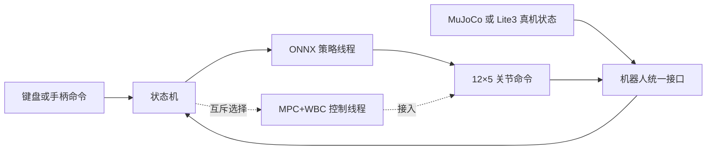

# 基于MPC+WBC算法实现的四足狗运动控制工程（以 Lite3 为验证对象）

面向云深处 Lite3 的平地运动控制工程。目标是通过 **MPC+WBC** 实现前进、后退、左右平移、原地旋转，以及这些方向的混合速度命令，并在 **MuJoCo** 和真机上验证。工程保留原有 ONNX 强化学习控制链，便于后续在相同机器人模型、输入命令和关节接口下对比两种方法。

## 1. 运动演示

| 前进与后退 | 左右平移 | 原地旋转 |
| :---: | :---: | :---: |
|  |  |  |

演示文件：[前进/后退](docs/video/01_前进-后退.gif) · [左右平移](docs/video/02_左右平移.gif) · [原地旋转](docs/video/03_原地旋转.gif)。

## 2. 当前控制链



仿真控制统一由 `build/mpc_control` 启动。默认使用 ONNX；设置 `LITE3_CONTROL_PATH=mpc_wbc` 则使用 MPC+WBC。两种控制器共用状态机、键盘命令和关节命令接口，每次运行只构造所选控制器。

## 3. 工程结构

```text
Lite3_MPC-WBC_project/
├── CMakeLists.txt                 C++ 构建入口
├── main.cpp                       程序入口
├── README.md                      工程说明
├── onnx/                          ONNX 推理与策略模型
│   ├── run_policy/                推理接口和实现
│   └── policy/                    ONNX 模型和转换示例
├── state_machine/                 状态机与控制状态
│   └── parameters/                Lite3 控制参数
├── robot_models/                  机器人模型与平地环境
├── interface/                     仿真、真机、控制接口
│   ├── robot/
│   └── user_command/
├── mpc_wbc/                       MPC+WBC 算法
├── support/                       相对固定的共用与外部支持文件
│   ├── types/                     共用数据类型
│   ├── utils/                     数学工具与遥测
│   ├── scripts/                   真机文件传输脚本
│   └── third_party/               Eigen、ONNX Runtime、手柄库与 Lite3 SDK
└── docs/                          工程结构和维护文档
```


## 4. 运行 MuJoCo 仿真

环境：Ubuntu、CMake、C++17 编译器、Python 3，以及 `backward.hpp` 和 `libdw-dev`。项目的 Eigen 和 ONNX Runtime 等 C++ 依赖位于 `support/third_party/`。安装 Python 仿真依赖：

```bash
python3 -m pip install mujoco colorama "numpy<2"
```

在工程根目录构建仿真控制程序：

```bash
cmake -S . -B build
cmake --build build -j
```

分别在两个终端运行：

```bash
# 终端 1：从工程根目录启动 MuJoCo
python3 interface/robot/simulation/mujoco_simulation.py
```

```bash
# 终端 2：使用默认 ONNX 控制器
./build/mpc_control
```

要用 MPC+WBC 走状态机路径（与 ONNX **互斥**，选 MPC 时不会构造 ONNX 状态，因此不需要 `policy.onnx`）：

```bash
# 终端 2：选择 MPC+WBC 控制器
LITE3_CONTROL_PATH=mpc_wbc ./build/mpc_control
```

仿真默认开启 MuJoCo viewer。不要设置 `MUJOCO_VIEWER=0`。仿真端和控制端分别运行，两个终端都应留在前台。

### 5. 键盘控制

仿真构建使用键盘接口。启动控制程序的终端需要保持焦点，按键后松开即可；速度命令在约 300 ms 后自动归零。

| 功能 | 按键 |
| --- | --- |
| 站起 | `z` |
| 进入当前所选控制器（ONNX 或 MPC+WBC） | `c` |
| 趴下 | `x` |
| 关节阻尼 | `r` |
| 前进 / 后退 | `w` / `s` |
| 左右平移 | `a` / `d` |
| 原地旋转 | `q` / `e` |

仿真初始姿态为站立位。按 `z` 进入站立状态，站稳后按 `c` 启用本次启动选择的控制器，再用方向键控制运动。按 `r` 可切换到关节阻尼状态。

各文件职责和模块关系见 [工程结构与文件说明](docs/01_project_structure.md)。模型说明见 [robot_models/README.md](robot_models/README.md)。

## 6. 来源与许可

本工程基于云深处的 [Lite3_rl_deploy](https://github.com/DeepRoboticsLab/Lite3_rl_deploy) 整理。源码许可见 [LICENSE](LICENSE)。
