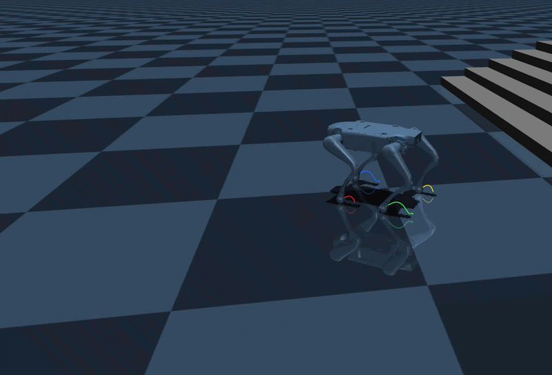
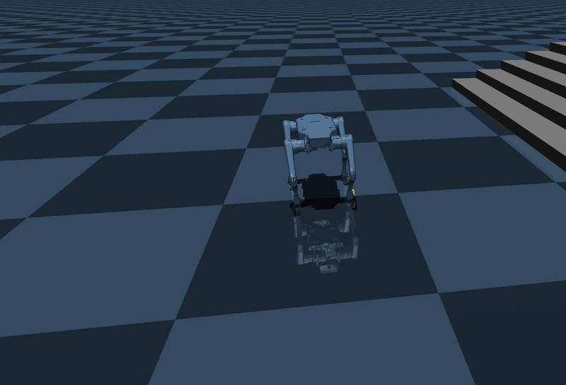
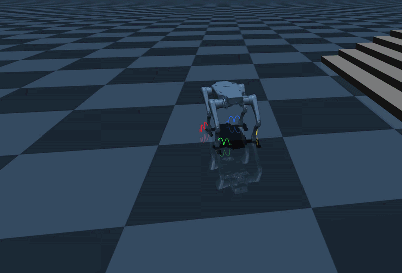
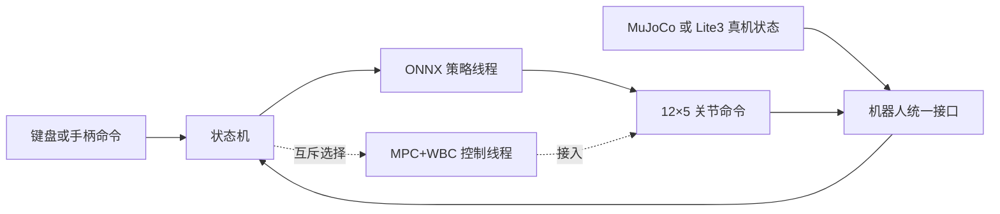

# 基于MPC+WBC算法实现的四足狗运动控制工程（以 Lite3 为验证对象）

面向云深处 Lite3 的平地运动控制工程。目标是通过 **MPC+WBC** 实现前进、后退、左右平移、原地旋转，以及这些方向的混合速度命令，并在 **MuJoCo** 仿真中验证达标（本项目不上真机）。工程保留原有 ONNX 强化学习控制链，便于后续在相同机器人模型、输入命令和关节接口下对比两种方法。

## 1. 运动演示

| 前进与后退 | 左右平移 | 原地旋转 |
| :---: | :---: | :---: |
|  |  |  |

演示文件：[前进/后退](docs/video/01_前进-后退.gif) · [左右平移](docs/video/02_左右平移.gif) · [原地旋转](docs/video/03_原地旋转.gif)。

## 2. 当前控制链



仿真控制统一由 `build/mpc_control` 启动。默认使用 ONNX；设置 `LITE3_CONTROL_PATH=mpc_wbc` 则使用 MPC+WBC。两种控制器共用状态机、键盘命令和关节命令接口，每次运行只构造所选控制器。

## 3. 工程结构

```text
Lite3_MPC-WBC_project/
├── CMakeLists.txt                 C++ 构建入口
├── main.cpp                       程序入口
├── README.md                      工程说明
├── onnx/                          ONNX 推理与策略模型
│   ├── run_policy/                推理接口和实现
│   └── policy/                    ONNX 模型和转换示例
├── state_machine/                 状态机与控制状态
│   └── parameters/                Lite3 控制参数
├── robot_models/                  机器人模型与平地环境
├── interface/                     仿真、真机、控制接口
│   ├── robot/
│   └── user_command/
├── mpc_wbc/                       MPC+WBC 算法
├── support/                       相对固定的共用与外部支持文件
│   ├── types/                     共用数据类型
│   ├── utils/                     数学工具与遥测
│   ├── scripts/                   真机文件传输脚本
│   └── third_party/               Eigen、ONNX Runtime、手柄库与 Lite3 SDK
└── docs/                          工程结构和维护文档
```


## 4. 运行 MuJoCo 仿真

环境：Ubuntu、CMake、C++17 编译器、Python 3，以及 `backward.hpp` 和 `libdw-dev`。项目的 Eigen 和 ONNX Runtime 等 C++ 依赖位于 `support/third_party/`。安装 Python 仿真依赖：

```bash
python3 -m pip install mujoco colorama "numpy<2"
```

在工程根目录构建仿真控制程序：

```bash
cmake -S . -B build
cmake --build build -j
```

分别在两个终端运行：

```bash
# 终端 1：从工程根目录启动 MuJoCo
python3 interface/robot/simulation/mujoco_simulation.py
```

```bash
# 终端 2：使用默认 ONNX 控制器
./build/mpc_control
```

要用 MPC+WBC 走状态机路径（与 ONNX **互斥**，选 MPC 时不会构造 ONNX 状态，因此不需要 `policy.onnx`）：

```bash
# 终端 2：选择 MPC+WBC 控制器
LITE3_CONTROL_PATH=mpc_wbc ./build/mpc_control
```

仿真默认开启 MuJoCo viewer。不要设置 `MUJOCO_VIEWER=0`。仿真端和控制端分别运行，两个终端都应留在前台。

### 5. 键盘控制

仿真构建使用键盘接口。启动控制程序的终端需要保持焦点，按键后松开即可；速度命令在约 300 ms 后自动归零。

| 功能 | 按键 |
| --- | --- |
| 站起 | `z` |
| 进入当前所选控制器（ONNX 或 MPC+WBC） | `c` |
| 趴下 | `x` |
| 关节阻尼 | `r` |
| 前进 / 后退 | `w` / `s` |
| 左右平移 | `a` / `d` |
| 原地旋转 | `q` / `e` |

仿真初始姿态为站立位。按 `z` 进入站立状态，站稳后按 `c` 启用本次启动选择的控制器，再用方向键控制运动。按 `r` 可切换到关节阻尼状态。

各文件职责和模块关系见 [工程结构与文件说明](docs/01_project_structure.md)。模型说明见 [robot_models/README.md](robot_models/README.md)。

## 6. MPC+WBC 单轴调试与回归

除主程序外，构建还会产出两个离线 harness（`-DBUILD_MPC_WBC_SIM=OFF` 可关闭）：
`build/mpc_wbc/mpc_wbc_mpc_wbc_sim`（闭环 MPC+WBC）与
`build/mpc_wbc/mpc_wbc_position_loop_sim`（开环位置环基线）。二者通过 UDP 与
`mujoco_simulation.py` 通信，可脚本化下发速度段，而不用手按键盘。

单轴 vx / vy / wz 扫速（±4 档 × 8 s + 2 s 停步，**强制开 viewer**）：

```bash
# 三条都跑（约 5 分钟），日志写 build/single_axis/r11_{vx,vy,wz}/
OUTROOT=build/single_axis/r11 mpc_wbc/test/run_single_axis.sh "vx vy wz"
# 只跑一个轴
mpc_wbc/test/run_single_axis.sh wz
```

脚本内部用 `run_s8_case.py --sim-env MUJOCO_VIEWER=1` 起仿真，跑完自动调用
`mpc_wbc/test/analyze_axis_sweep.py` 输出逐段线性/偏航跟踪误差、纹波和倾角。
判定口径：线速度/偏航误差 ≤ 0.05（m/s、rad/s），倾角 ≤ 10°，>25° 或机身高度
< 0.15 m 记 FELL。

当前实测（2026-11-01，单轴 8 s/段）：

**最终指标：$v_x$ 0.10–0.60 m/s / $v_y$ 0.10–0.50 m/s / $\omega_z$ 0.10–1.00 rad/s**
（`mpc_wbc/test/scenarios/spec_vx.csv` / `spec_vy.csv` / `spec_wz.csv` 为对应的验收场景）。
2026-11-01 修复 SRBD-MPC 角加速度坐标系混用（详见 `docs/05_优化日志.md`「R11 收尾」）
之后，转向不再是「时好时坏」：

| 工况 | 跟踪误差 | 倾角 max / p95 | 结论 |
| --- | --- | --- | --- |
| vx ±0.20 / ±0.40 / ±0.60 | ≤ 0.019 | ≤ 5.3° | ✅ |
| vy ±0.10 / ±0.20 / ±0.30 | ≤ 0.030 | ≤ 7.9° | ✅（0.50 可用、0.80 失效） |
| wz ±0.10 / ±0.20 / ±0.30 | ≤ 0.003 rad/s | 0.8° | ✅ 双向全过 |
| wz ±1.00（12 s 长段，±1.9 圈） | ≤ 0.002 rad/s | ≤ 2.9° | ✅ 失稳点 ≈2.5 rad/s |
| wz −0.30 连转 37 s（航向走两整圈） | ≤ 0.007 rad/s | ≤ 1.2° | ✅ |
| vx 0.60 + wz 0.20 / 0.35 | 0.019 / 0.036 | ≤ 5.4° | ✅ |
| vx 0.45 + wz 0.50 / 0.70 | 0.030 / 0.047 | ≤ 5.4° | ✅ |
| vy 0.50 + wz 0.20（含 0.30/0.50 各档） | 0.030–0.040 | ≤ 8.6° | ✅ |
| 三轴满量程（削到 0.418/0.349/0.697） | 见 `docs/00 §5.3` | ≤ 8.6° | ✅ |
| 同上但关闭组合约束 | 发散 | **46.6°** | ❌ 翻车 |

组合工况只需要一条线性归一化（`docs/00 §2.2`）：$v_{xy}+0.18\lvert\omega_z\rvert\le0.67$，
超限三轴同比缩比。单轴钳位 `S8_CMDMAX_VX/VY/WZ`，组合约束 `S8_COMBO_MAX` / `S8_COMBO_WZ`。
一键验收：`mpc_wbc/test/run_acceptance.sh`（单轴 / 组合 / 三轴满量程，默认开 viewer）。

修复前的历史数据（保留作对照）：wz ±0.30 倾角 5–15°、±0.40 10–12°、±0.50 13–18°，
且同一指令在不同航向下的结果相差 10° 以上。

线速度「恒快 ~0.045 m/s」是接触/滑移标定问题，已用**命令级补偿** `cmd_vel_trim`
处理，并**固化进默认参数 `0.04`**（仿真标定值，本项目只跑 MuJoCo）。上表的数字
就是默认参数下测的，不需要加任何 env；`S8_CMD_VTRIM=0` 可回到未补偿状态做对照。
调试开关（全部只影响 harness 的 `MpcWbcControllerParams`）：`S8_MPC_VTRIM`
（MPC 速度参考前馈）、`S8_GAIT_VFB` / `S8_GAIT_WFB` / `S8_GAIT_VTRIM`（步态级
速度/偏航率反馈与步幅 trim）、`S8_KV_STANCE`（支撑足速度阻尼）、`S8_Q_VXY` /
`S8_Q_YAW` / `S8_Q_WYAW` / `S8_Q_RP` / `S8_Q_WRP`（MPC 权重）、
`S8_SWING_LOW/MID/HIGH`（分段抬腿高度）。细节与已证伪路线见
[docs/05_优化日志.md](docs/05_优化日志.md) R11 节。

## 7. 来源与许可

本工程基于云深处的 [Lite3_rl_deploy](https://github.com/DeepRoboticsLab/Lite3_rl_deploy) 整理。源码许可见 [LICENSE](LICENSE)。
