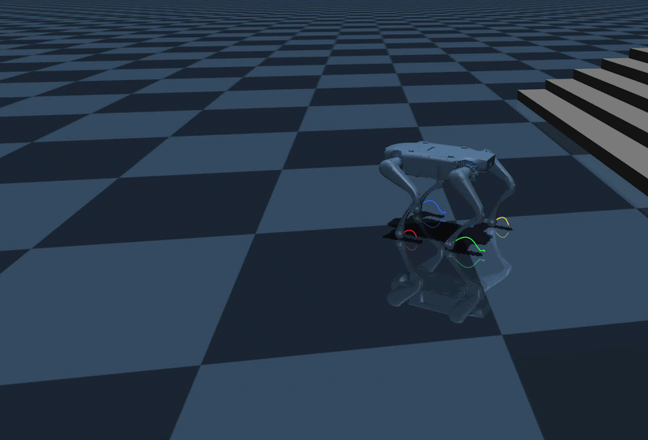
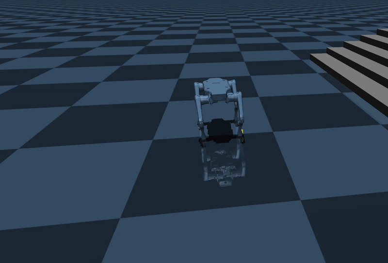
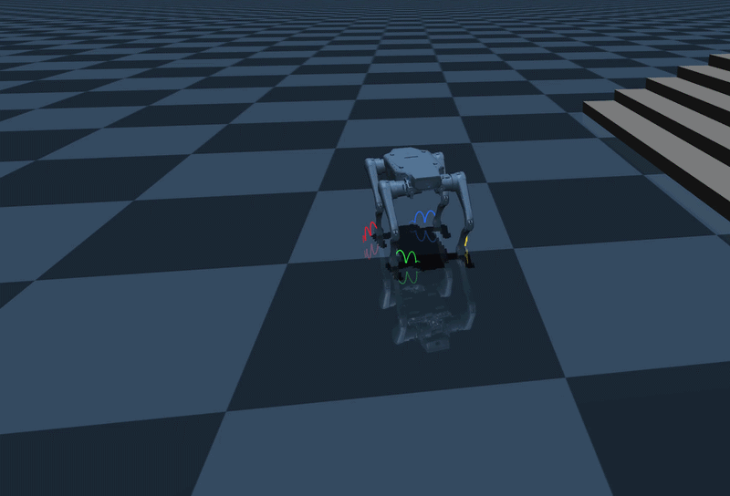
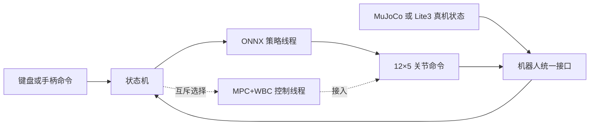

# 基于MPC+WBC算法实现的四足狗运动控制工程（以 Lite3 为验证对象）

面向云深处 Lite3 的平地运动控制工程。目标是通过 **MPC+WBC** 实现前进、后退、左右平移、原地旋转，以及这些方向的混合速度命令，并在 **MuJoCo** 和真机上验证。工程保留原有 ONNX 强化学习控制链，便于后续在相同机器人模型、输入命令和关节接口下对比两种方法。

## 1. 运动演示

| 前进与后退 | 左右平移 | 原地旋转 |
| :---: | :---: | :---: |
|  |  |  |

演示文件：[前进/后退](docs/video/01_前进-后退.gif) · [左右平移](docs/video/02_左右平移.gif) · [原地旋转](docs/video/03_原地旋转.gif)。

## 2. 当前控制链



仿真与真机共用关节命令格式：每个关节发送 `kp、目标位置、kd、目标速度、前馈力矩`。后续 ONNX 与 MPC+WBC 控制线程只能选择其中一条写入关节命令，状态切换仍由现有状态机管理。

## 3. 工程结构

```text
Lite3_MPC-WBC_project/
├── CMakeLists.txt                 C++ 构建入口
├── main.cpp                       程序入口
├── README.md                      工程说明
├── onnx/                          ONNX 推理与策略模型
│   ├── run_policy/                推理接口和实现
│   └── policy/                    ONNX 模型和转换示例
├── state_machine/                 状态机与控制状态
│   └── parameters/                Lite3 控制参数
├── robot_models/                  机器人模型与平地环境
├── interface/                     仿真、真机、控制接口
│   ├── robot/
│   └── user_command/
├── mpc_wbc/                       MPC+WBC 算法
├── support/                       相对固定的共用与外部支持文件
│   ├── types/                     共用数据类型
│   ├── utils/                     数学工具与遥测
│   ├── scripts/                   真机文件传输脚本
│   └── third_party/               Eigen、ONNX Runtime、手柄库与 Lite3 SDK
└── docs/                          工程结构和维护文档
```


## 4. 运行 MuJoCo 仿真

环境：Ubuntu、CMake、C++17 编译器、Python 3，以及 `backward.hpp` 和 `libdw-dev`。项目的 Eigen、ONNX Runtime、Lite3 MotionSDK 等 C++ 依赖位于 `support/third_party/`。安装 Python 仿真依赖：

```bash
python3 -m pip install mujoco colorama "numpy<2"
```

在工程根目录构建仿真控制程序：

```bash
cmake -S . -B build -DBUILD_PLATFORM=x86 -DBUILD_SIM=ON -DSEND_REMOTE=OFF
cmake --build build -j
```

### MPC+WBC 开发对表（可选）

MPC+WBC 算法位于 `mpc_wbc/`，当前已完成运动学（FK/IK/雅可比）、全身动力学（`M/h/Jc`）、trot 步态/足端轨迹、位置环基线（S4）、状态估计（S5）、SRBD 预测时域 MPC（S6）与统一 Weighted-QP WBC（S7，含自研内点法 QP 求解器）。开启对表测试后可用 CTest 跑 MuJoCo 数值对照（需要 `python3` 与 `mujoco`）：

```bash
cmake -S . -B build -DBUILD_MPC_WBC_TESTS=ON
cmake --build build -j
cd build && ctest -R mpc_wbc --output-on-failure
```

SRBD-MPC 离线自检（不需要 MuJoCo）：

```bash
cmake -S . -B build -DBUILD_MPC_WBC_TESTS=ON
cmake --build build -j
mpc_wbc/test/run_srbd_mpc_test.sh
```

Weighted-QP WBC 离线自检 + MuJoCo 正动力学复核（自研 QP 单测 → WBC 自检 → 把解回灌 MuJoCo）：

```bash
mpc_wbc/test/run_wbc_test.sh
```

位置环跑步基线（无头仿真 + 自动分析）：

```bash
cmake -S . -B build -DBUILD_MPC_WBC_SIM=ON
cmake --build build -j
mpc_wbc/test/run_s4_position_loop.sh 24
```

`BUILD_MPC_WBC_TESTS` 默认关闭，不影响上面的 ONNX 仿真/真机构建。详见 [mpc_wbc/README.md](mpc_wbc/README.md) 与 [MPC+WBC 实现步骤与里程碑](docs/04_Lite3_MPC_WBC实现步骤与里程碑.md)。

分别在两个终端运行：

```bash
# 终端 1：从工程根目录启动 MuJoCo
python3 interface/robot/simulation/mujoco_simulation.py
```

```bash
# 终端 2：从 build/ 目录启动当前 ONNX 控制程序
cd build
./rl_deploy
```

控制程序当前通过运行目录定位 `onnx/policy/ppo/policy.onnx`，因此上述 `cd build` 不应省略。MuJoCo 加载的平地场景为 `robot_models/robots/Lite3/Lite3_mjcf/mjcf/Lite3_flat.xml`。

### 5. 当前 ONNX 控制按键

仿真程序检测到 `/dev/input/js0` 时使用 Xbox 手柄，否则使用键盘。

| 功能 | 键盘 | Xbox 手柄 |
| --- | --- | --- |
| 站起 | `z` | LB |
| 进入当前 ONNX 控制 | `c` | RB |
| 趴下 | `x` | X |
| 关节阻尼 | `r` | LT |
| 前进 / 后退 | `w` / `s` | 左摇杆上下 |
| 左右平移 | `a` / `d` | 左摇杆左右 |
| 原地旋转 | `q` / `e` | 右摇杆左右 |

先站起，再进入 ONNX 控制状态，随后发送速度命令。上述按键属于当前 ONNX 基线；MPC+WBC 接入后计划复用相同的运动命令入口。

## 6. 真机构建

真机路径使用 Lite3 MotionSDK，默认输入为 Retroid 手柄。ARM 构建需要相应的 `aarch64-linux-gnu` 编译器及库：

```bash
cmake -S . -B build -DBUILD_PLATFORM=arm -DBUILD_SIM=OFF -DSEND_REMOTE=OFF
cmake --build build -j
cd build
./rl_deploy
```

Retroid 手柄：Y 站起、A 进入当前 ONNX 控制、X 趴下、同时按下左右摇杆进入阻尼；左摇杆控制平移，右摇杆控制转向。真机运行前需核对网络配置、SDK 控制权、关节顺序、传感器单位和关节限幅。本 README 中的真机构建步骤描述现有接口，**不表示 MPC+WBC 已完成真机部署**。


各文件职责和模块关系见 [工程结构与文件说明](docs/01_project_structure.md)。模型说明见 [robot_models/README.md](robot_models/README.md)。

## 7. 来源与许可

本工程基于云深处的 [Lite3_rl_deploy](https://github.com/DeepRoboticsLab/Lite3_rl_deploy) 整理。源码许可见 [LICENSE](LICENSE)。
