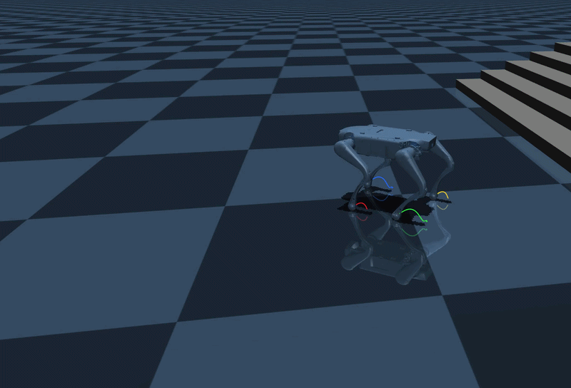
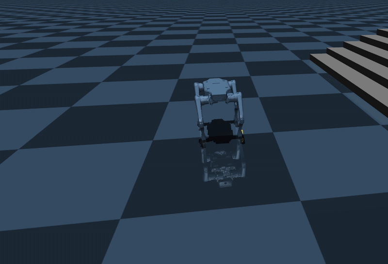
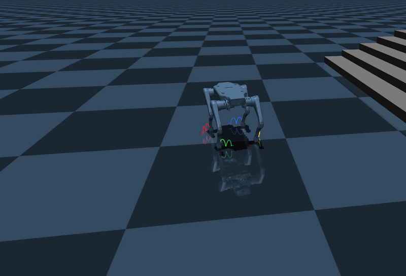
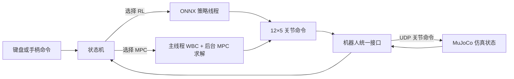
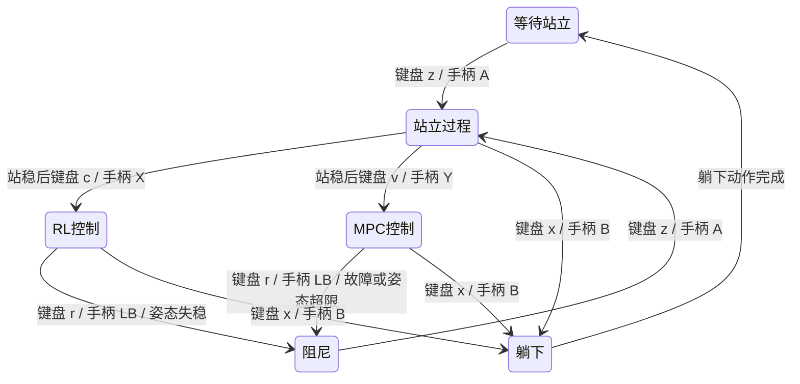

# 基于MPC+WBC算法实现的四足狗运动控制工程（以 Lite3 为验证对象）

[](README.md)

面向云深处 Lite3 的平地运动控制工程。通过 **MPC+WBC** 实现前进、后退、左右平移、原地旋转，以及这些方向的混合速度命令，并在 **MuJoCo** 仿真中进行闭环验证（本项目不上真机）。工程保留原有 ONNX 强化学习控制链，便于后续在相同机器人模型、输入命令和关节接口下对比两种方法。

## 1. 运动演示

| 前进与后退 | 左右平移 | 原地旋转 |
| :---: | :---: | :---: |
|  |  |  |

演示文件：[前进/后退](docs/video/01_前进-后退.gif) · [左右平移](docs/video/02_左右平移.gif) · [原地旋转](docs/video/03_原地旋转.gif)。

## 2. 当前控制链



`build/mpc_control` 和 `build/rl_control` 共用状态机、用户输入和关节命令接口。站立完成后，键盘按 `v`、手柄按 `Y` 进入 MPC+WBC；键盘按 `c`、手柄按 `X` 选择 RL。RL 策略在首次选择时加载。

## 3. 工程结构

```text
Lite3_MPC-WBC_project/
├── CMakeLists.txt                 C++ 构建入口
├── main.cpp                       程序入口
├── README.md                      英文工程说明
├── README_ZH.md                   中文工程说明
├── onnx/                          ONNX 推理与策略模型
│   ├── run_policy/                推理接口和实现
│   └── policy/                    ONNX 模型和转换示例
├── state_machine/                 状态机与控制状态
│   └── parameters/                Lite3 控制参数
├── robot_models/                  机器人模型与平地环境
├── interface/                     仿真通信与用户输入接口
│   ├── robot/
│   └── user_command/
├── mpc_wbc/                       MPC+WBC 算法
├── support/                       相对固定的共用与外部支持文件
│   ├── types/                     共用数据类型
│   ├── utils/                     数学工具与遥测
│   └── third_party/               Eigen、ONNX Runtime 等依赖
└── docs/                          工程结构和维护文档
```


## 4. 运行 MuJoCo 仿真

安装工程依赖：

```bash
sudo apt install build-essential cmake libdw-dev
```

安装 Python 仿真依赖：

```bash
python3 -m pip install mujoco colorama "numpy<2"
```

在工程根目录构建仿真控制程序：

```bash
cmake -S . -B build
cmake --build build -j2
```

分别在两个终端运行：

```bash
# 终端 1：从工程根目录启动 MuJoCo
python3 interface/robot/simulation/mujoco_simulation.py
```

```bash
# 终端 2：从工程根目录进入 build，默认使用键盘
cd build
./mpc_control

# 或使用 USB 手柄：按 A 站立，站稳后按 Y 进入 MPC+WBC
LITE3_USER_INPUT=usb ./mpc_control
```

## 5. 键盘与 USB 手柄控制

### 5.1 按键与摇杆映射

| 功能 | 键盘 | 手柄 |
| --- | --- | --- |
| 站起；阻尼后重新站起 | `z` | `A` |
| 躺下 | `x` | `B` |
| 选择 RL 控制 | 站立后按 `c` | 站立后按 `X` |
| 选择 MPC+WBC 控制 | 站立后按 `v` | 站立后按 `Y` |
| 进入关节阻尼 | `r` | RL/MPC 控制时按 `LB` |
| 前进 / 后退 | `w` / `s` | 左摇杆上 / 下 |
| 向左 / 向右平移 | `a` / `d` | 左摇杆左 / 右 |
| 向左 / 向右旋转 | `q` / `e` | 右摇杆左 / 右 |

### 5.2 状态切换流程



## 6. 来源与许可

- [OCS2经典控制框架] https://github.com/qiayuanl/legged_control
- [云深处rl_deplay] https://github.com/DeepRoboticsLab/Lite3_rl_deploy
- [机器狗MPC算法学习笔记] https://blog.csdn.net/wills9/article/details/119377036

