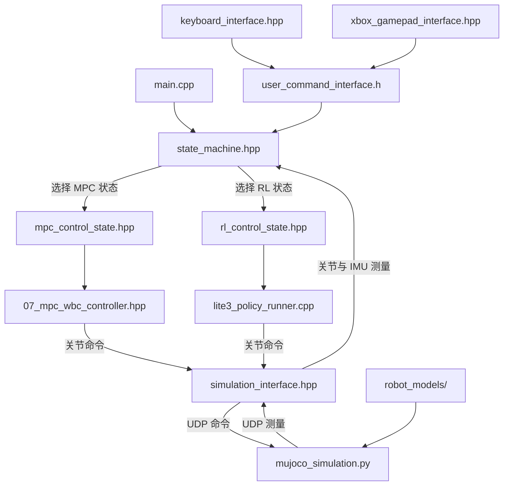
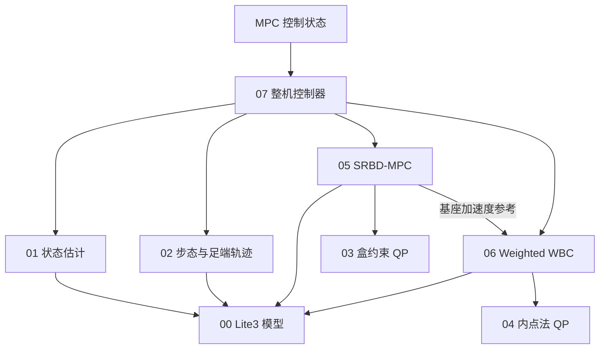

# 01_Lite3 四足狗运动控制工程结构

本工程以 Lite3 为对象，在 MuJoCo 平地仿真中运行 MPC+WBC 或 ONNX 强化学习控制。工程由程序入口、状态机、控制算法、输入与仿真接口、机器人模型及公共支持文件组成。

## 1. 总体目录结构

```text
lite3_MPC-WBC_project/
├── CMakeLists.txt                         工程构建入口
├── main.cpp                               C++ 程序入口
├── README.md                              英文使用说明
├── README_ZH.md                           中文使用说明
├── LICENSE                                源码许可
├── state_machine/                         状态管理与控制模式接入
│   ├── state_machine.hpp                  创建接口和状态，运行状态切换循环
│   ├── state_base.h                       状态基类与共享控制数据
│   ├── idle_state.hpp                     等待站立、检查传感器状态
│   ├── standup_state.hpp                  站立动作
│   ├── liedown_state.hpp                  躺下动作
│   ├── joint_damping_state.hpp            关节阻尼
│   ├── mpc_control_state.hpp              MPC+WBC 状态适配
│   ├── rl_control_state.hpp               ONNX RL 状态适配
│   └── parameters/
│       ├── control_parameters.h           控制参数定义
│       └── control_parameters_lite3.cpp   Lite3 参数初始化
├── mpc_wbc/                               MPC+WBC 核心算法，00～07 号头文件
│   └── CMakeLists.txt                     核心算法接口库配置
├── interface/                             用户输入与仿真通信
│   ├── user_command/
│   │   ├── user_command_interface.h       用户命令抽象接口
│   │   ├── keyboard_interface.hpp         键盘输入
│   │   └── xbox_gamepad_interface.hpp     USB XInput 手柄输入
│   └── robot/
│       ├── robot_interface.h              机器人状态和关节命令抽象接口
│       └── simulation/
│           ├── simulation_interface.hpp  C++ UDP 状态接收与命令发送
│           └── mujoco_simulation.py      Python MuJoCo 仿真与可视化
├── onnx/                                  强化学习策略推理
│   ├── run_policy/
│   │   ├── policy_runner_base.hpp         策略运行器基类
│   │   ├── lite3_policy_runner.h          Lite3 ONNX 运行器声明
│   │   └── lite3_policy_runner.cpp        观测处理、模型推理与动作转换
│   └── policy/
│       ├── ppo/policy.onnx                RL 策略模型
│       └── pt2onnx.py                     模型转换脚本
├── robot_models/                          Lite3 机器人模型和仿真环境
│   ├── robots/Lite3/
│   │   ├── Lite3_mjcf/                    MuJoCo 模型与网格
│   │   └── Lite3_urdf/                    URDF 模型与网格
│   └── environments/flat/mjcf/floor.xml   平地及场景外观
├── support/                               公共类型、工具与第三方依赖
│   ├── types/
│   │   ├── common_types.h                 通用矩阵、向量等类型
│   │   └── custom_types.h                 机器人状态、用户命令等工程类型
│   ├── utils/
│   │   ├── basic_function.hpp             公共数学与插值函数
│   │   ├── data_streaming.hpp             遥测与数据记录
│   │   └── json.hpp                       JSON 支持
│   └── third_party/
│       ├── eigen/                         Eigen 线性代数库
│       ├── onnxruntime/                   ONNX Runtime 推理库
│       └── Lite3_MotionSDK/                保留的 SDK，当前仿真构建未使用
├── docs/                                  设计、结构、算法说明和运动演示
│   ├── archive/                           历史文档
│   └── video/                             运动演示 GIF
└── build/                                 CMake 生成的构建目录
    ├── mpc_control                        控制程序
    └── rl_control                         共用同一套状态机的另一程序入口
```

`build/` 是生成目录，不属于源码。`robot_models/` 存放仿真加载的模型文件；`mpc_wbc/00_lite3_model.hpp` 是算法内部的数学模型实现，两者职责不同。

## 2. 工程运行结构



运行时包含一个 C++ 控制进程和一个 Python 仿真进程：

1. [main.cpp](../main.cpp) 创建 Lite3 状态机并调用 `Run()`。
2. [state_machine.hpp](../state_machine/state_machine.hpp) 创建仿真接口、用户输入接口、控制参数和各个状态。RL 状态在首次选择时创建并加载模型。
3. 状态机收到新的仿真时间戳后执行当前状态，根据用户请求和失控判断决定是否切换状态。
4. 当前控制状态生成关节命令，C++ 仿真接口通过 UDP 发给 Python。
5. Python 执行关节命令、推进 MuJoCo 仿真并回传测量，形成闭环。

`mpc_control` 和 `rl_control` 使用相同源文件及状态机，均支持站立后选择 MPC 或 RL；可执行文件名称不固定运行时控制模式。

## 3. 状态机与控制算法的分工

### 3.1 状态管理层

[state_base.h](../state_machine/state_base.h) 定义 `OnEnter()`、`Run()`、`OnExit()`、`LoseControlJudge()` 和 `GetNextStateName()` 等状态接口，并通过 `ControllerData` 共享机器人接口、用户输入、控制参数和遥测对象。

| 状态文件 | 主要职责 |
| --- | --- |
| `idle_state.hpp` | 等待站立，检查关节与 IMU 数据是否满足进入条件 |
| `standup_state.hpp` | 完成站立轨迹，站稳后接受运动模式或躺下请求 |
| `liedown_state.hpp` | 完成躺下轨迹，结束后返回等待状态 |
| `joint_damping_state.hpp` | 输出关节阻尼命令，等待重新站立 |
| `mpc_control_state.hpp` | 整理测量和用户命令，启停 MPC 工作线程，调用核心算法并发送命令，处理模式退出与失控切换 |
| `rl_control_state.hpp` | 整理策略观测，管理策略推理线程，调用 ONNX 运行器并发送策略命令 |

[state_machine/parameters/](../state_machine/parameters/) 存放站立、躺下、关节限位及相关增益等控制参数。MPC/WBC 自身的参数分别定义在核心算法头文件中，部分参数由 `mpc_control_state.hpp` 初始化时覆盖。

### 3.2 MPC+WBC 算法层

`mpc_wbc/` 的编号按基础模型、状态与轨迹、数值求解器、控制算法及整机编排组织，便于按依赖顺序阅读。

| 文件 | 主要职责 |
| --- | --- |
| [00_lite3_model.hpp](../mpc_wbc/00_lite3_model.hpp) | Lite3 几何、正逆运动学、雅可比、全身动力学和质心模型 |
| [01_state_estimator.hpp](../mpc_wbc/01_state_estimator.hpp) | 根据 IMU、关节状态和支撑信息估计基座速度、高度及有效性 |
| [02_gait_trajectory.hpp](../mpc_wbc/02_gait_trajectory.hpp) | 速度分段、trot 相位、足端轨迹、起停过渡和未来接触计划 |
| [03_box_qp.hpp](../mpc_wbc/03_box_qp.hpp) | 盒约束 QP 求解器，供 MPC 使用 |
| [04_qp_ipm.hpp](../mpc_wbc/04_qp_ipm.hpp) | 等式及不等式约束 QP 内点法求解器，供 WBC 使用 |
| [05_srbd_mpc.hpp](../mpc_wbc/05_srbd_mpc.hpp) | 单刚体预测控制，求解未来接触力并生成基座运动参考 |
| [06_weighted_wbc.hpp](../mpc_wbc/06_weighted_wbc.hpp) | 结合任务和全身动力学约束，求解广义加速度、接触力及关节力矩 |
| [07_mpc_wbc_controller.hpp](../mpc_wbc/07_mpc_wbc_controller.hpp) | 编排估计、步态、MPC 与 WBC，生成关节命令，维护故障状态和 MPC 工作线程 |

8 个算法头文件的调用与依赖关系如下：



`03_box_qp.hpp` 与 `04_qp_ipm.hpp` 并非重复求解器。前者处理 SRBD-MPC 中的盒约束 QP，后者处理 WBC 中同时含有等式和不等式约束的 QP。`05_srbd_mpc.hpp` 输出基座运动参考，`06_weighted_wbc.hpp` 再结合当前全身状态与接触约束恢复关节力矩。

`mpc_control_state.hpp` 负责把算法接入状态机和仿真接口；`07_mpc_wbc_controller.hpp` 实现具体控制计算，不直接读写机器人接口。这两个文件属于不同层级。

### 3.3 RL 算法层

[policy_runner_base.hpp](../onnx/run_policy/policy_runner_base.hpp) 定义策略运行器接口；[lite3_policy_runner.h](../onnx/run_policy/lite3_policy_runner.h) 和 [lite3_policy_runner.cpp](../onnx/run_policy/lite3_policy_runner.cpp) 实现 Lite3 的观测处理、ONNX 推理和动作转换。模型位于 `onnx/policy/ppo/policy.onnx`。

`pt2onnx.py` 用于离线模型转换，不属于仿真运行循环。

## 4. 接口、进程与线程

### 4.1 用户输入与机器人接口

| 接口 | 实现与职责 |
| --- | --- |
| `UserCommandInterface` | `KeyboardInterface` 或 `XboxGamepadInterface` 读取输入，生成模式请求与归一化速度命令，并接收当前状态反馈 |
| `RobotInterface` | 提供关节、IMU、时间戳读取和关节命令写入接口；当前由 `SimulationInterface` 实现 |

输入方式在启动时选择，键盘和 USB 手柄共用同一套控制状态。两种控制算法均输出 12×5 关节命令，每行对应一个关节，列顺序为 `[kp, q_des, kd, dq_des, tau_ff]`。Python 仿真端按 PD 加前馈计算力矩，并受模型执行器限幅约束。

### 4.2 运行节拍与线程职责

| 执行部分 | 职责与节拍 |
| --- | --- |
| C++ 状态机主线程 | 轮询间隔为 500 μs；仅在仿真时间戳更新时执行当前控制状态，不代表固定 2 kHz 控制频率 |
| C++ 输入线程 | 读取键盘或手柄事件，更新用户命令 |
| C++ UDP 接收线程 | 接收并更新仿真测量 |
| C++ UDP 发送线程 | 以 1 ms 定时器发送最近一次关节命令；没有新计算结果时仍发送已有命令 |
| MPC 工作线程 | MPC 模式进入时启动，读取请求快照、求解并发布结果；每轮求解后默认休眠 0.05 s，实际周期还包含求解耗时 |
| RL 策略线程 | RL 模式进入时启动，根据策略降采样配置运行 ONNX 推理并更新命令 |
| Python 仿真循环 | 按墙钟推进，仿真步长为 1 ms，发送状态并更新可视化；另有 UDP 命令接收线程 |

MPC 模式下，状态机主线程发布 `MpcRequest` 快照，读取最近的 `MpcWrench` 结果，再执行快速控制计算和命令写入。后台线程仅求解 MPC，不直接发送关节命令。

C++ 与 Python 通过 UDP 异步运行，不进行锁步同步。仿真、通信、算法更新与图形刷新各有自己的节拍。

## 5. 模型、公共支持与构建关系

### 5.1 模型与环境

| 文件或目录 | 用途 |
| --- | --- |
| `robot_models/robots/Lite3/Lite3_mjcf/mjcf/Lite3_flat.xml` | Python 仿真加载的场景入口，组合机器人与平地 |
| `robot_models/robots/Lite3/Lite3_mjcf/mjcf/Lite3.xml` | 机器人本体、关节、惯量、执行器和传感器定义 |
| `robot_models/environments/flat/mjcf/floor.xml` | 地面、天空、材质和灯光 |
| `robot_models/robots/Lite3/Lite3_urdf/` | URDF 模型及网格，供模型参数核对使用 |

### 5.2 公共支持文件

`support/types/` 提供共用数据结构；`support/utils/` 提供数学工具、JSON 和遥测。`DataStreaming` 由状态机创建，当前配置关闭在线绘图与数据记录；Python 仿真日志由仿真脚本单独管理。

`support/third_party/` 中的 Eigen 用于矩阵运算，ONNX Runtime 用于策略推理。保留的 Lite3 MotionSDK 未参与当前仿真主程序构建。

### 5.3 构建目标

| 构建配置或目标 | 作用 |
| --- | --- |
| 根目录 `CMakeLists.txt` | 配置 C++17、依赖路径，加入 `mpc_wbc` 子工程并生成两个控制程序 |
| `mpc_wbc/CMakeLists.txt` | 定义 `mpc_wbc` 接口库，提供 00～07 号头文件及包含路径，不单独生成算法可执行程序 |
| `run_policy` | 将 `lite3_policy_runner.cpp` 编译为对象库，供两个控制程序链接 |
| `mpc_control`、`rl_control` | 由 `main.cpp` 和 `control_parameters_lite3.cpp` 构建，链接相同的算法、推理及系统依赖 |

在工程根目录执行以下命令，可配置工程并构建两个控制程序：

```bash
cmake -S . -B build
cmake --build build --target mpc_control rl_control -j2
```

构建完成后，可执行文件位于 `build/mpc_control` 和 `build/rl_control`。两个目标使用相同的程序入口与状态机，并都能在站立完成后选择 MPC 或 RL 控制状态。因此，可执行文件名称不等同于运行期的固定控制模式。仿真启动、输入方式与按键映射见[工程使用说明](../README_ZH.md)。

核心算法只占完整工程的一部分。闭环运行还需要状态机、输入接口、C++/Python 仿真通信、机器人模型和公共依赖共同配合。

## 6. 文档分工与工程边界

`docs/` 中各文档按设计指标、工程结构、控制理论与调试记录分工。为避免参数和验收结果在多份文档中重复维护，本文只说明工程组成与模块关系。

| 文档 | 内容范围 |
| --- | --- |
| [00_Lite3 四足狗运动控制设计指标.md](<00_Lite3 四足狗运动控制设计指标.md>) | 速度范围、组合约束、稳定性指标、历史验收结果与适用边界 |
| [03_基于MPC+WBC的四足狗运动控制理论与实现.md](03_基于MPC+WBC的四足狗运动控制理论与实现.md) | Lite3 运动学、动力学、状态估计、SRBD-MPC、Weighted WBC 及代码对应 |
| [README_ZH.md](../README_ZH.md) | 环境准备、构建、仿真启动、键盘与 USB 手柄使用方法 |

本工程的运行范围为 MuJoCo 仿真。当前源码不包含真机通信、硬件执行器驱动、实时调度或真机安全保护链路，因而工程目录中的 SDK 或 URDF 文件不表示已具备真机部署能力。
