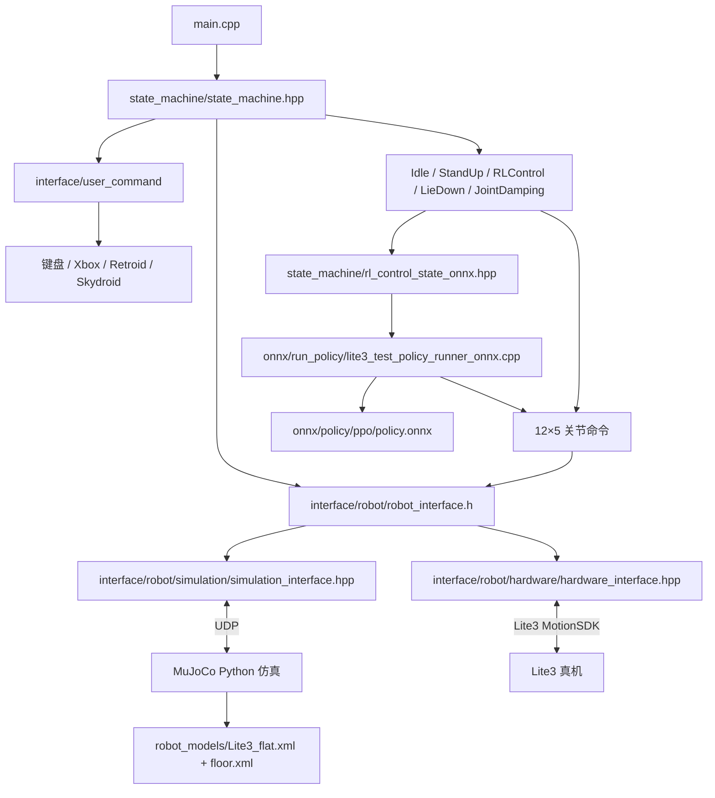

# 工程结构与文件说明

本工程的根目录只有 7 个功能目录。当前运动控制器是 ONNX 策略；`mpc_wbc/` 暂时只用于规划，算法和控制线程尚未实现。

## 1. 目录图

```text
lite3_MPC-WBC_project/
├── CMakeLists.txt                 C++ 构建入口
├── main.cpp                       程序入口
├── README.md / README_EN.md       运行说明
├── onnx/                          ONNX 推理与策略模型
│   ├── run_policy/                推理接口和实现
│   └── policy/                    ONNX 模型和转换示例
├── state_machine/                 状态机与控制状态
│   └── parameters/                Lite3 控制参数
├── robot_models/                  Lite3 URDF/MJCF 与平地环境
├── interface/                 仿真、真机、键盘和手柄接口
│   ├── robot/
│   └── user_command/
├── mpc_wbc/                       预留的独立算法目录
├── support/                       相对固定的共用与外部支持文件
│   ├── types/                     共用数据类型
│   ├── utils/                     数学工具与遥测
│   ├── scripts/                   真机文件传输脚本
│   └── third_party/               Eigen、ONNX Runtime、手柄库与 Lite3 SDK
└── docs/                          工程结构和维护文档
```

## 2. 当前控制链



`RobotInterface` 统一关节位置、速度、力矩、IMU 读取和关节命令下发。关节命令是 12×5 矩阵，五列依次为 `kp、目标位置、kd、目标速度、前馈力矩`。`UserCommandInterface` 统一状态切换与前后、横移和旋转输入。后续 MPC+WBC 控制器将复用这些接口，并与 ONNX 控制路径互斥。

## 3. 核心文件职责

### （1）根目录

| 文件 | 作用 |
| --- | --- |
| `CMakeLists.txt` | 选择 x86 MuJoCo 仿真或 ARM 真机，编译接口、ONNX 推理库和 `rl_deploy`。 |
| `main.cpp` | 创建 Lite3 状态机并进入主循环。 |
| `README.md`、`README_EN.md` | 中英文构建、运行及操作说明。 |
| `.gitignore`、`LICENSE` | 忽略规则和原工程许可证。 |


### （2）状态机

| 文件 | 作用 |
| --- | --- |
| `state_machine/state_base.h` | 状态生命周期、安全判断接口和共享控制数据。 |
| `state_machine/state_machine.hpp` | 选择机器人与用户接口，创建状态，按接口时间戳运行和切换。 |
| `state_machine/idle_state.hpp` | 空闲时发送零命令并检查关节、IMU 数据。 |
| `state_machine/standup_state.hpp` | 站起轨迹与目标关节角。 |
| `state_machine/liedown_state.hpp` | 趴下轨迹与回到空闲的切换。 |
| `state_machine/joint_damping_state.hpp` | 关节阻尼状态。 |
| `state_machine/rl_control_state_onnx.hpp` | 当前运动控制状态：采集观测，运行 ONNX 线程，执行安全判断。 |
| `state_machine/parameters/control_parameters.h` | Lite3 几何、站高、增益和限位参数声明。 |
| `state_machine/parameters/lite3_control_parameters.cpp` | Lite3 参数数值。 |


### （3）ONNX 推理 `onnx/`

| 文件 | 作用 |
| --- | --- |
| `onnx/run_policy/policy_runner_base.hpp` | 策略运行器接口及执行周期参数。 |
| `onnx/run_policy/lite3_test_policy_runner_onnx.h/.cpp` | ONNX Runtime 推理；45 维观测映射到 12 维动作和目标关节命令。 |
| `onnx/policy/ppo/policy.onnx` | 当前对照用 RL 模型。 |
| `onnx/policy/pt2onnx.py` | TorchScript 转 ONNX 示例；路径和维度是示例值，使用前需核对。 |

### （4）通信接口 `interface/`

| 文件 | 作用 |
| --- | --- |
| `interface/CMakeLists.txt` | 编译手柄库和 Lite3 MotionSDK 的接口静态库。 |
| `interface/robot/robot_interface.h` | 仿真和真机共用的机器人状态与关节命令抽象接口。 |
| `interface/robot/simulation/simulation_interface.hpp` | C++ 侧 MuJoCo UDP 状态接收和命令发送。 |
| `interface/robot/simulation/mujoco_simulation.py` | Python MuJoCo 仿真、关节 PD 加前馈力矩计算及 UDP 通信。 |
| `interface/robot/hardware/hardware_interface.hpp` | Lite3 MotionSDK 状态映射和关节命令发送。 |
| `interface/user_command/user_command_interface.h` | 用户命令抽象接口。 |
| `interface/user_command/keyboard_interface.hpp` | 键盘模式与速度输入。 |
| `interface/user_command/xbox_gamepad_interface.hpp` | 仿真自动检测到的 Xbox 手柄输入。 |
| `interface/user_command/retroid_gamepad_interface.hpp` | 真机默认的 Retroid 手柄输入。 |
| `interface/user_command/skydroid_gamepad_interface.hpp` | 保留的另一种手柄适配器；当前状态机默认不选用。 |

### （5）模型文件

| 文件或目录 | 作用 |
| --- | --- |
| `robot_models/robots/Lite3/Lite3_mjcf/mjcf/Lite3.xml` | Lite3 MuJoCo 本体、关节、惯量、碰撞几何、执行器和传感器。 |
| `robot_models/robots/Lite3/Lite3_mjcf/mjcf/Lite3_flat.xml` | 当前仿真入口，组合机器人和平地。 |
| `robot_models/environments/flat/mjcf/floor.xml` | 平地几何、摩擦和材质。 |
| `robot_models/robots/Lite3/Lite3_urdf/urdf/Lite3.urdf` | 关节、几何和动力学参数核对用 URDF；当前仿真不直接加载。 |
| `robot_models/**/meshes/` | MJCF/URDF 各自引用的 Lite3 STL 零件。 |
| `robot_models/README.md` | 模型目录说明。 |

### （6）算法预留文件

| 文件或目录 | 作用 |
| --- | --- |
| `mpc_wbc/README.md` | 后续独立算法目录的边界与当前状态。 |

### （7）支持文件

| 文件或目录 | 作用 |
| --- | --- |
| `support/types/common_types.h` | 机器人观测、动作、用户命令等共用数据结构。 |
| `support/types/custom_types.h` | 机器人类型及状态编号。 |
| `support/utils/basic_function.hpp` | 限幅、旋转矩阵、重力方向等数学工具。 |
| `support/utils/data_streaming.hpp`、`json.hpp` | UDP/CSV 遥测和 JSON 单头文件；当前默认关闭遥测。 |
| `support/scripts/scp_onnx_to_remote.sh` | 向真机传输 ONNX Runtime 库。 |
| `support/scripts/sftp_to_remote.sh` | 向真机传输可执行文件和 ONNX 模型。 |
| `support/third_party/` | Eigen、ONNX Runtime、Lite3 MotionSDK、手柄库；一般不修改其供应商源码。 |


## 4. 后续 MPC+WBC 接入位置

控制算法放在 `mpc_wbc/`，状态切换放在 `state_machine/`。一次运行只能由 ONNX 或 MPC+WBC 中的一条运动控制路径写关节命令。控制频率、状态估计、步态规划、MPC 和 WBC 求解器将在后续需求明确后设计。
