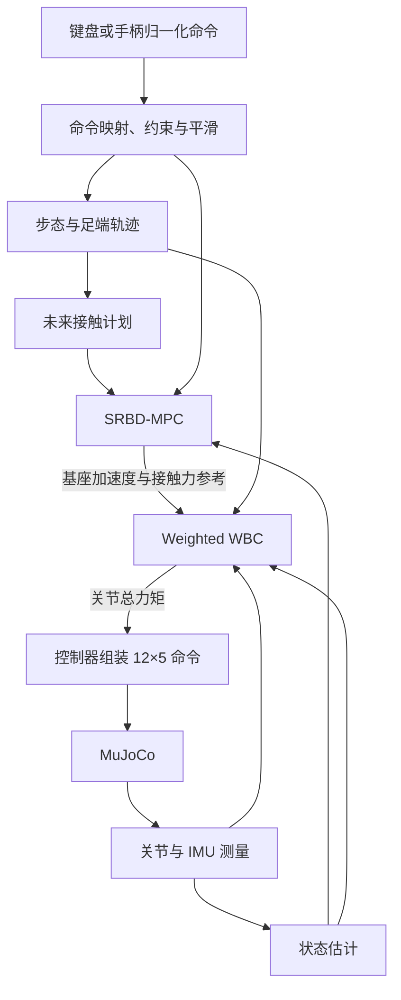
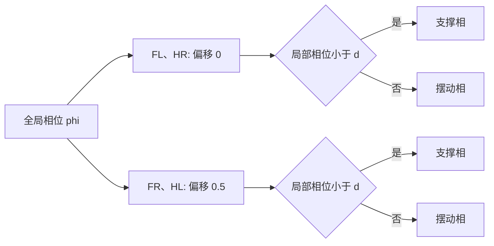
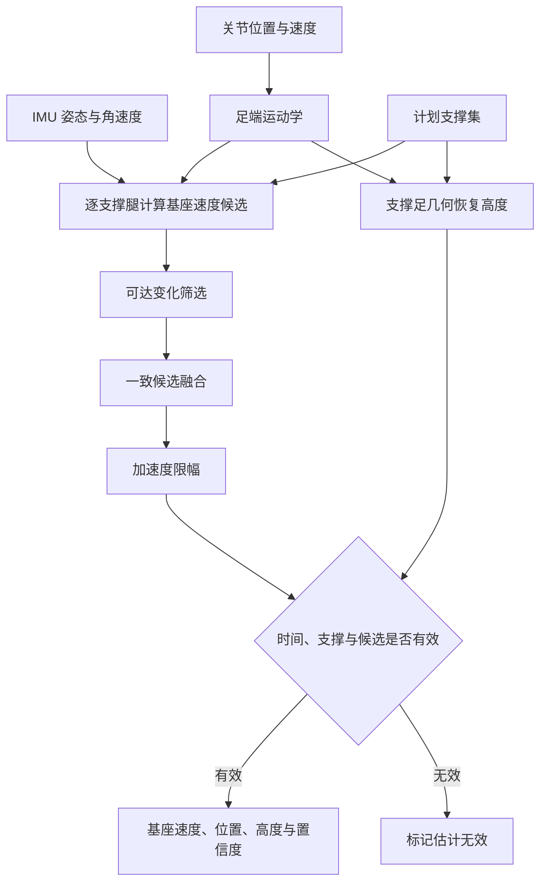
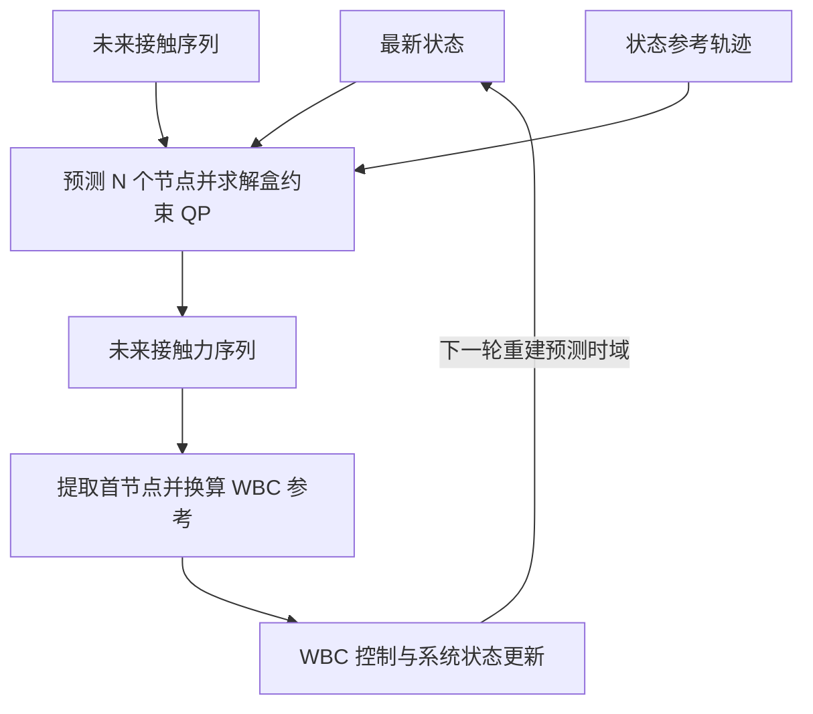
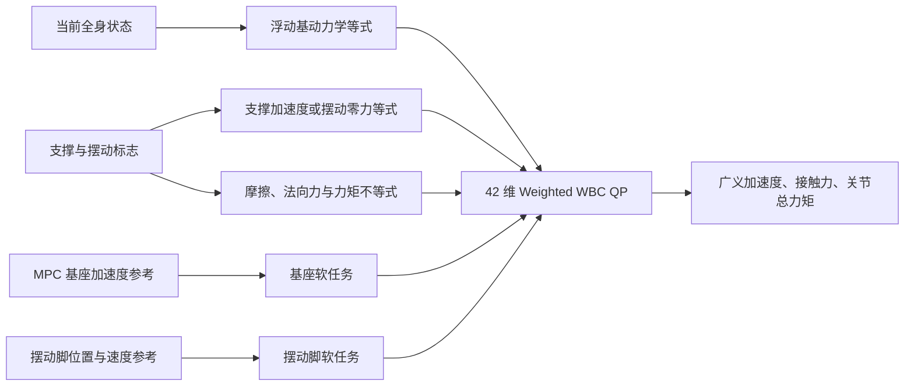
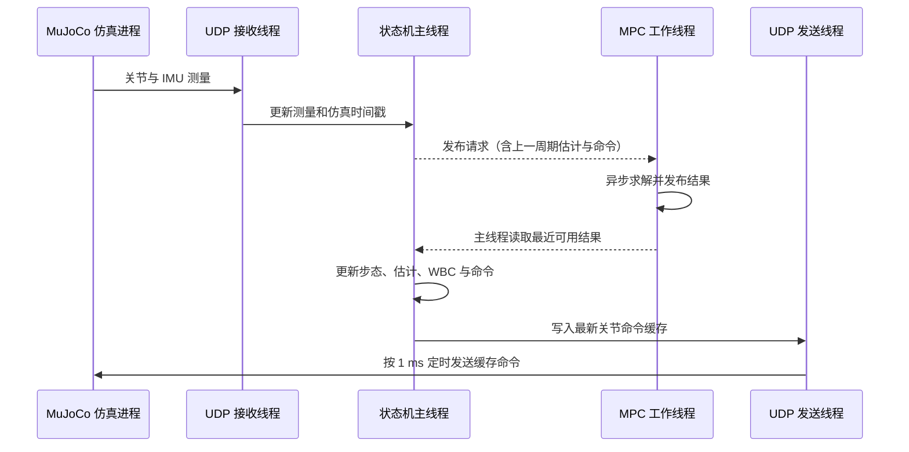

# Lite3 四足机器人 MPC+WBC 运动控制原理与工程实现

本文面向 Lite3 四足机器人的 MPC+WBC 运动控制学习与工程复盘，介绍浮动基多刚体建模、步态与足端轨迹、基座状态估计、单刚体模型预测控制（SRBD-MPC）和加权全身控制（Weighted WBC）。各章结合当前源码解释算法，并明确区分理论关系、实现近似与已发现的实现偏差。

## 前言

本文的实现范围是 MuJoCo 平地环境中的对角小跑（trot）。系统接收机体系纵向速度、横向速度和偏航角速度指令，输出 12 个关节的位置增益、目标位置、速度增益、目标速度与前馈力矩。本工程不包含真机驱动、实时总线和真机安全链路，因而文中参数及结论仅适用于当前仿真模型。

### 学习目标

完成本文的学习后，读者应能够：

1. 建立 Lite3 的足端运动学与浮动基全身动力学模型；
2. 解释步态相位、足端轨迹和未来接触序列之间的关系；
3. 理解基于支撑足零速约束的基座状态估计方法；
4. 推导 SRBD-MPC 的离散预测模型、代价函数与接触力约束；
5. 建立 Weighted WBC 的决策变量、硬约束和加权软任务；
6. 沿着本工程的数据流，完成从测量量到关节控制命令的代码阅读与调试。

### 阅读前提与代码范围

读者宜具备线性代数、刚体运动学、多刚体动力学、二次规划和现代控制的基础知识。文中主要对应 `mpc_wbc/00～07`、`state_machine/mpc_control_state.hpp`、C++ 仿真接口以及 Python MuJoCo 仿真程序。数学符号与代码变量的对应关系见附录 B。

第 1—3 章建立问题、坐标和模型，第 4—7 章解释算法，第 8—10 章说明集成、时序与适用边界，第 11 章提供源码阅读入口。文中“默认值”指当前源码中的初始配置，环境变量覆盖后的实际值应以运行配置为准。本次核对基于 2026 年 11 月 11 日的工作区源码；所指出的实现偏差是静态代码检查结论。

## 第 1 章 控制问题与系统架构

本章首先定义 Lite3 的浮动基系统特性，然后分析 MPC 与 WBC 在分层控制架构中的功能分工，并给出工程数据流。

### 1.1 浮动基多刚体系统特性

Lite3 有四条腿，每条腿包含 HipX、HipY、Knee 三个主动关节，共 12 个驱动关节。机身在空间中具有 6 个自由度，但没有直接驱动机身的执行器，因此整机属于浮动基系统。

本工程使用的广义速度排列为

$$
\mathbf{v}=
\begin{bmatrix}
{}^{W}\mathbf{v}_B\\
{}^{B}\boldsymbol\omega_B\\
\dot{\mathbf q}
\end{bmatrix}
\in\mathbb R^{18},
$$

其中 ${}^{W}\mathbf v_B$ 是世界系基座线速度，${}^{B}\boldsymbol\omega_B$ 是机体系角速度，$\mathbf q\in\mathbb R^{12}$ 只表示关节角，不包含基座位姿。广义加速度按 $[{}^{W}\mathbf a_B;\ {}^{B}\boldsymbol\alpha_B;\ \ddot{\mathbf q}]$ 排列，分号表示纵向拼接。

这是“世界系线速度 + 机体系角速度”的混合表达约定。公式中的叉乘、惯量乘法和参考量转换仍必须在一致的坐标系内进行；采用统一接口排列，并不能自动保证每处计算都正确。当前实现中的相关偏差见第 6.1、6.4 节。

### 1.2 MPC 与 WBC 的功能分工

四足运动控制可以分成两个互补问题：

1. MPC 根据当前质心状态、速度指令和未来接触序列，在有限预测时域内求解支撑脚接触力，使机身的位置、速度、高度与姿态跟踪参考轨迹。
2. WBC 在单个控制周期内引入完整浮动基动力学，将 MPC 生成的基座加速度参考、摆动脚轨迹和接触约束统一表示为二次规划问题，并求解广义加速度、足端接触力以及 12 个关节的总力矩。

该架构形成两个时间尺度：MPC 以较低频率计算中短期运动趋势，WBC 以较高频率处理全身动力学协调和瞬时约束。步态模块为两者生成具有一致时基的足端轨迹与接触序列，状态估计器则提供在线基座状态。

| 对比项 | SRBD-MPC | Weighted WBC |
| --- | --- | --- |
| 主要目标 | 预测未来质心与姿态运动 | 实现当前控制周期的全身协调 |
| 主要模型 | 单刚体动力学 | 完整浮动基多刚体动力学 |
| 决策量 | 未来支撑脚接触力 | 广义加速度、接触力与关节力矩 |
| 时间范围 | $N=10$ 个节点，约 0.5 s | 当前单个控制周期 |
| 默认更新节拍 | 名义频率约 20 Hz | 随新仿真状态更新，约 1 kHz |
| 向下游提供 | 基座加速度和逐脚力参考 | 关节总力矩 |

### 1.3 系统数据流

状态机入口位于 [mpc_control_state.hpp](../state_machine/mpc_control_state.hpp)。该文件完成仿真接口适配、控制状态生命周期管理与线程启停；[07_mpc_wbc_controller.hpp](../mpc_wbc/07_mpc_wbc_controller.hpp) 完成各算法模块的数据组织与调度。

## 第 2 章 坐标、关节和接口约定

坐标系、向量排列与单位是多模块控制系统的基础约定。任何隐式的坐标变换或顺序不一致，都可能使数学上正确的控制律产生错误输出。本章给出后续推导和代码实现共同遵循的约定。

### 2.1 坐标系

- 世界系 $W$：固定在地面，$z$ 轴向上。
- 机体系 $B$：固定在机身，$x$ 向前、$y$ 向左、$z$ 向上。
- $\mathbf R_{WB}$：把机体系向量旋转到世界系，即 ${}^{W}\mathbf x=\mathbf R_{WB}{}^{B}\mathbf x$。
- 姿态数组按 $[\mathrm{roll},\mathrm{pitch},\mathrm{yaw}]$ 存储，旋转复合采用 ZYX 约定：$\mathbf R_{WB}=\mathbf R_z(\mathrm{yaw})\mathbf R_y(\mathrm{pitch})\mathbf R_x(\mathrm{roll})$。数组存储顺序与旋转复合顺序是两个概念。

| 物理量 | 表达坐标系 | 主要使用模块 |
| --- | --- | --- |
| 基座位置 ${}^{W}\mathbf p_B$ | 世界系 | 状态估计、MPC |
| 基座线速度 ${}^{W}\mathbf v_B$ | 世界系 | 状态估计、MPC、WBC |
| 基座角速度 ${}^{B}\boldsymbol\omega_B$ | 机体系 | IMU、MPC、WBC |
| 足端位置 ${}^{B}\mathbf p_{f_i}$ | 机体系 | 正逆运动学、步态规划 |
| 足端接触力 ${}^{W}\mathbf f_i$ | 世界系 | MPC、WBC |

由于偏航角的主值区间为 $[-\pi,\pi]$，直接对主值角求差会在边界处产生近 $2\pi$ 的不连续误差。本实现将偏航角测量展开为连续角，并独立积分偏航角参考，从而保持偏航误差的连续性。

### 2.2 腿和关节顺序

四腿顺序固定为 FL、FR、HL、HR，分别表示前左、前右、后左、后右；每腿关节顺序为 HipX、HipY、Knee。

整机 12 维关节向量按四腿依次拼接。足端位置、足端速度、接触状态和接触力也必须使用同一腿序。

### 2.3 控制输入和输出

用户输入首先表示为归一化命令，再映射为物理速度 $\mathbf u=[v_x,v_y,\omega_z]^T$。其中 $v_x>0$ 为前进，$v_y>0$ 为左移，$\omega_z>0$ 为左转；平移速度单位为 m/s，偏航角速度单位为 rad/s。

控制器输出 $12\times5$ 关节命令矩阵，每行对应一个关节，五列依次为 $[k_p,\ q_{des},\ k_d,\ \dot q_{des},\ \tau_{ff}]$。仿真端逐关节计算：

$$
\tau_{cmd}=k_p(q_{des}-q)+k_d(\dot q_{des}-\dot q)+\tau_{ff}
$$

计算结果写入 MuJoCo 的执行器控制量，再由模型中的执行器控制范围限幅。

## 第 3 章 Lite3 运动学与全身动力学

本章建立单腿正逆运动学、足端雅可比矩阵与浮动基全身动力学。这些模型是足端轨迹生成、状态估计和 WBC 约束构造的共同基础。对应实现集中在 [00_lite3_model.hpp](../mpc_wbc/00_lite3_model.hpp)。

### 3.1 单腿正运动学

令单腿关节角为 $\mathbf q_i=[q_{x,i},q_{y,i},q_{k,i}]^T$，大腿和小腿长度分别为 $l_1,l_2$。在矢状平面内，足端相对髋部的前后和竖直坐标为

$$
\begin{aligned}
x_i &=l_1\sin q_{y,i}+l_2\sin(q_{y,i}+q_{k,i}),\\
z_i &=-l_1\cos q_{y,i}-l_2\cos(q_{y,i}+q_{k,i}).
\end{aligned}
$$

令 $d_h$ 为髋部侧向偏置长度，$s_i$ 为左右腿符号（左腿 $+1$，右腿 $-1$）。加入该偏置和 HipX 旋转后，球心机体系位置为

$$
{}^{B}\mathbf p_{f_i}
={}^{B}\mathbf p_{h_i}
+\mathbf R_x(-q_{x,i})
\begin{bmatrix}x_i\\s_i d_h\\z_i\end{bmatrix}.
$$

代码中的 `FootPositionBody()` 实现该计算，返回球足中心而非球足最低接触点。

### 3.2 逆运动学

`InverseKinematics()` 根据目标球心位置求解关节角。求解过程首先在 $y$-$z$ 平面计算 HipX 的两个候选分支，然后将目标位置旋转回腿部矢状平面，并依据余弦定理求解 HipY 与 Knee。

平面两连杆距离为 $\rho$ 时，膝关节满足

$$
\cos q_k=\frac{\rho^2-l_1^2-l_2^2}{2l_1l_2}.
$$

程序先检查侧向可达性，不可达时返回失败；对通过检查的目标，再将平面距离和反余弦输入夹取到合法范围。提供上一目标关节角作为种子时，程序比较两个分支的完整三关节解，选取欧氏距离较小者。该策略有助于减少分支跳变，但返回成功并不保证原目标精确可达，也不表示通过了全部关节限位检查，上层仍需限位。

### 3.3 足端雅可比

单腿球心在机体系中的相对速度满足 ${}^{B}\dot{\mathbf p}_{f_i}=\mathbf J_i(\mathbf q_i)\dot{\mathbf q}_i$，其中 $\mathbf J_i\in\mathbb R^{3\times3}$ 由正运动学中心差分计算。完整世界系球心速度还包含基座平移和转动：

$$
{}^{W}\mathbf v_{f_i}
={}^{W}\mathbf v_B
-\mathbf R_{WB}[{}^{B}\mathbf p_{f_i}]_\times{}^{B}\boldsymbol\omega_B
+\mathbf R_{WB}\mathbf J_i\dot{\mathbf q}_i.
$$

`FootJacobianWorld()` 将上述关系组装为四个球心的 $12\times18$ 雅可比，记为 $\mathbf J_f$。WBC 使用的 `ContactJacobianWorld()` 则把球足转动引起的表面点速度也计入：以球心下方一个半径处为瞬时接触位置，构造接触点速度映射 $\mathbf J_c$。因此 $\mathbf J_f$ 与 $\mathbf J_c$ 不应混用；几何最低点的位置偏移也不意味着其接触速度与球心速度相同。

### 3.4 浮动基动力学

整机动力学写为

$$
\mathbf M(\mathbf q,\mathbf R_{WB})\dot{\mathbf v}
+\mathbf h(\mathbf q,\mathbf R_{WB},\mathbf v)
=\mathbf S^T\boldsymbol\tau+\mathbf J_c^T\mathbf f,
$$

这里显式写出基座姿态的依赖，因为 $\mathbf q$ 只包含关节角；后文约束式为简洁起见省略函数自变量。各项含义为：

- $\mathbf M\in\mathbb R^{18\times18}$ 为质量矩阵；
- $\mathbf h\in\mathbb R^{18}$ 包含重力、科氏和离心项；
- $\mathbf S=[\mathbf0_{12\times6}\ \mathbf I_{12}]$ 为关节选择矩阵；
- $\boldsymbol\tau\in\mathbb R^{12}$ 为关节总力矩；
- $\mathbf J_c\in\mathbb R^{12\times18}$ 为四个接触点雅可比；
- $\mathbf f\in\mathbb R^{12}$ 为四脚世界系接触力。

`MassMatrix()` 通过累加各刚体质心线动能与转动动能对广义速度的二次型贡献，构造整机质量矩阵。偏置力项 $\mathbf h$ 通过刚体树的速度与加速度递推获得：首先计算各刚体的惯性力和惯性矩，然后将其投影至广义坐标空间。

接触点加速度为

$$
\mathbf a_c=\mathbf J_c\dot{\mathbf v}+\dot{\mathbf J}_c\mathbf v.
$$

`ContactBiasAccel()` 通过沿当前关节速度和机身角速度前后推进极小时间，对接触雅可比做中心差分，计算 $\dot{\mathbf J}_c\mathbf v$。WBC 的支撑约束和摆动任务均同时使用 $\mathbf J_c\dot{\mathbf v}$ 与该偏置项。

### 3.5 整机质心与转动惯量

SRBD-MPC 需要当前整机质心和绕质心惯量。模型按所有刚体质量加权计算机体系质心，并用平行轴定理把各刚体惯量合成为整机惯量，再按姿态旋转到世界系。

## 第 4 章 步态调度与足端轨迹

步态调度器决定各腿的支撑相与摆动相，足端轨迹规划器则在相位约束下生成位置和速度参考。对应实现位于 [02_gait_trajectory.hpp](../mpc_wbc/02_gait_trajectory.hpp)。本工程采用对角小跑步态：FL 与 HR 同相，FR 与 HL 同相，两组对角腿之间相差半个步态周期。

### 4.1 相位与接触状态

给定步态周期 $T$ 和相位起点 $t_0$，全局相位与第 $i$ 条腿的局部相位为

$$
\phi(t)=\operatorname{frac}\left(\frac{t-t_0}{T}\right),
\qquad
\phi_i=\operatorname{frac}(\phi+\delta_i).
$$

其中 $\operatorname{frac}$ 表示取小数部分，$\delta_i$ 为相位偏移。支撑占空比为 $d$ 时，$\phi_i<d$ 判为支撑相，其余为摆动相。未来接触表与当前足端轨迹使用同一相位源，但 MPC 异步求解与快照延迟仍可能使其结果对应较早的接触计划。计划支撑也不等于已由接触传感器确认的实际支撑。

对角小跑的相位分组如下表所示。表中“支撑”与“摆动”由各腿局部相位 $\phi_i$ 和占空比 $d$ 判定，并不意味着每相恰好占半个周期。

| 对角腿组 | 腿 | 相位偏移 $\delta_i$ | 局部相位 | 接触判定 |
| --- | --- | ---: | --- | --- |
| A 组 | FL、HR | $0$ | $\phi_i=\operatorname{frac}(\phi)$ | $\phi_i<d$ 时支撑 |
| B 组 | FR、HL | $0.5$ | $\phi_i=\operatorname{frac}(\phi+0.5)$ | $\phi_i<d$ 时支撑 |

### 4.2 分段步态

系统以三轴归一化速度中的最大分量确定主导运动方向，并根据该方向的物理速度选择低速、中速或高速参数。在分段边界附近，系统对参数进行平滑插值。默认闭环参数如下：

| 速度段 | 周期 $T$ | 占空比 $d$ | 抬脚高度 $H$ |
| --- | ---: | ---: | ---: |
| 低速 | 1.20 s | 0.72 | 0.07 m |
| 中速 | 0.75 s | 0.70 | 0.07 m |
| 高速 | 0.44 s | 0.625 | 0.10 m |

分界附近使用平滑插值；改变周期时重新计算起始时间，保持相位连续。完整速度分界和设计范围见 [00_Lite3 四足狗运动控制设计指标.md](<00_Lite3 四足狗运动控制设计指标.md>)。

### 4.3 支撑相与摆动相轨迹

足端标称位置由默认站姿正运动学得到，并整体沿机体系 $x$ 方向调整，以平衡前后腿负载。

给定机体系平移速度 $\mathbf v_{\mathrm{cmd}}=[v_x,v_y,0]^T$ 和偏航角速度 $\boldsymbol\omega_{\mathrm{cmd}}=[0,0,\omega_z]^T$，标称足位 $\mathbf p_i^0$ 对应的机身运动速度为

$$
\mathbf v_{\mathrm{sweep},i}
=\mathbf v_{\mathrm{cmd}}+\boldsymbol\omega_{\mathrm{cmd}}\times\mathbf p_i^0.
$$

为近似保持支撑足在地面不动，其相对机身速度取上述速度的负值。代码用 $\Delta\mathbf p_i=dT\,\mathbf v_{\mathrm{sweep},i}$ 计算水平步幅，并在停步时进一步缩放。支撑相以 $-\Delta\mathbf p_i/(dT)$ 后扫，摆动相采用五次水平插值和余弦抬脚曲线回到前端。

轨迹模块输出球心目标位置与相内速度，分别用于 IK 和 WBC 任务。这里的速度导数按当前命令、周期和步幅冻结计算，没有包含命令变化与停步缩放变化的全部导数；支撑与摆动交界也不能据此认定为全程速度连续。

### 4.4 起步与平滑停步

若从静止状态直接切换到完整步幅，足端参考会产生不连续变化。为此，实现中引入步态运行状态与轨迹缩放系数：

- 起步时由当前实际足位向规划轨迹混合；
- 停步请求出现后逐步缩小水平步幅；
- 等待合适的全支撑相位后退出步态；
- MPC 速度参考使用相同的停步缩放系数，使足端水平轨迹与机身速度参考同步收敛至零。

## 第 5 章 基座状态估计

基座位置、速度和姿态是 MPC 与 WBC 的关键反馈量。本工程通过仿真 IMU 接口读取姿态和机体系角速度；基座平移位置与速度则由关节状态和计划支撑腿的运动学约束估计。因而“未直接使用平移真值”不等于“所有基座状态均独立估计”：仿真端的姿态和角速度来自 MuJoCo 状态。估计器实现位于 [01_state_estimator.hpp](../mpc_wbc/01_state_estimator.hpp)，当前未用加速度计输入做惯性积分。

### 5.1 支撑腿零速假设

当前估计器假设计划支撑脚的球心世界系速度近似为零，即 ${}^{W}\mathbf v_{f_i}\approx\mathbf0$。这是忽略球足滚动的运动学近似；无滑移条件严格约束的是接触处速度，不能直接推得球心静止。

使用 `FootJacobianWorld()` 的球心雅可比，可以从每条计划支撑腿得到一个基座线速度候选：

$$
{}^{W}\mathbf v_B^{(i)}
=-\left(\mathbf J_{f,i}^{\omega}{}^{B}\boldsymbol\omega_B
+\mathbf J_{f,i}^{q}\dot{\mathbf q}\right).
$$

由于足端滑移、接触切换和模型误差，不同支撑脚得到的速度候选值可能存在明显差异。估计器首先根据相对前一控制周期速度的可达变化范围筛选候选值；随后选取与其他候选值总距离最小的代表值，并融合与该代表值一致的支撑腿结果。

### 5.2 速度限幅和高度恢复

初始化后，速度更新量满足 $\lVert\Delta\mathbf v_B\rVert\le a_{\max}\Delta t$。超限时，估计值沿“融合候选速度减去上一估计速度”的方向更新，而不是沿候选速度本身的方向更新。这可以抑制触地尖峰；若前面的可达性筛选拒绝了所有候选，程序仍保留原候选做一致性融合与限幅，避免估计完全冻结。

平地条件下，第 $i$ 个可靠支撑球心给出的基座高度为

$$
h_i=r_f-\left(\mathbf R_{WB}{}^{B}\mathbf p_{f_i}\right)_z,
$$

其中 $r_f$ 为球足半径。对多个一致支撑腿给出的高度取算术平均，并可选择低通滤波以减小高频波动。世界系 $x,y$ 位置由估计速度积分得到，仅服务于 MPC 的相对运动预测，不具备全局定位功能。

### 5.3 有效性与置信度

初始化后，估计有效要求时间增量合法、高度可恢复且有速度候选；筛选后仍有多条候选时，至少两条必须一致，若筛选后只剩一条候选，则允许以较低置信度使用。这里的“可靠支撑”指运动学筛选结果，并非额外的触地检测。触发速度限幅时置信度还会降低。MPC 请求在估计无效或无支撑时不求解，WBC 首次使能也要求有效估计和至少一条可靠支撑腿。

状态估计的数据处理顺序可概括为：

## 第 6 章 SRBD-MPC

模型预测控制通过在有限时域内显式预测系统状态，将跟踪性能、接触时序和地面作用力约束统一到优化问题中。本工程的 SRBD-MPC 使用单刚体模型预测质心、姿态和角速度，并以未来各预测节点上的支撑脚接触力作为决策变量。对应实现位于 [05_srbd_mpc.hpp](../mpc_wbc/05_srbd_mpc.hpp)。

### 6.1 单刚体模型

令 $\mathbf p_c$ 为整机质心位置，$\mathbf r_i$ 为质心到第 $i$ 个接触作用点的向量。将位置、力、惯量和角速度统一表达在世界系，单刚体动力学为

$$
\begin{aligned}
m\,{}^{W}\ddot{\mathbf p}_c
&=\sum_i{}^{W}\mathbf f_i+m\,{}^{W}\mathbf g,\\
\mathbf I_W\,{}^{W}\dot{\boldsymbol\omega}
+{}^{W}\boldsymbol\omega\times(\mathbf I_W{}^{W}\boldsymbol\omega)
&=\sum_i{}^{W}\mathbf r_i\times{}^{W}\mathbf f_i.
\end{aligned}
$$

QP 使用 12 维状态 $\mathbf x=[{}^{W}\mathbf p_c;\ {}^{W}\mathbf v_c;\ \boldsymbol\Theta;\ {}^{B}\boldsymbol\omega]$，其中 $\boldsymbol\Theta=[\mathrm{roll},\mathrm{pitch},\mathrm{yaw}]^T$。欧拉角速率由 $\dot{\boldsymbol\Theta}=\mathbf T(\boldsymbol\Theta){}^{B}\boldsymbol\omega$ 给出，不可直接把欧拉角速率当作角速度。

每次组装 QP 时，当前惯量、姿态变换、欧拉角速率矩阵和接触力臂在整个预测时域内冻结，角动量耦合项被忽略。接触力矩先通过世界系惯量得到角加速度，再旋回机体系角速度通道。未来接触表只改变哪些脚可以施力，并未预测每次落足后的新接触位置。

质心速度还需要注意基座与整机质心的区别。令 ${}^{B}\mathbf c(\mathbf q)$ 为质心相对基座的位置，其完整运动学关系为

$$
{}^{W}\mathbf v_c
={}^W\mathbf v_B+
\mathbf R_{WB}\!\left(
{}^{B}\boldsymbol\omega_B\times{}^{B}\mathbf c
+\frac{\partial{}^{B}\mathbf c}{\partial\mathbf q}\dot{\mathbf q}
\right).
$$

当前 `SolveWrench()` 用 `omega_body.cross(com_world - base_pos)` 构造修正项：机体系角速度与世界系位移直接叉乘，存在坐标系混用，同时省略了腿部运动引起的相对质心速度。它不是上式的完整实现，不能用“单刚体近似”解释坐标变换缺失。

### 6.2 摩擦锥生成变量

在每个预测节点上，算法仅为计划支撑脚建立决策变量。单脚接触力使用四个非负生成系数表示：

$$
\mathbf f_i=\sum_{g=1}^{4}\lambda_{i,g}\mathbf d_g,
\qquad \lambda_{i,g}\ge0,
$$

四个生成方向为 $(\mu,0,1)$、$(-\mu,0,1)$、$(0,\mu,1)$ 和 $(0,-\mu,1)$。非负组合保证 $f_z\ge0$，且满足 $|f_x|+|f_y|\le\mu f_z$，对应圆形库仑摩擦锥的内接金字塔。

代码进一步对每个生成系数施加 $0\le\lambda_{i,g}\le f_{z,\max}/4$，因此单脚法向力 $f_z=\sum_g\lambda_{i,g}\le f_{z,\max}$。但这比单独限制总法向力更保守：某一方向的生成系数也会提前达到上限，不能表示金字塔内所有满足总法向力上限的力。例如 $f_z=f_{z,\max}$ 时四个系数必须都取上限，水平力相互抵消。摆动脚不建立接触力变量，预测接触力为零。

### 6.3 离散预测与目标函数

当前预测节点数 $N=10$，节点间隔 $\Delta t=0.05$ s，对应约 0.5 s 的预测范围。离散系统写为

$$
\mathbf x_{k+1}=\mathbf A\mathbf x_k+\mathbf B_k\boldsymbol\lambda_k+\mathbf c_g.
$$

将所有接触力变量对未来状态的影响递推展开，可得

$$
\mathbf X=\mathbf X_{free}+\mathbf G\boldsymbol\lambda.
$$

这里 $\mathbf G$ 是代码中的预测灵敏度矩阵 `S`，区别于第 3 章的关节选择矩阵 $\mathbf S$。输入项包含 $\Delta t$ 和 $\tfrac12\Delta t^2$ 的作用，因此不是仅对所有状态做一次前向欧拉离散。

参考轨迹由当前状态与指令速度生成：水平质心位置按线速度积分，竖直位置保持目标质心高度，roll 和 pitch 参考设为零，yaw 参考按偏航角速度连续积分。机体系角速度参考取 $[0,0,\omega_z^{\mathrm{cmd}}]^T$，与水平姿态参考一致。代价函数为

$$
J=\frac12\sum_{k=1}^{N}
(\mathbf x_k-\mathbf x_k^{ref})^T\mathbf W
(\mathbf x_k-\mathbf x_k^{ref})
+\frac12r_\lambda\lVert\boldsymbol\lambda\rVert^2.
$$

代入状态展开后得到盒约束 QP：

$$
\min_{\boldsymbol\lambda}
\frac12\boldsymbol\lambda^T\mathbf H\boldsymbol\lambda
+\mathbf g_{\mathrm{QP}}^T\boldsymbol\lambda,
\qquad
\mathbf l\le\boldsymbol\lambda\le\mathbf u.
$$

[03_box_qp.hpp](../mpc_wbc/03_box_qp.hpp) 负责求解，$\mathbf g_{\mathrm{QP}}$ 为一次项系数，与重力向量无关。当前热启动在新节点 $k$ 查找旧节点 $\max(k-1,0)$ 的缓存；这与常见的“新节点 $k$ 接旧节点 $k+1$”前移方式不同，应按实际索引理解。

MPC 当前以返回向量的维数正确、数值有限作为接纳条件，虽然记录投影梯度残差，却未把 `converged` 作为必要条件。因此“返回可用结果”不等于已经达到求解器收敛容差。输出中的 `pred_*` 轨迹另行加入了角速度耦合计算，且存在坐标表达不一致，不能将其直接视为代价函数实际使用的线性预测轨迹。

图中展示滚动时域的基本过程。每次求解得到一段未来接触力序列，但控制器只提取首节点构造 WBC 参考；后台下一轮求解时，再读取最新可用状态重建预测时域。

### 6.4 MPC 输出

控制器取预测时域中第 0 个节点的四脚接触力，计算世界系合力 $\mathbf F_W$ 与绕质心合力矩 $\boldsymbol\tau_{c,W}=\sum_i{}^W\mathbf r_i\times{}^W\mathbf f_i$。按坐标一致的单刚体关系，加速度参考应为

$$
\begin{aligned}
{}^{W}\mathbf a_{c,\mathrm{ref}}
&=\mathbf F_W/m+{}^{W}\mathbf g,\\
{}^{B}\boldsymbol\alpha_{\mathrm{ref}}
&=\mathbf R_{WB}^T\mathbf I_W^{-1}
\left[\boldsymbol\tau_{c,W}
-{}^{W}\boldsymbol\omega\times(\mathbf I_W{}^{W}\boldsymbol\omega)\right].
\end{aligned}
$$

其中 ${}^{W}\boldsymbol\omega=\mathbf R_{WB}{}^{B}\boldsymbol\omega$。当前 `ComputeBaseAccelDesired()` 在陀螺项中直接将 `omega_body` 与 `inertia_com_world` 相乘，缺少这一变换；以上是坐标一致的理论公式，不代表当前函数已经完整实现。

另一个近似是将质心线加速度直接赋给基座原点的线加速度参考，未补偿基座到质心偏置及腿部运动产生的加速度差。程序保存首节点逐脚力，但默认 WBC 力跟踪权重为零，因此实际接触力由 WBC 重新分配，不能称为直接执行 MPC 首节点接触力。

## 第 7 章 Weighted WBC

全身控制的目标是在满足整机动力学与接触物理约束的条件下，协调基座运动、摆动脚跟踪与关节力矩输出。本工程的 Weighted WBC 将全身动力学、接触约束、摩擦条件和力矩限制定义为硬约束，将基座与摆动脚跟踪定义为加权软任务。对应实现位于 [06_weighted_wbc.hpp](../mpc_wbc/06_weighted_wbc.hpp)。

### 7.1 决策变量

QP 决策向量为 $\mathbf z=[\dot{\mathbf v};\ \mathbf f;\ \boldsymbol\tau]\in\mathbb R^{42}$，三个变量块的含义和维数如下。

决策变量中的 $\boldsymbol\tau$ 表示满足全身动力学的关节总力矩，其物理含义不同于最终 $12\times5$ 命令中的前馈力矩 $\tau_{ff}$。两者的转换关系见第 8.6 节。

| 决策变量块 | 维数 | 物理含义 |
| --- | ---: | --- |
| $\dot{\mathbf v}$ | 18 | 基座 6 维加速度与 12 维关节加速度 |
| $\mathbf f$ | 12 | 4 个足端的三维世界系接触力 |
| $\boldsymbol\tau$ | 12 | 12 个驱动关节的总力矩 |
| **合计** | **42** | WBC QP 的完整决策向量 |

### 7.2 硬等式约束

第一组等式是完整浮动基动力学：

$$
\mathbf M\dot{\mathbf v}-\mathbf J_c^T\mathbf f-\mathbf S^T\boldsymbol\tau=-\mathbf h.
$$

第二组等式按每条腿的接触状态选择：

- 支撑腿满足接触点加速度约束

$$
\mathbf J_{c,i}\dot{\mathbf v}
=-\dot{\mathbf J}_{c,i}\mathbf v
+\mathbf a_{feedback,i};
$$

- 摆动腿施加零接触力约束 $\mathbf f_i=\mathbf0$。

当前默认配置中，支撑足位置与速度反馈增益均为零，因而 $\mathbf a_{feedback,i}=\mathbf0$，支撑足实际执行刚性零加速度约束。

### 7.3 不等式约束

每条支撑腿的接触力满足摩擦金字塔：

$$
f_z\ge0,
\qquad |f_x|\le\mu f_z,
\qquad |f_y|\le\mu f_z.
$$

同时限制单脚法向力和关节力矩：

$$
f_z\le f_{z,max},
\qquad
-\tau_{max}\le\tau_j\le\tau_{max}.
$$

当前默认 $\mu=0.6$、$\tau_{max}=30$ N·m、单脚法向力上限 200 N。

这里的水平截面为 $\max(|f_x|,|f_y|)\le\mu f_z$，与 MPC 的 $|f_x|+|f_y|\le\mu f_z$ 不同。相对圆锥 $\sqrt{f_x^2+f_y^2}\le\mu f_z$，WBC 当前采用外接方形近似，允许对角方向的水平合力达到 $\sqrt2\mu f_z$。因此相同的 $\mu$ 参数不代表两个优化器具有相同的摩擦可行域，也不能直接保证满足圆锥摩擦条件。

### 7.4 加权软任务

WBC 目标函数由多项加权最小二乘任务组成：

$$
\min_{\mathbf z}
\frac12\sum_r w_r\lVert\mathbf A_r\mathbf z-\mathbf b_r\rVert^2
+\frac12\epsilon\lVert\mathbf z\rVert^2.
$$

基座任务跟踪前六维广义加速度，参考按 $[{}^{W}\mathbf a_{des};\ {}^{B}\boldsymbol\alpha_{des}]$ 拼接。摆动脚采用笛卡尔 PD 反馈，理想的同一足端几何点跟踪关系为

$$
\mathbf a_{f_i}^{des}
=K_p(\mathbf p_{f_i}^{des}-\mathbf p_{f_i})
+K_d(\mathbf v_{f_i}^{des}-\mathbf v_{f_i}),
$$

记该点的完整广义速度雅可比为 $\mathbf J_{\mathrm{task},i}$（区别于第 3.3 节的单腿 $3\times3$ 雅可比），则加速度跟踪任务为

$$
\mathbf J_{\mathrm{task},i}\dot{\mathbf v}
\approx\mathbf a_{f_i}^{des}-\dot{\mathbf J}_{\mathrm{task},i}\mathbf v.
$$

当前代码对摆动任务也使用 $\mathbf J_{c,i}$ 和对应的偏置加速度，但位置误差来自球心目标，实际速度则来自接触点雅可比。这些量的几何定义并未完全统一。规划速度转换为世界系时仅乘旋转矩阵，也省略了移动参考系的平移与转动速度项。因此，上述一致几何点的公式用于解释任务原理，不能据此认定当前代码实现了严格的球心轨迹跟踪。代码还将减去偏置后的任务右端逐分量限幅至 $\pm200\ \mathrm{m/s^2}$。

默认基座任务权重为 1，摆动脚任务权重为 100。较大权重提高对应残差在目标函数中的相对代价，但不构成严格优先级，效果还取决于量纲、增益和约束。逐脚力跟踪、关节姿势任务和额外关节力矩惩罚默认关闭；对全部决策变量的微小数值正则仍存在。

### 7.5 QP 求解与历史解处理

[04_qp_ipm.hpp](../mpc_wbc/04_qp_ipm.hpp) 采用原始—对偶内点法求解同时含有等式与不等式约束的 QP，并允许以前一控制周期的原始变量作为初值。与 MPC 的接纳条件不同，WBC 要求求解器报告收敛才提取新结果。

当前周期没有新解时，WBC 可复用距上次成功求解不超过 0.01 s 的旧结果，并标记为 `kStale`；上层仍将其视为可用。旧结果连同诊断量来自旧帧，未按当前状态或接触集重新验证。只有既无新解、又无可用旧解时，才返回 `kFailed`，触发关节位置 PD 降级并累计失败次数。

## 第 8 章 整机控制器集成

前述各章定义了建模、规划、估计与优化求解模块。整机控制器还需要完成命令处理、模块调度、线程通信、输出合成和故障降级。[07_mpc_wbc_controller.hpp](../mpc_wbc/07_mpc_wbc_controller.hpp) 实现的是这一控制集成层，并不引入独立的 MPC 或 WBC 数学模型。

### 8.1 进入 MPC 状态

状态机切入 MPC 后，`MPCControlState::OnEnter()` 完成：

1. 读取当前时间和关节角；
2. 调用控制器 `Reset()` 清除估计、步态、故障、WBC 旧解和 MPC 参考；
3. 记录当前关节角作为平滑接管起点；
4. 启动后台 MPC 工作线程；
5. 更新用户输入接口中的当前状态反馈。

控制器在初始 0.30 s 内将关节目标从进入状态时的实际角度平滑过渡至标准站姿，随后保持约 0.20 s 以完成稳定。在接管与稳定阶段，WBC 保持未使能状态。

### 8.2 命令处理

归一化用户输入首先根据步态调度器的全局上限映射为物理速度，随后按以下顺序进行处理：

1. 单轴上限：$|v_x|\le0.60\ \mathrm{m/s}$、$|v_y|\le0.50\ \mathrm{m/s}$、$|\omega_z|\le1.00\ \mathrm{rad/s}$；
2. 平移标定补偿 `cmd_vel_trim=0.04 m/s`：保持方向缩小平移速度，每次最多削减其幅值的一半；
3. 组合约束 $\sqrt{v_x^2+v_y^2}+c_\omega|\omega_z|\le0.67\ \mathrm{m/s}$，其中 $c_\omega=0.18\ \mathrm m$ 将转向需求折算为线速度预算（弧度视为无量纲）；
4. 一阶低通；
5. 线速度和角速度变化率限制。

处理后的同一速度参考供步态和 MPC 使用，避免两个模块追踪不同目标。

### 8.3 高频控制路径的单周期时序

每当接收到新的仿真时间戳，状态层执行一次高频控制更新，其计算顺序为：

1. 读取 IMU、关节位置和关节速度；
2. 调用 `BuildMpcRequest()`，发布 MPC 请求；
3. 读取最近一次 MPC 结果快照；
4. 在 `Step()` 内更新命令约束、滤波、步态及 IK 目标；
5. 按当前计划支撑集更新状态估计，检查 WBC 使能条件；
6. 在使能时组装并求解 WBC，随后生成 $12\times5$ 关节命令；
7. 将命令写入 `SimulationInterface` 的最新命令缓存。

请求发布发生在本帧 `Step()` 之前：其中关节角、IMU 等来自本帧输入，基座估计和滤波命令却来自上次高频更新的缓存，接触表按当时的步态内部状态生成。因此它不是所有分量严格同一采样时刻的快照，还需叠加后台求解和通信延迟理解其时效。

### 8.4 MPC 后台线程

后台线程通过序列锁快照读取最新的 `MpcRequest`，调用 `SolveWrench()` 完成优化求解，并发布 `MpcWrench`。默认情况下，线程在每次求解后休眠 0.05 s，因而名义更新频率约为 20 Hz。实际更新周期还包含优化求解耗时与操作系统线程调度延迟。

快照容器采用单写者、单读者与奇偶序列号检查：写入中为奇数，完成后为偶数；读端在复制前后核对序号，最多尝试 8 次。其意图是让高频线程无需等待 MPC 求解，并在检测到并发写入时放弃本次读取。

当前 `SeqLockBox<T>` 的载荷 `value_` 仍由普通非原子赋值读写。序列号检查和内存栅栏本身不能消除 C++ 内存模型下的载荷数据竞争，因此不能把该实现描述为已经具有可移植的线程安全保证；这属于实现问题，需与序列锁算法的设计意图区分。

下图表示高频控制路径与 MPC 工作线程的异步关系。虚线表示快照数据交换，读到的结果可以来自更早的请求；箭头顺序不表示主线程等待本次 MPC 求解完成。

### 8.5 MPC 结果时效

高频控制路径优先使用当前有效且未超时的 MPC 结果；若当前求解不可用，则检查最近一次有效缓存。默认最大快照时效为 0.15 s。若不存在满足时效要求的参考，则将基座加速度参考置零；WBC 仍可依据当前硬约束与摆动脚任务继续求解。

这里检查的是 `MpcWrench.t`，它被设置为本次请求时间。若 MPC 内部返回旧解，外层仍用本次请求时间封装结果；因此 0.15 s 是快照时间检查，不能无条件理解为距接触力原始求解时刻的严格上限。诊断时应同时查看旧解标志、内部缓存时效和请求时间。

### 8.6 从 WBC 总力矩到 12×5 命令

WBC 求得的 $\tau_{wbc}$ 是期望关节总力矩。由于仿真执行端还会计算关节 PD 力矩，控制器按下式计算前馈项：

$$
\tau_{ff}=\tau_{wbc}
-k_p(q_{des}-q)
-k_d(\dot q_{des}-\dot q)
$$

上式用控制器采样时的关节状态抵消 PD 分量。只有执行端使用相同状态、前馈与执行器均未限幅且额外 PD 关闭时，合成力矩才等于 $\tau_{wbc}$。实际系统通过异步 UDP 传递并保持命令，执行端会用更新后的关节状态重新计算 PD；即使没有饱和，执行力矩也可能偏离采样时的 WBC 结果。前馈还被单独限制在 $\pm\tau_{max}$ 内，饱和会进一步改变合成力矩。

若 WBC 未使能，或新解与允许复用的旧解都不可用，则令 $\tau_{ff}=0$，输出退为关节位置 PD。返回有效期内旧解时，仍按旧解力矩计算前馈。

## 第 9 章 状态机、仿真与时间关系

控制算法的动态性能不仅取决于数学模型，还受状态切换、通信节拍、仿真步长和执行端语义的共同影响。本章说明 MPC+WBC 控制器与外层状态机及 MuJoCo 仿真端之间的时序关系。

### 9.1 状态机职责

[state_machine.hpp](../state_machine/state_machine.hpp) 负责各控制状态的生命周期管理和转移判定，不参与 MPC 或 WBC 的数值求解。典型状态序列包括等待站立、站立过程、MPC 或 RL 控制、关节阻尼以及躺下。

MPC 状态中，用户按阻尼键、控制器故障锁存或姿态超过状态保护阈值时，状态机切入关节阻尼。RL 与 MPC 不直接互切，需要先阻尼并重新站立，或躺下后重新开始。

### 9.2 异步仿真通信

Python MuJoCo 仿真以 1 ms 步长推进，并通过 UDP 发送仿真测量。C++ `SimulationInterface` 的命令发送线程同样采用 1 ms 定时周期。若在相邻两次发送之间未生成新的控制命令，发送线程将保持并重复发送最近一条缓存命令。

状态机循环在每次轮询末尾休眠 500 μs，但仅当仿真时间戳更新时才执行当前控制状态。因此，500 μs 表示接收端的轮询间隔，并不表示固定的 2 kHz 控制频率。高频控制更新的实际节拍主要由约 1 kHz 的仿真状态到达频率决定。

### 9.3 MuJoCo 执行端

[mujoco_simulation.py](../interface/robot/simulation/mujoco_simulation.py) 完成以下工作：

- 加载 Lite3 MJCF 和平地环境；
- 在收到第一帧命令前用内部 PD 保持初始站姿；
- 接收 12×5 命令并计算 PD 加前馈力矩；
- 推进 MuJoCo、发送 IMU 和关节测量；
- 提供调试输出、CSV 日志、外力扰动和足端轨迹显示。

仿真器与控制器运行于两个独立进程，两者之间不存在严格的锁步机制，因而一条控制命令不一定与某一帧仿真测量一一对应。在调试与性能评估中，应同时考察优化求解结果、命令时效与单周期计算耗时。

## 第 10 章 故障处理与控制边界

优化控制器的输出依赖状态估计、接触计划和数值求解的有效性。工程实现必须对无效输入、超时结果和求解失败给出确定的降级策略。同时，读者需要区分仿真闭环验证结果与真机可部署性结论。

### 10.1 WBC 使能条件

WBC 首次使能要求：接管和稳定阶段结束、状态估计有效、至少存在一条可靠支撑腿、roll/pitch 在使能门限内。使能后允许估计或门控短时失效若干帧，避免接触切换瞬间频繁退出。

### 10.2 求解失败降级

- MPC 求解失败：在时效范围内使用最近有效参考；超出时效后将基座加速度参考置零。
- WBC 单周期无新解：优先使用 0.01 s 有效期内的旧解；没有可用旧解时才退为关节位置 PD。
- WBC 连续返回无可用结果达到阈值（默认 20 次）：锁存控制器故障，外层状态机转入阻尼；返回可用旧解也会清零该计数。
- 姿态超过控制器故障阈值：锁存故障，保持最近关节目标并等待状态机切入阻尼。

上述“保持最近关节目标”仅是状态机完成降级转移前的短时过渡措施，不具备跌倒后姿态恢复或自主起身功能。

### 10.3 模型和算法近似

当前方法包含以下模型近似与适用边界：

1. MPC 使用单刚体模型，不预测各腿完整多刚体动力学。
2. 状态估计依赖计划支撑脚零速假设；足端滑移或计划接触与实际接触不一致将引入估计误差。
3. MPC 与 WBC 使用不同的四边摩擦近似，MPC 还受逐生成系数上限限制；可行域差异见第 6.2、7.3 节。
4. MPC 线性预测冻结当前姿态、惯量和力臂，未将非线性角动量耦合项纳入 QP，也未预测未来落足位置。
5. WBC 使用加权软任务二次规划，各任务之间通过权重折中，未实现严格的层级优先级或零空间投影。
6. 球心轨迹、球足最低接触点和 MuJoCo 实际软接触位置是不同几何量。
7. 当前所有参数和设计指标仅针对本工程 MuJoCo 模型。

此外，当前源码存在需要单独处理的实现偏差：质心速度与陀螺项的坐标混用、摆动任务的球心/接触点量混用、请求数据时刻不完全一致、MPC 接纳条件与收敛状态脱节，以及快照载荷的并发访问问题。对应细节分别见第 6—8 章；它们不应被当作 MPC+WBC 方法本身的必要特征。

## 第 11 章 理论与代码的对照阅读

为建立从系统数据流到数值算法细节的认识，建议按以下顺序对照阅读：

| 顺序 | 文件 | 阅读重点 |
| ---: | --- | --- |
| 1 | [state_machine/mpc_control_state.hpp](../state_machine/mpc_control_state.hpp) | 外部测量到控制输入的映射、线程生命周期与命令发送 |
| 2 | [07_mpc_wbc_controller.hpp](../mpc_wbc/07_mpc_wbc_controller.hpp) | 高频控制路径、MPC 请求、降级逻辑与 $12\times5$ 命令组装 |
| 3 | [02_gait_trajectory.hpp](../mpc_wbc/02_gait_trajectory.hpp) | 步态相位、分段参数、足端轨迹和平滑停步 |
| 4 | [01_state_estimator.hpp](../mpc_wbc/01_state_estimator.hpp) | 支撑腿速度融合、基座高度和有效性 |
| 5 | [05_srbd_mpc.hpp](../mpc_wbc/05_srbd_mpc.hpp) | 预测模型、摩擦锥生成变量和盒约束 QP |
| 6 | [06_weighted_wbc.hpp](../mpc_wbc/06_weighted_wbc.hpp) | 42 维 QP、硬约束和软任务 |
| 7 | [00_lite3_model.hpp](../mpc_wbc/00_lite3_model.hpp) | 运动学、质量矩阵、偏置力、接触雅可比和质心惯量 |
| 8 | [03_box_qp.hpp](../mpc_wbc/03_box_qp.hpp)、[04_qp_ipm.hpp](../mpc_wbc/04_qp_ipm.hpp) | 两类 QP 的数值求解 |
| 9 | [simulation_interface.hpp](../interface/robot/simulation/simulation_interface.hpp)、[mujoco_simulation.py](../interface/robot/simulation/mujoco_simulation.py) | UDP 时序和执行器语义 |

工程目录和各文件职责见 [01_Lite3 四足狗运动控制工程结构.md](<01_Lite3 四足狗运动控制工程结构.md>)，速度范围和验收口径见 [00_Lite3 四足狗运动控制设计指标.md](<00_Lite3 四足狗运动控制设计指标.md>)。

## 附录 A：核心参数速查

| 参数 | 当前默认值 | 含义 |
| --- | ---: | --- |
| MPC 节点数 $N$ | 10 | 预测节点数量 |
| MPC 节点间隔 | 0.05 s | 预测离散步长 |
| MPC 工作线程休眠 | 0.05 s | 每轮求解后的休眠时间 |
| MPC 快照最大时效 | 0.15 s | 相对快照请求时间的门限，见第 8.5 节 |
| MPC 内部旧解最大时效 | 0.20 s | 相对上次接纳结果的采样时间 |
| 摩擦系数 $\mu$ | 0.6 | 两层数值相同，摩擦可行域不同 |
| 单脚法向力上限 | 200 N | MPC/WBC 接触力限制 |
| 关节力矩上限 | 30 N·m | WBC 约束及前馈限幅 |
| 位置增益 $k_p$ | 100 | 关节位置 PD |
| 速度增益 $k_d$ | 2.5 | 关节速度 PD |
| WBC 基座任务权重 | 1 | 基座加速度跟踪 |
| WBC 摆动脚任务权重 | 100 | 摆动脚笛卡尔跟踪 |
| WBC 旧解最大时效 | 0.01 s | 相对上次成功求解的采样时间 |
| WBC 连续失败阈值 | 20 次 | 无新解且无可用旧解时累计 |
| 命令低通时间常数 | 0.25 s | 速度指令平滑 |
| 线速度变化率上限 | 0.8 m/s² | 指令变化率限制 |
| 转向变化率上限 | 2.0 rad/s² | 指令变化率限制 |
| 接管时间 | 0.30 s | 当前关节角到站姿的平滑过渡 |
| 接管后稳定时间 | 0.20 s | WBC 使能前的保持时间 |

上表记录文档编写时的默认参数。由于参数可能随控制器标定而调整，进行实验复现与指标验收时，应核对源码中的实际配置、运行日志与 MuJoCo 模型参数。

## 附录 B：符号与代码对应

| 数学符号 | 代码中的主要对应项 |
| --- | --- |
| $\mathbf q,\dot{\mathbf q}$ | `ControllerInput::q`, `ControllerInput::dq` |
| $\mathbf R_{WB}$ | `RpyToRotation(rpy)`、`StateEstimate::R_WB` |
| $\mathbf M,\mathbf h$ | `Lite3Model::MassMatrix()`、偏置力计算 |
| $\mathbf J_c,\dot{\mathbf J}_c\mathbf v$ | `ContactJacobianWorld()`、`ContactBiasAccel()` |
| $\mathbf u=[v_x,v_y,\omega_z]$ | `GaitCommand` |
| 未来接触计划 | `MpcRequest::contact` |
| MPC 接触力变量 | `SrbdPreviewMpc::Solve()` 中的 `lambda` |
| 球心雅可比 $\mathbf J_f$ | `FootJacobianWorld()`，状态估计使用 |
| 预测灵敏度矩阵 $\mathbf G$ | `SrbdPreviewMpc::Solve()` 中的 `S` |
| MPC 快照 | `MpcWrench` |
| WBC 决策变量 | `[qdd; foot_force; tau]` |
| WBC 输出总力矩 | `WbcOutput::tau`、`ControllerOutput::tau_wbc` |
| 最终关节命令 | `ControllerOutput::joint_cmd` |
