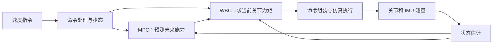
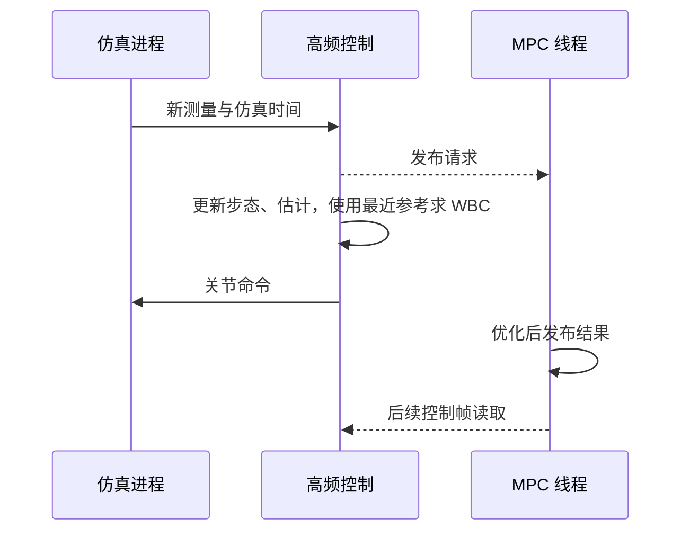

# Lite3 四足机器人 MPC+WBC 从一次迈步理解运动控制

这份文档围绕一个具体任务展开：**让当前 Lite3 仿真模型从站立开始，以给定速度向前走，并在换腿支撑时保持机身姿态。** 每个模块都从它接到的输入讲起，说明为什么需要这一步，再推导输出怎样得到，最后对应到源码。

正文按“整体控制链 → 坐标与模型 → 步态与估计 → MPC → WBC → 执行与验证”推进。矩阵是已经讲清楚的物理关系的集中写法。第一次出现时会拆开解释，不要求先背下整套公式。接触秩、完整转动推导、滤波扩展和求解器细节放在附录 C，适合主线读通后准备深入追问。

本文对应当前仓库的 MuJoCo 平地 MPC+WBC 路径。它在线计算控制量，不进行神经网络训练。源码事实沿用 2026 年 11 月 12 日的核对范围；讲解中的算例会明确区分模型计算、简化示例与实测结果，不能据此宣称已完成真机验证。

## 第 1 章 从“让机器人前进”到整套控制架构

### 1.1 站住和向前走，分别需要什么力

先让 Lite3 静止站立。它受到向下的重力，四只脚受到地面向上的支撑力。高度不变且竖直速度不变时，总支撑力应等于重力：

$$
f_{z,1}+f_{z,2}+f_{z,3}+f_{z,4}=mg.
$$

这里 $f_{z,i}$ 是第 $i$ 只脚受到的向上地面力，$m$ 是整机质量，$g$ 是重力加速度的大小。本模型质量约为 $11.94$ kg，总重量约为 $117.11$ N。如果质心和四脚位置完全对称，单脚约承担 $29.28$ N。实际分配还要满足机身不向前后或左右倾倒，所以并非只要四个数加起来等于重量就可以。

现在要求向前加速。脚向后推地，地面反过来向前推机器人，前向合力产生前向加速度：

$$
m a_x=\sum_i f_{x,i}.
$$

若希望向前加速度为 $1$ m/s²，就需要约 $11.94$ N 的前向合力，同时仍要提供足够的竖直支撑。到了某只脚离地时，这只脚就不能继续提供地面力，负载必须由剩余支撑脚承担。

这已经包含运动控制的三个核心问题：**需要多大的力、由哪些脚提供、腿部电机能否实现。**

### 1.2 为什么关节角控制还不够

Lite3 的电机安装在腿上，每腿三个，共 12 个。它们可以直接施加关节力矩，但机身没有“向前电机”“升高电机”或“保持水平电机”。

机身本身可以沿三个方向平移、绕三个方向转动，共 6 个自由度；再加上 12 个关节，整机瞬时运动需要 18 个速度分量描述。只有 12 个直接驱动输入，所以称为**欠驱动系统**。机身没有固定在地面，又称为**浮动基系统**。

位置 PD 可以让膝盖接近某个角度，却不会自动回答“这只脚应承重多少”“换腿之后剩余两脚能否平衡机身”。尤其受到扰动时，同一组关节目标可能对应不同的机身姿态和接触受力。需要把接触、机身运动和关节能力联系起来。

### 1.3 一条前进指令要经过哪些模块

以目标前进速度 $0.2$ m/s 为例。这个数告诉机器人最终希望走多快，却没有给出哪条腿先抬、脚落在哪里或电机出多大力矩。各模块依次补齐这些信息：

| 模块 | 已知什么 | 计算什么 | 结果交给谁 |
| --- | --- | --- | --- |
| 命令处理 | 用户希望前进 $0.2$ m/s | 限幅、平滑后的有效速度 | 步态、MPC |
| 步态与轨迹 | 有效速度、当前步态时刻 | 哪些腿支撑，摆动脚应到哪里 | 估计器、MPC、WBC |
| 状态估计 | 关节角与速度、IMU、支撑计划 | 当前机身速度、位置与高度 | MPC、WBC |
| MPC | 当前状态、目标速度、未来接触计划 | 未来接触力方案及首步运动参考 | WBC |
| WBC | 当前全身状态、运动参考、当前接触 | 关节总力矩 | 命令组装 |
| 执行端 | 关节命令 | 实际施加力矩并更新运动 | 返回新测量 |

最后一行的测量重新进入前面的模块，这就是闭环。没有反馈，控制器就只能假设机器人完全按上次计划运动，无法修正滑移、扰动或执行偏差。

### 1.4 MPC 与 WBC 为什么分成两层

MPC 是模型预测控制。它先用简化模型判断：如果未来一段时间这样施力，速度和姿态会怎样变化。随后选择较好的方案，但只取当前需要的一步；收到新状态后再预测。这样，控制器能提前考虑即将发生的换腿。

WBC 是全身控制。它面对的是当前这一帧：机身要产生某个加速度，摆动脚要抬起，支撑脚不能任意运动，电机力矩又有上限。WBC 把这些要求放在一起，求出当前可执行的关节力矩。

两层分开，是计算复杂度与模型细节之间的取舍。MPC 暂时把整机看成一个刚体，能预测得更远；WBC 包含腿部连杆，处理当前构型更细。在本工程中，MPC 预测 $10$ 步、每步 $0.05$ s；WBC 随新仿真状态约每 $1$ ms 更新。

两层之间传递什么也很关键：当前 MPC 把首步接触力换算成基座加速度参考；WBC 默认没有开启逐脚力跟踪。因此 WBC 可以重新分配各脚力，并不严格复制 MPC 的第一组力。这一实际接口在第 6、7 章继续展开。

本章读完，应能顺着“目标速度 → 接触力需求 → 关节力矩 → 新测量”解释控制链。接触矩阵的秩留到附录 C.1，在理解受力与雅可比之后再推。

> 面试提示：先用站立和向前加速说明架构，再解释两层分别省略了什么。只报“20 Hz、1 kHz”还没有说明设计原因。

## 第 2 章 坐标与接口：先保证每个数表示同一件事

### 2.1 世界系和机体系为什么必须区分

世界系 $W$ 固定在地面，$z$ 轴向上。机体系 $B$ 跟着机身走，$x$ 向前、$y$ 向左、$z$ 向上。

机器人朝世界系 $x$ 方向站立时，“机身向前”也就是“世界系向前”。左转 90° 后，机身前方已经对应世界系 $y$ 方向。同样的前进指令，在世界系中的两个速度分量就不同了。

用旋转矩阵 $\mathbf R_{WB}$ 表示这次换坐标：

$$
{}^W\mathbf v=\mathbf R_{WB}\,{}^B\mathbf v.
$$

粗体表示向量或矩阵；向量是一组按顺序排列的数，矩阵把它们按确定规则组合成另一组数。左上标告诉我们用哪个坐标系描述向量。上式右侧是机体系的三个分量，左侧是同一物理速度在世界系中的三个分量。

反向转换用转置 $\mathbf R_{WB}^T$。转置就是把矩阵的行与列互换；旋转矩阵的转置恰好也是它的逆，所以能把刚才的转换反过来。

只考虑偏航角 $\psi$ 时，这个矩阵可以直接展开：

$$
\mathbf R_z(\psi)=
\begin{bmatrix}
\cos\psi&-\sin\psi&0\\
\sin\psi&\cos\psi&0\\
0&0&1
\end{bmatrix}.
$$

取 $\psi=90^\circ$，它把机体系速度 $[0.2,0,0]^T$ 变成世界系 $[0,0.2,0]^T$。这是旋转变换最直接的检查例子。代码使用弧度，$90^\circ$ 对应 $\pi/2$ rad。

### 2.2 位置、速度为什么不能用同一个转换式

方向向量只需要旋转。位置还涉及原点在哪里：脚相对机身的位置是 $\mathbf r$，机身原点在世界系的位置是 $\mathbf p_B$，那么脚的世界位置为

$$
\mathbf p_f=\mathbf p_B+\mathbf R_{WB}\mathbf r.
$$

例如机身世界位置为 $[1,0,0.3]^T$ m，姿态与世界系一致，某脚相对机身为 $[0.2,0.1,-0.28]^T$ m，则脚的世界位置是 $[1.2,0.1,0.02]^T$ m。这个例子是坐标计算示意，并非默认站姿。

求脚速时，要对整个位置式求导。位置对时间的变化率是速度，写作位置字母上方加一个点；再求一次导数就是加速度。先不考虑转动：机身以 $0.2$ m/s 向前，脚相对机身以 $0.2$ m/s 向后，两者相加，脚对地面就静止。

有机身转动时，还会多出“机身转动带着脚走”的速度：

$$
\mathbf v_f
=\underbrace{\mathbf v_B}_{\text{机身平移}}
+\underbrace{\mathbf R_{WB}(\boldsymbol\omega_B\times\mathbf r)}_{\text{机身转动带动}}
+\underbrace{\mathbf R_{WB}\dot{\mathbf r}}_{\text{关节使脚相对机身运动}}.
$$

$\boldsymbol\omega_B$ 是机体系角速度，$\times$ 表示叉乘。这里两项被叉乘的向量都在机体系内，结果再旋到世界系。

因此，把一条机体系足端速度直接乘旋转矩阵，只完成了最后一项。它通常不等于足端对地面的绝对速度。状态估计和摆动脚控制都要用到这个区别。

### 2.3 姿态角与角速度分别描述什么

roll 表示侧倾，pitch 表示俯仰，yaw 表示偏航。本工程姿态数组按这三个数排列，旋转矩阵采用

$$
\mathbf R_{WB}=\mathbf R_z(\mathrm{yaw})\mathbf R_y(\mathrm{pitch})\mathbf R_x(\mathrm{roll}).
$$

矩阵乘法有顺序，不能随意交换。IMU 给出的角速度，则是此刻绕机身三个轴的转动速率。姿态已经倾斜时，三个姿态角的导数不等于这三个角速度，需要额外的映射；完整式见附录 C.2。

yaw 还要处理表示范围。实际从 $179^\circ$ 转到 $181^\circ$，若测量用 $[-180^\circ,180^\circ]$ 表示，数值会变成 $-179^\circ$。直接相减会误判为转了 $-358^\circ$。当前代码把 yaw 展开成连续角，再与连续参考比较。

### 2.4 关节数据按什么顺序排列

四条腿固定按 FL、FR、HL、HR 排列，即前左、前右、后左、后右。每腿按 HipX、HipY、Knee 排列：侧向张合、大腿前后摆动、膝关节弯曲。

于是第 0～2 项是前左腿，第 3～5 项是前右腿，依次类推。关节角、关节速度和输出命令必须使用同一顺序。足位与接触力也要按相同腿序组织，否则程序即使维度正确，也可能给错腿施力。

本工程用 $\mathbf q$ 表示 12 个关节角，$\dot{\mathbf q}$ 表示关节速度。粗体表示一组数；一个点表示对时间求导，两个点表示加速度。基座位置和姿态单独保存，不包含在这里的 $\mathbf q$ 中。

### 2.5 一条关节命令实际上如何执行

输出是 $12\times5$ 的矩阵，每行给一个关节，五列为

$$
[k_p,\ q_{des},\ k_d,\ \dot q_{des},\ \tau_{ff}].
$$

$q_{des}$、$\dot q_{des}$ 是目标角度与速度；$k_p$、$k_d$ 是反馈增益；$\tau_{ff}$ 是额外直接加入的前馈力矩。仿真端把它们合成为

$$
\tau_{cmd}
=k_p(q_{des}-q)+k_d(\dot q_{des}-\dot q)+\tau_{ff}.
$$

第一项根据角度误差出力，第二项根据速度误差出力，第三项来自控制器的预先计算。例如角度落后 $0.02$ rad，$k_p=100$，仅位置反馈就贡献 $2$ N·m。

这不是“收到 $\tau_{ff}$ 就只施加 $\tau_{ff}$”的接口。WBC 算的是期望总力矩，发送之前必须考虑执行端还会加 PD，第 8 章会把这个转换完整算一遍。

> 面试提示：能用 90° 转向解释坐标转换，用支撑脚对地静止解释速度分解，再讲矩阵，通常比直接列旋转公式更清楚。

## 第 3 章 从单腿几何走到整机动力学

这一章依次建立四种关系：关节角到脚位、脚位到关节角、关节速度到脚速、力矩到加速度。实现集中在 [00_lite3_model.hpp](../mpc_wbc/00_lite3_model.hpp)。

### 3.1 正运动学：把每段腿的投影加起来

先忽略侧向张合，只看前后—竖直平面。大腿长 $l_1=0.20$ m，小腿长 $l_2=0.21012$ m。大腿角为 $q_y$，膝角为 $q_k$；小腿相对同一参考方向的角度就是 $q_y+q_k$。

两段腿各自贡献一段水平投影和竖直投影，相加得到脚相对髋部的坐标：

$$
x=l_1\sin q_y+l_2\sin(q_y+q_k),
$$

$$
z=-l_1\cos q_y-l_2\cos(q_y+q_k).
$$

公式中的负号对应竖直向上为正，而腿从髋部向下伸。令 $q_y=-0.6$ rad、$q_k=1.2$ rad，算得 $x\approx0.00571$ m、$z\approx-0.33849$ m：前后投影接近抵消，脚位于髋部下方约 33.85 cm。这里只演示平面两连杆计算。

恢复三维时，先加入髋侧向偏置，再绕 HipX 轴旋转，最后加上髋在机身上的安装位置：

$$
{}^B\mathbf p_f
={}^B\mathbf p_h+\mathbf R_x(-q_x)
\begin{bmatrix}x\\s\,d_h\\z\end{bmatrix}.
$$

$d_h=0.09735$ m；左腿 $s=+1$，右腿 $s=-1$。负关节角来自本模型的轴定义。`FootPositionBody()` 返回的是球足中心，球半径为 $0.022$ m，因此球心与接触位置也不能当成同一个点。

### 3.2 逆运动学：先检查够不够得到，再选关节解

步态规划给出脚应在的位置，电机却需要关节目标，所以要把上一节反过来算。这就是逆运动学 IK。

在平面内，髋、膝、脚形成一个三角形。髋到脚的距离为 $\rho=\sqrt{x^2+z^2}$，两根连杆长度已知，由余弦定理得到

$$
\cos q_k=\frac{\rho^2-l_1^2-l_2^2}{2l_1l_2}.
$$

先由这个式子求膝角，再根据目标方向求大腿角。三维情况还要先求 HipX，使目标回到腿的平面中。

这一步会出现两个实际问题。目标太远时，没有任何关节姿势够得到；某些目标能由不同的弯腿方式到达，解不唯一。控制器应优先选与上一目标接近的解，避免连续脚位变成突然跳变的关节角。

当前 `InverseKinematics()` 比较两个 HipX 分支到种子的距离，膝关节固定正弯曲分支，并对部分距离和反余弦输入做夹取。夹取可以避免数值非法，却也可能把目标改成附近可达位置。因此返回成功之后，还应检查

$$
e_{IK}=\|FK(\mathbf q_{IK})-\mathbf p_{target}\|.
$$

这表示把求出的角度重新代入 FK，实际脚位离原目标还差多少。还要另外检查关节限位；有几何解，不等于关节不过限，更不等于运动所需速度和力矩都能实现。

### 3.3 雅可比：从“位置怎么算”走到“微小变化怎么算”

FK 是一个函数 $\mathbf p=FK(\mathbf q)$。现在只让一个关节转动很小的 $\Delta q$，看脚的位置改变多少。位移除以角度变化，就是这个关节对足端位置的局部影响。

以膝关节为例，对上一节的 $x,z$ 求导：

$$
\frac{\partial x}{\partial q_k}=l_2\cos(q_y+q_k),\qquad
\frac{\partial z}{\partial q_k}=l_2\sin(q_y+q_k).
$$

在 $q_y=-0.6,\ q_k=1.2$ 的例子中，它们约为 $0.17342$ m/rad 和 $0.11864$ m/rad。膝角再增加 $0.01$ rad，脚会近似向前移动 $1.73$ mm、向上移动 $1.19$ mm。这是局部近似，角度变化很大时需要重新计算。

把三个关节对三个位置分量的影响排成矩阵，就得到单腿雅可比 $\mathbf J_i$：

$$
\Delta\mathbf p\approx\mathbf J_i\Delta\mathbf q_i,
\qquad
\dot{\mathbf p}=\mathbf J_i\dot{\mathbf q}_i.
$$

每列对应一个关节，每行对应一个位置方向。当前代码通过正运动学中心差分计算它：对同一关节分别增加和减少一个小角度，计算两次 FK，再作差。差分步长是 $10^{-6}$ rad。独立解析导数可用来检查符号与精度。

加上机身平移和转动，便得到足端对地速度。代码用 `FootJacobianWorld()` 把这三个来源统一写成 $\mathbf v_f=\mathbf J_f\mathbf v$，其中整机速度按

$$
\mathbf v=
\begin{bmatrix}
{}^W\mathbf v_B\\{}^B\boldsymbol\omega_B\\\dot{\mathbf q}
\end{bmatrix}\in\mathbb R^{18}
$$

排列。四个脚各有三个速度分量，所以 $\mathbf J_f$ 是 $12\times18$。维度来自“4 个脚的速度”对“整机速度”的映射，不是需要死记的数字。

### 3.4 雅可比为什么也出现在力矩计算里

先看一根水平杆：杆长 $l$，末端受到竖直力 $f$，绕固定端的力矩是 $lf$；若杆以角速度 $\dot q$ 转动，末端竖直速度是 $l\dot q$。同一个几何长度同时参与速度和受力关系。

多关节的几何关系由雅可比表达。外力做功的速率为“力乘速度”，因此

$$
P=\mathbf f^T\mathbf v_f
=\mathbf f^T\mathbf J\mathbf v
=(\mathbf J^T\mathbf f)^T\mathbf v.
$$

最后一项说明，足端外力对应的广义力是 $\mathbf J^T\mathbf f$。转置来自功率相等，而不是人为规定。力和速度必须指向同一个几何点，并在同一坐标系表达。[Modern Robotics：雅可比与静力学](https://modernrobotics.northwestern.edu/nu-gm-book-resource/5-2-statics-of-open-chains/)

要注意符号：本文 $\mathbf f$ 是地面对机器人的力，不是机器人对地面的力。电机力矩还要平衡重力和惯性，所以不能直接把 $\mathbf J^T\mathbf f$ 当成最终电机命令。

### 3.5 从牛顿定律组装整机动力学

一个物体满足“质量 × 加速度 = 合力”。Lite3 的机身和连杆彼此连接，一条腿加速也会影响机身，不能把每个关节当成独立物体。

把所有运动方向一起写，会得到

$$
\mathbf M\dot{\mathbf v}+\mathbf h
=\mathbf S^T\boldsymbol\tau+\mathbf J_c^T\mathbf f.
$$

读这个式子时，从右往左看：

| 项 | 在当前问题中表示什么 |
| --- | --- |
| $\boldsymbol\tau$ | 12 个电机真正需要提供的总力矩 |
| $\mathbf S^T\boldsymbol\tau$ | 把这 12 个力矩放进整机方程；基座前 6 行没有直接电机输入 |
| $\mathbf J_c^T\mathbf f$ | 地面接触力对机身和关节的共同作用 |
| $\mathbf h$ | 当前状态下的重力、科氏和离心等偏置项 |
| $\mathbf M\dot{\mathbf v}$ | 使整机产生指定加速度所需的惯性作用 |

$\mathbf M$ 是 $18\times18$ 质量矩阵。对角项描述各方向惯性，非对角项描述运动耦合。`MassMatrix()` 从各连杆的动能贡献构造它；并非只把 12 个电机惯量填到对角线上。

静止时 $\dot{\mathbf v}=0$。取动力学的关节部分，就得到

$$
\boldsymbol\tau=\mathbf h_j-\mathbf J_{c,j}^T\mathbf f.
$$

这才说明电机怎样配合地面力平衡重力。运动时还需加上 $\mathbf M_j\dot{\mathbf v}$。WBC 要同时求这些量，正是为了让它们相互一致。

### 3.6 支撑约束为什么会出现雅可比的导数

接触点速度为 $\mathbf v_c=\mathbf J_c\mathbf v$。求加速度时，速度在变，姿势改变也使雅可比在变，按乘积求导得到

$$
\mathbf a_c=\mathbf J_c\dot{\mathbf v}+\dot{\mathbf J}_c\mathbf v.
$$

第一项来自整机速度的变化，第二项来自几何映射的变化。若要求接触点加速度为零，就必须满足 $\mathbf J_c\dot{\mathbf v}=-\dot{\mathbf J}_c\mathbf v$，不能只把第一项设为零。

当前 `ContactBiasAccel()` 沿当前运动方向微小推进姿态和关节，差分得到第二项。接触雅可比 $\mathbf J_c$ 对应球足表面接触处；球心雅可比 $\mathbf J_f$ 对应球心。球足滚动时，接触处可不滑，而球心仍然运动，这也是两个雅可比不能随意互换的原因。

### 3.7 用几何、质量和奇异性检查模型

先核对简单量：本模型有机身及四腿共 17 个刚体，质量和为

$$
m=5.6056+4(0.550+0.86+0.153+0.02)=11.9376\ \mathrm{kg}.
$$

静立总承重应约为 $117.11$ N。若计算结果差好几倍，应先查单位、重力方向和关节轴，而不是先调 MPC 权重。

还要检查腿接近伸直时的情况。完全伸直的两连杆不能继续沿腿轴向外伸；某些方向的足速会越来越难用有限关节速度实现，这就是雅可比奇异性。IK 可以返回角度，但不能由此保证足端速度可执行。

数值上可观察雅可比最小奇异值。它越接近零，某个方向的逆映射放大越严重。阻尼最小二乘可以限制放大，但会牺牲足端精度；当前 IK 用的是解析分支选择，不能把阻尼算法说成已实现。完整推导与质量矩阵的动能检查放在附录 C.3。

> 面试提示：沿“FK → 微分得到雅可比 → 功率得到力映射 → 牛顿定律得到整机方程”推导，能把四个知识点连起来。

## 第 4 章 一次迈步怎样变成四条腿的参考轨迹

### 4.1 先区分支撑和摆动

支撑腿踩着地面，提供承重和推力；摆动腿离地，移到下一次落脚位置。机身向前时，支撑脚相对地面尽量不动，所以相对机身向后扫；摆动脚再从后方回到前方。

本工程使用对角小跑 trot：FL 与 HR 一组，FR 与 HL 一组，两组错开半个周期。步态模块的职责是安排这种时间关系，具体受力由 MPC/WBC 计算。实现位于 [02_gait_trajectory.hpp](../mpc_wbc/02_gait_trajectory.hpp)。

### 4.2 用相位表达“这一步走到哪里了”

周期 $T$ 是一条腿完成一次支撑加摆动所需的时间。相位 $\phi$ 是周期已完成的比例，从 0 增长到 1，再回到 0。占空比 $d$ 是其中用于支撑的比例。

$$
\phi=\operatorname{frac}\left(\frac{t-t_0}{T}\right),\qquad
\phi_i=\operatorname{frac}(\phi+\delta_i).
$$

$t_0$ 是起始时间，$\operatorname{frac}$ 取小数部分；A 组的偏移 $\delta_i=0$，B 组为 $0.5$。若 $\phi_i<d$，该腿支撑，否则摆动。

用 $T=1$ s、$d=0.7$ 的教学例子展开一个周期，就不必只看公式：

| 周期内时间 | A 组 FL、HR | B 组 FR、HL |
| --- | --- | --- |
| 0～0.2 s | 支撑 | 支撑 |
| 0.2～0.5 s | 支撑 | 摆动 |
| 0.5～0.7 s | 支撑 | 支撑 |
| 0.7～1.0 s | 摆动 | 支撑 |

所以两组错开半周期，不等于始终只有两脚接触。占空比大于 $0.5$ 会产生四脚同时支撑的区间，其时间占比为 $2d-1$；当前步态没有腾空相。

### 4.3 由机身速度算支撑脚后扫速度

先只考虑前进。机身目标速度为 $v$，支撑时长为 $dT$，这一段机身预计前进的距离为

$$
\Delta x=v\,dT.
$$

为了让脚对地面不动，它相对机身就要向后扫同样的距离。例如 $v=0.2$ m/s、$T=1$ s、$d=0.7$，得到后扫距离 $0.14$ m、后扫速度 $-0.2$ m/s。摆动阶段再把脚送回前端。

加入横移和转向后，不同脚的位置不同，转向带来的速度也不同：

$$
\mathbf v_{\mathrm{sweep},i}
=\mathbf v_{\mathrm{cmd}}+\boldsymbol\omega_{\mathrm{cmd}}\times\mathbf p_i^0,\qquad
\Delta\mathbf p_i=dT\,\mathbf v_{\mathrm{sweep},i}.
$$

$\mathbf p_i^0$ 是标称足位；支撑脚相对机身速度取后扫方向，即上述速度的负值。这是用目标机身运动生成脚步的几何近似，并未在线优化落脚位置。

### 4.4 摆动脚怎样从后方回到前方

令 $\xi$ 表示摆动阶段的完成比例，从 0 到 1。水平位置可以写成

$$
x(\xi)=x_{start}+(x_{end}-x_{start})s(\xi).
$$

最简单的 $s(\xi)=\xi$ 会让摆动段内部保持恒速，但起止突然改变速度。当前采用五次函数

$$
s(\xi)=10\xi^3-15\xi^4+6\xi^5,
$$

使这一段的起止速度、加速度都为零。竖直方向先抬高再落下：

$$
z(\xi)=z_0+\frac H2(1-\cos 2\pi\xi).
$$

在 $\xi=0$ 和 1 时高度为 $z_0$，在 $\xi=0.5$ 时为 $z_0+H$。轨迹输出脚位和相内脚速：脚位交给 IK 生成关节目标，脚位/脚速也交给 WBC 构造摆动跟踪任务。

### 4.5 周期、占空比和高度为什么要一起调

当前默认分三档，并在边界附近平滑插值：

| 速度段 | 周期 $T$ | 占空比 $d$ | 抬脚高度 $H$ | 摆动时间 $(1-d)T$ |
| --- | ---: | ---: | ---: | ---: |
| 低速 | 1.20 s | 0.72 | 0.07 m | 0.336 s |
| 中速 | 0.75 s | 0.70 | 0.07 m | 0.225 s |
| 高速 | 0.44 s | 0.625 | 0.10 m | 0.165 s |

增加 $d$，脚承重更久，但回摆时间更短。摆动平均速度的量级是

$$
\bar v_{sw}\sim\frac{vdT}{(1-d)T}=v\frac d{1-d}.
$$

缩短 $T$，每步距离减小，但完成动作的时间也缩短；提高 $H$，脚要在同样时间内抬得更高，竖直加速度需求约按 $H/T_{sw}^2$ 增长。因此不能只看“脚抬得高不高”，还要看关节速度、力矩和触地冲击。

当前起步从实际足位向规划轨迹混合；停步逐渐缩小水平步幅，在合适的全支撑区间退出。MPC 的速度参考使用同一停步缩放，避免腿已经收步、机身却还在被要求前进。速度分界见 [设计指标](<00_Lite3 四足狗运动控制设计指标.md>)。

### 4.6 一段曲线平滑，不代表两段拼起来平滑

摆动水平曲线在端点脚速为零，支撑段后扫脚速却通常非零。两段直接拼起来，位置可以接上，速度仍会跳变。余弦抬脚的端点竖直加速度也不为零，与支撑段不连续。

对当前高速标称参数，端点竖直加速度为

$$
\frac{2\pi^2H}{T_{sw}^2}\approx72.5\ \mathrm{m/s^2}.
$$

这是参考曲线导数，不是实测脚速或实测加速度。它提示要检查轨迹导数和力矩尖峰。改进时应先确定离地、落地边界速度，再用满足这些边界条件的曲线连接；变步幅、变周期时，还要处理参数变化的导数。

此外，步态表说“支撑”不等于已经触地。脚提前落地还继续执行摆动任务，可能向地面压脚；脚延迟落地却被当成支撑，会同时影响受力和估计。当前没有用实际触地事件统一修正这些模式，相关边界在第 10 章讨论。

> 面试提示：用一个周期的接触表讲清步态，再从摆动时间推导参数代价；“使用五次多项式”不能单独证明全程平滑。

## 第 5 章 状态估计：从腿部运动反推机身怎样移动

### 5.1 控制器缺少的反馈是什么

用户要求前进 $0.2$ m/s，控制器必须知道机器人现在是 $0.1$、$0.2$ 还是 $0.3$ m/s，才能决定加速或减速。但关节编码器直接测到的是关节角和关节速度，并没有直接测量机身对地速度。

当前实现从仿真 IMU 接口取得姿态与机体系角速度，再用腿部运动学估计基座平移速度和位置。仿真姿态来自 MuJoCo 状态；当前没有用加速度计做惯性积分，也没有运行 EKF。对应 [01_state_estimator.hpp](../mpc_wbc/01_state_estimator.hpp)。

### 5.2 一只不动的支撑脚怎样提供速度观测

先只看前后方向，忽略机身转动：

$$
v_{foot}=v_B+v_{relative}.
$$

$v_{foot}$ 是脚对地速度，$v_B$ 是机身对地速度，$v_{relative}$ 是脚相对机身速度。如果脚踩住地面不动，左边为零，就有

$$
v_B=-v_{relative}.
$$

假设由关节角、关节速度和雅可比算出脚相对机身以 $0.18$ m/s 后退，那么在这个支撑假设成立时，机身就在以 $0.18$ m/s 前进。

三维情况下，直接使用第 2 章的速度分解。把球心对地速度设为零，再将机身平移速度以外的项移到右边：

$$
{}^W\mathbf v_B^{(i)}
=-\mathbf R_{WB}
\left(\boldsymbol\omega_B\times{}^B\mathbf p_{f_i}
+\mathbf J_i\dot{\mathbf q}_i\right).
$$

括号内第一项是机身转动带动脚的速度，第二项是关节运动产生的速度。每条计划支撑腿都能算出一个候选值。代码通过球心雅可比的对应列完成同一计算。

这里的“球心静止”是近似。真正无滑移约束的是接触材料点；球足滚动时球心可以移动。因此这个速度并非无条件可靠的直接测量。

### 5.3 多条腿给出不同结果时，怎样融合

如果三条候选腿给出前进速度 $0.18$、$0.20$、$1.10$ m/s，直接平均会得到约 $0.49$ m/s。第三条明显不同，可能处于触地瞬间、打滑或计划接触不准确。

当前实现先检查候选相对上一估计值是否变化过大，再选出与其他候选总距离最小的代表值，融合与该代表值一致的候选。这个过程是在找一组彼此支持的观测，不能把它称为带协方差的卡尔曼滤波。

融合后还限制速度更新量：

$$
\|\mathbf v_{new}-\mathbf v_{old}\|\le a_{\max}\Delta t.
$$

默认 $a_{\max}=30$ m/s²，若两帧相隔 $1$ ms，每次速度最多改变 $0.03$ m/s。这能压制触地尖峰，也会限制估计响应速度。它是算法门限，不是宣称机器人实测加速度达到了 $30$ m/s²。

若前面的变化筛选拒绝了所有候选，代码仍用原候选进行一致性融合，再限制更新量，避免估计完全冻结。多个候选存在时至少需要两个一致；筛选后只剩一个候选时允许低置信度使用。经验置信度反映门控情况，不是严格统计概率。

### 5.4 高度怎样从“脚踩在地上”恢复

已知平地高度为零，球足半径为 $r_f$，触地时球心世界高度约为 $r_f$。脚相对基座的世界竖直偏移可以由 FK 和姿态算出：

$$
z_{foot}=z_B+\left(\mathbf R_{WB}{}^B\mathbf p_f\right)_z.
$$

把左边设为 $r_f$ 并移项：

$$
z_B=r_f-\left(\mathbf R_{WB}{}^B\mathbf p_f\right)_z.
$$

例如球心相对基座的竖直偏移为 $-0.30$ m、半径为 $0.022$ m，就得到基座高度 $0.322$ m。多条可靠支撑腿提供多个高度，再取平均。地面不平、脚未落地或接触几何不符时，这个推算会偏离真实高度。

水平位置则由速度积分得到。它能帮助 MPC 描述短期相对运动，但误差也会累积，不是全局定位。

### 5.5 估计一致为什么仍然可能错误

两脚同时向后滑时，两条腿可能都把机身前进速度估大。它们彼此一致，却共同违反“脚对地静止”的前提。一致性筛选擅长发现彼此不同，发现不了所有共同错误。

还有一些量在现有观测下根本分不出来。把机器人和它踩的接触点一起水平移动 1 m，而姿态、关节角、运动都相同，IMU 和腿部运动学的读数不会因此改变。没有外部参照，就无法恢复绝对水平位置。这称为不可观。

已知平地提供高度参照；当前仿真姿态还额外提供 yaw。若只依赖真实 IMU 和未知位置的接触点，全局位置与全局 yaw 仍有不可观方向，不能靠调小滤波噪声凭空恢复。[Hartley 等：接触辅助 InEKF](https://arxiv.org/abs/1805.10410)

### 5.6 接入真实 IMU 后怎样继续扩展

惯性融合通常先根据陀螺和加速度计预测状态，再用可信接触关系校正；同时估计传感器偏置及不确定性。可以把它理解为：IMU 提供连续运动预测，接触腿提供带条件的几何参照。

加速度计读数不是可以直接积分的世界系平动加速度。它测的是比力，需要扣除偏置、旋到世界系，再加重力向量。静止且坐标轴与世界系一致时，理想读数向上约为 $g$，加上向下的重力后才得到零平动加速度。

具体状态方程、加权观测和无力传感器的接触估计放在附录 C.4。这些是扩展方向，不能写成当前工程已经实现。

> 面试提示：从“支撑脚对地静止”推到机身速度，再主动指出滑移、滚动和绝对位置漂移的边界，才能说明自己理解了估计前提。

## 第 6 章 MPC：把未来运动算出来，再决定怎样施力

### 6.1 先用一个方向理解预测

MPC 的第一步不是写优化器，而是回答：给定当前状态和某个输入，下一时刻会怎样。

只看竖直方向，向上为正。若总支撑力 $F_z$ 在短时间 $h$ 内保持不变，则

$$
a_z=\frac{F_z}{m}-g,\qquad
v_{z,next}=v_z+h a_z,\qquad
z_{next}=z+h v_z+\frac12h^2a_z.
$$

这三式依次完成“力变成加速度、加速度改变速度、速度和加速度改变位置”。若当前竖直速度为零、$F_z=mg$，预测高度不变。若多提供约 $11.94$ N 支撑，本模型就产生约 $1$ m/s² 向上加速度；持续 $0.05$ s 后，速度增加 $0.05$ m/s、高度增加 $1.25$ mm。

再把下一时刻当成当前时刻，重复计算，就得到一段未来轨迹。实际 MPC 会同时预测平移和姿态，原理仍是这个递推。

### 6.2 一段预测怎样比较“好”和“不好”

用一个只控制前进速度的教学模型，把优化算完整。假设初速度 $v_0=0$，目标 $v^\ast=0.2$ m/s，每步 $h=0.05$ s，暂时只预测两步。把每步向前加速度 $a_0,a_1$ 作为未知量：

$$
v_1=h a_0,\qquad v_2=h a_0+h a_1.
$$

希望两步速度都接近目标，但也不希望无限增大加速度，于是定义

$$
J=\frac12(v_1-v^\ast)^2+\frac12(v_2-v^\ast)^2
+\frac12r(a_0^2+a_1^2).
$$

前两项是速度误差的平方，最后一项惩罚过大的输入。$r$ 决定这两种需求的折中。这里用加速度代替力是为了减少符号，得到加速度之后可用 $F_x=ma$ 换算；它不是当前工程完整目标函数。

取教学权重 $r=h^2$，代入预测式后对两个未知量分别求导，令导数为零：

$$
\begin{aligned}
(2h^2+r)a_0+h^2a_1&=2h v^\ast,\\
h^2a_0+(h^2+r)a_1&=h v^\ast.
\end{aligned}
$$

代入数值得到

$$
3a_0+a_1=8,\qquad a_0+2a_1=4,
$$

因此 $a_0=2.4$ m/s²、$a_1=0.8$ m/s²，预测速度为 $0.12$、$0.16$ m/s。这个结果没有立刻达到目标，因为代价函数允许以一定跟踪误差换取较小输入。

注意第一步加速度同时影响 $v_1$ 和 $v_2$；第二步只影响 $v_2$。**未来目标通过预测关系反过来影响当前决策**，这就是提前看几步的作用。真实系统还有摩擦与力上限，不能仅令导数为零，还需在允许范围内找最优解。

### 6.3 为什么只执行首步，还要重新计算

上例算出了两步，但第一步执行以后，实际速度可能因模型误差或扰动只到 $0.10$ m/s。此时继续盲用原来的第二步，会沿着已经偏离实际的预测走。

MPC 会重新读取状态，把 $0.10$ m/s 当作新的初速度，再计算未来两步。预测窗口不断向前滚动，因此叫滚动时域控制。闭环来自这种测量与重算，不是一次优化已经知道了真实未来。

当前工程预测 $N=10$ 步、节点间隔 $h=0.05$ s，总计约 $0.5$ s。MPC 工作线程每轮计算新的力序列，只取首节点构造下层参考；两次 MPC 更新之间由高频 WBC 继续执行。预测节点间隔、MPC 实际更新周期、WBC 更新周期是三个不同时间量。

### 6.4 把教学模型换成 Lite3 的单刚体模型

SRBD 表示单刚体动力学。MPC 暂时把整机看成一个带质量和惯量的物体，不逐个预测关节。输入是各支撑脚的地面力，状态包括

$$
\mathbf x=
\begin{bmatrix}
{}^W\mathbf p_c\\{}^W\mathbf v_c\\
\boldsymbol\Theta\\{}^B\boldsymbol\omega
\end{bmatrix}\in\mathbb R^{12}.
$$

四块依次是质心位置、质心速度、姿态角、机体系角速度，各三个数。下标 $c$ 表示质心；它不必与机身坐标原点重合。整机质心是各连杆质心按质量的加权平均，腿姿变化时也会变化。

平移由合力决定，转动由绕质心的合力矩决定。转动惯量描述改变转速有多困难，类似质量对平动加速度的作用；同样质量离转轴越远，通常越难加速转动。将以下物理量统一放在世界系，理论关系为

$$
m\ddot{\mathbf p}_c=\sum_i\mathbf f_i+m\mathbf g,
$$

$$
\mathbf I_W\dot{\boldsymbol\omega}_W
+\boldsymbol\omega_W\times(\mathbf I_W\boldsymbol\omega_W)
=\sum_i\mathbf r_i\times\mathbf f_i.
$$

$\mathbf I_W$ 是绕整机质心、在世界系表达的惯量，$\mathbf r_i$ 从质心指向接触点。右侧说明同样大的力，作用点不同，对机身转动的影响也不同。

第二式含有角速度与自身相关的非线性项。当前 QP 为了保持简单，在一次预测中冻结惯量、姿态变换和力臂，并省略这一耦合项。接触表会改变哪些脚能出力，但不会预测每次新落脚后的力臂。下一次求解再用当前状态重建模型。

因此它是当前状态附近的近似。快速转动、大幅摆腿、较远的未来落脚都会增加误差。上述公式使用一致坐标解释理论；当前质心速度和输出角加速度中的坐标实现偏差单独列在第 10.4 节。实现位于 [05_srbd_mpc.hpp](../mpc_wbc/05_srbd_mpc.hpp)。

### 6.5 从两步小矩阵推广到真正的 QP

把第 6.2 节的两个预测速度排在一起，就有

$$
\begin{bmatrix}v_1\\v_2\end{bmatrix}
=
\begin{bmatrix}v_0\\v_0\end{bmatrix}
+\underbrace{\begin{bmatrix}h&0\\h&h\end{bmatrix}}_{\text{每步输入对未来速度的影响}}
\begin{bmatrix}a_0\\a_1\end{bmatrix}.
$$

矩阵右上角为零，因为第二步的输入不能改变第一步已经发生的速度。真实 12 维模型只是把每个数换成对应的矩阵块：

$$
\mathbf x_{k+1}=\mathbf A\mathbf x_k+\mathbf B_k\boldsymbol\lambda_k+\mathbf c_g.
$$

$\mathbf A$ 描述现有状态怎样继续演化，$\mathbf B_k$ 描述本步力系数的作用，$\mathbf c_g$ 是重力贡献。$\boldsymbol\lambda_k$ 是实际用于表示接触力的系数，下一节解释。

将所有未来状态堆叠成 $\mathbf X$，递推展开：

$$
\mathbf X=\mathbf X_{free}+\mathbf G\boldsymbol\lambda.
$$

$\mathbf X_{free}$ 是不施加接触力时的预测，仍包含当前速度和重力。$\mathbf G$ 与两步例子中的下三角矩阵作用相同。代码称它为 `S`，这里记作 $\mathbf G$，避免与关节选择矩阵混淆。

把状态误差平方加权，得到

$$
J=\frac12(\mathbf X-\mathbf X_{ref})^T\bar{\mathbf W}
(\mathbf X-\mathbf X_{ref})
+\frac12r_\lambda\boldsymbol\lambda^T\boldsymbol\lambda.
$$

$\bar{\mathbf W}$ 放各步位置、速度、姿态等误差的权重。用预测关系替换 $\mathbf X$，展开平方、去掉与输入无关的常数，就得到

$$
J=\frac12\boldsymbol\lambda^T\mathbf H\boldsymbol\lambda
+\mathbf g_{QP}^T\boldsymbol\lambda+\text{常数},
$$

$$
\mathbf H=\mathbf G^T\bar{\mathbf W}\mathbf G+r_\lambda\mathbf I,\qquad
\mathbf g_{QP}=\mathbf G^T\bar{\mathbf W}(\mathbf X_{free}-\mathbf X_{ref}).
$$

这一步与展开标量 $(e_0+b a)^2$ 完全相同：二次项来自 $b^2a^2$，一次项来自 $2e_0ba$。目标是二次函数、约束是线性关系，这样的问题称为二次规划 QP。

状态权重非负且 $r_\lambda>0$ 时，二次项矩阵正定，可以把目标想成一个向上开口的多维抛物面，有唯一最低点。加上线性盒约束后仍是凸优化问题，不会出现一个比全局最优更差的局部最低点。这个性质来自冻结模型和代价结构，不是所有 MPC 天然都凸。[Di Carlo 等：Cheetah 3 凸 MPC](https://dspace.mit.edu/entities/publication/96d12c0a-997a-4e3f-a3e8-75a9c8072231)

### 6.6 地面允许的力怎样变成变量上下限

普通接触只能向上托脚，不能向下拉脚，所以 $f_z\ge0$。用 $\mu$ 表示摩擦系数，水平力受以下限制：

$$
\sqrt{f_x^2+f_y^2}\le\mu f_z.
$$

例如 $\mu=0.6$、$f_z=30$ N，水平合力最多 $18$ N。要保持优化简单，当前 MPC 用四个方向的非负组合近似这个圆锥：

$$
\begin{aligned}
f_x&=\mu(\lambda_1-\lambda_2),\\
f_y&=\mu(\lambda_3-\lambda_4),\\
f_z&=\lambda_1+\lambda_2+\lambda_3+\lambda_4.
\end{aligned}
$$

四个系数分别对应 $(\mu,0,1)$、$(-\mu,0,1)$、$(0,\mu,1)$、$(0,-\mu,1)$。例如取 $(20,10,10,10)$ N，得到力 $(6,0,50)$ N。四个系数相等则只有竖直支撑力。

非负组合满足 $|f_x|+|f_y|\le\mu f_z$，水平截面是圆内的菱形。代码又规定

$$
0\le\lambda_g\le f_{z,max}/4.
$$

每个变量独立有上下限，故称“盒约束”。默认 $f_{z,max}=200$ N，单个系数上限为 $50$ N。但这种限法比只限制总法向力更保守：若要达到 $f_z=200$ N，四个系数必须全为 50，水平力反而只能为零。

每个支撑脚每步有四个变量，摆动脚没有力变量。若十步始终四脚支撑，共 $160$ 个变量；若始终两脚支撑，共 $80$ 个。当前 [03_box_qp.hpp](../mpc_wbc/03_box_qp.hpp) 求解这个问题，没有调用 OSQP。具体迭代与 KKT 放在附录 C.5。

### 6.7 权重、预测长度与结果该怎样理解

权重应先结合单位和允许误差理解。位置误差 $0.02$ m 与姿态误差 $0.02$ rad 数字一样，含义不同。可先除以各自允许误差，把它们变成“占允许范围的几倍”，再决定相对重视程度。

增加误差权重会增强纠偏需求，但不能突破摩擦和执行器能力。增加力系数正则会抑制输入，也可能让高度跟踪变差；它没有直接惩罚相邻两步的力差，因此不能自动解释为“力变化更平滑”，更不等于直接优化耗电。

预测更久，能看到更多接触事件，也会增加计算量和冻结模型误差。当前 $0.5$ s 时域，在低速步态只覆盖约 $0.42$ 个周期，在高速步态约 $1.14$ 个周期。同样十个节点，预见的换腿次数不同。

QP 有解，只说明优化约束允许某个力序列。当前零力系数本身就在盒内，所以即使高度跟踪很差，仍可能有可行解。代码还没有把求解器的 `converged` 作为接纳 MPC 结果的必要条件，有限数值返回不等于充分收敛。

此外，数值最优不等于闭环稳定。当前没有终端稳定性设计或递归可行性证明；状态估计、WBC 重分配和执行延迟还会改变真实运动。与 LQR 的关系和稳定性条件见附录 C.6。[MIT：LQR 与带约束 MPC](https://underactuated.mit.edu/lqr.html)

### 6.8 MPC 的输出怎样进入 WBC

取首步各脚力，先求总力，再求绕质心的总力矩。线加速度由

$$
\mathbf a_{c,ref}=\frac{\sum_i\mathbf f_i}{m}+\mathbf g
$$

得到；角加速度由单刚体转动方程换算。当前接口将这些量作为基座加速度参考，并保存逐脚力参考。

默认 WBC 力跟踪权重为零，所以有效传递的主要目标是六维基座加速度。即使两组逐脚力产生相同的合力和合力矩，它们对应的腿部负载也可能不同；WBC 可以改变分配，因此不能说已原样执行 MPC 预测的整条力序列。

质心与基座原点也并非总有相同加速度。慢速、小偏移时近似可能实用，快速摆腿和转动时偏差会增加。完整差值关系见附录 C.2。

> 面试提示：先独立推完两步速度例子，再说明真实系统多了哪些状态、摩擦变量和模型近似，QP 的矩阵就有了来历。

## 第 7 章 WBC：把机身和摆腿要求变成可执行的关节力矩

### 7.1 先看当前这一帧发生了什么

假设当前前左、后右支撑，另外两腿摆动。MPC 希望机身向前加速，轨迹模块希望摆动脚抬高。如果分别给每条腿写一个跟踪控制器，就可能出现摆腿反作用扰动机身、支撑腿承重不足或某关节需要过大力矩的问题。

WBC 在同一次计算中协调这些要求。它把要求分两类：必须满足的动力学和执行边界称为硬约束；尽量达到的机身与脚部运动目标称为软任务。任务冲突时可以留误差，但不能靠违反硬约束获得漂亮的跟踪结果。

本工程实现是加权 WBC，位于 [06_weighted_wbc.hpp](../mpc_wbc/06_weighted_wbc.hpp)。

### 7.2 为什么要一起求 42 个数

当前未知量有三组：

$$
\mathbf z=
\begin{bmatrix}
\dot{\mathbf v}\\\mathbf f\\\boldsymbol\tau
\end{bmatrix}.
$$

整机加速度 $\dot{\mathbf v}$ 有 18 项，各脚力 $\mathbf f$ 有 12 项，各关节总力矩 $\boldsymbol\tau$ 有 12 项，共 42 项。

同时求它们，是因为动力学把它们绑在一起。例如希望机身向上加速，需要增加支撑力；支撑力增加后，各腿关节必须提供与之相符的力矩。如果先任意指定加速度和力，最后才计算力矩，可能发现执行器根本做不到。

这里的加速度是 WBC 在当前模型中预测能实现的量，不是已经测得的真实加速度；真实响应还要经过执行端与接触。

### 7.3 先满足两组等式

第一组来自第 3 章的整机动力学。把三个未知量放到等式左边：

$$
\mathbf M\dot{\mathbf v}-\mathbf J_c^T\mathbf f-\mathbf S^T\boldsymbol\tau=-\mathbf h.
$$

也可以看成矩阵拼接：

$$
\begin{bmatrix}\mathbf M&-\mathbf J_c^T&-\mathbf S^T\end{bmatrix}\mathbf z=-\mathbf h.
$$

这只是把同一个方程写成求解器需要的“矩阵乘未知量等于已知量”，共 18 行。

第二组依赖接触模式。支撑腿要求接触点加速度满足

$$
\mathbf J_{c,i}\dot{\mathbf v}=-\dot{\mathbf J}_{c,i}\mathbf v+\mathbf a_{feedback,i}.
$$

摆动腿则要求 $\mathbf f_i=0$，因为它没有地面可以施力。每条腿始终提供三行等式，因此总等式数是 $18+4\times3=30$。

当前支撑位置和速度反馈默认关闭，$\mathbf a_{feedback,i}=0$。这要求接触点零加速度，却不会自动消除已有滑移速度；若初始速度不为零，零加速度会让它维持。位置/速度稳定化需要另外设计，也依赖接触判断正确。

### 7.4 再限制摩擦和电机能力

WBC 当前对每脚施加

$$
0\le f_z\le200\ \mathrm N,\qquad
|f_x|\le0.6f_z,\qquad |f_y|\le0.6f_z,
$$

并要求每个关节满足 $|\tau_j|\le30$ N·m。这些都是线性不等式：绝对值可以拆成正负两条边界。

这里的摩擦近似与 MPC 不同。固定 $f_z$ 后，WBC 分别限制 $x,y$，允许的区域是方形；MPC 的 $|f_x|+|f_y|$ 限制是菱形。

取 $f_z=100$ N、$f_x=f_y=60$ N，WBC 两轴检查都通过，但水平合力为 $\sqrt{60^2+60^2}\approx84.85$ N，已经超过圆锥允许的 60 N。因此相同的 $\mu=0.6$ 不代表两层有相同摩擦余量。

当前共 48 行不等式：四脚各 5 行摩擦/非负法向条件与 1 行法向上限，再加 12 个关节各两条力矩边界。摆动脚已经被约束为零力，对应摩擦行不再产生额外限制。

### 7.5 摆动脚误差怎样变成一个任务

假设脚的目标比实际位置高 $0.01$ m，先用位置误差生成向上的加速度需求；若实际脚速与目标不同，再用速度误差调整：

$$
\mathbf a_f^{des}
=K_p(\mathbf p_f^{des}-\mathbf p_f)
+K_d(\mathbf v_f^{des}-\mathbf v_f).
$$

默认 $K_p=350$、$K_d=37$。若这一方向速度误差为零，$1$ cm 的位置误差对应 $3.5$ m/s² 加速度需求。它还不是电机力矩，而是 WBC 希望脚实现的运动。

足端加速度由 $\mathbf J\dot{\mathbf v}+\dot{\mathbf J}\mathbf v$ 给出，所以任务写成

$$
\mathbf J_{\mathrm{task}}\dot{\mathbf v}
\approx \mathbf a_f^{des}-\dot{\mathbf J}_{\mathrm{task}}\mathbf v.
$$

这里用近似等号，因为摆动跟踪是软任务。当前没有加入轨迹加速度前馈，且会把减去偏置后的任务右端逐分量限制到 $\pm200$ m/s²。基座任务也类似：尽量让前六维广义加速度接近 MPC 给出的参考。

以上推导假设位置、速度、雅可比对应同一个几何点和参考系。当前代码存在球心位置与接触点雅可比混用，以及速度参考缺少移动参考系项的问题；这些具体偏差集中在第 10.4 节，不应当作理论公式本身的含义。

### 7.6 多个任务怎样在同一个代价里折中

对一个任务，$\mathbf A_r\mathbf z$ 表示 WBC 当前变量会产生的结果，$\mathbf b_r$ 是目标，二者之差叫残差。把各任务残差平方后求和：

$$
J_{WBC}
=\frac12\sum_r w_r\|\mathbf A_r\mathbf z-\mathbf b_r\|^2
+\frac12\epsilon\|\mathbf z\|^2.
$$

权重 $w_r$ 越大，同样误差受到的惩罚越大。$\epsilon$ 是很小的正则参数，帮助抑制不必要的大变量并改善数值问题，不能替代力矩约束。

用一个数就能看清加权的含义：任务一希望 $z=0$、权重 100，任务二希望 $z=1$、权重 1。最小化 $100z^2+(z-1)^2$ 得到 $z=1/101$。第一个任务更受重视，却仍让步了。

当前基座任务权重为 1，摆动脚为 100；逐脚力、关节姿势与额外关节力矩代价默认关闭。这是加权折中，不是严格任务层级。严格层级要求低优先任务不能破坏高优先任务已获得的最优结果，不能单靠把权重设得很大来等同实现。

软任务互相冲突，一般表现为残差变大。只有硬约束冲突等问题才会直接造成无可行解；“摆腿与机身目标打架”不必然等于 QP 无解。

### 7.7 求解成功和输出可用不是同一层判断

WBC 使用 [04_qp_ipm.hpp](../mpc_wbc/04_qp_ipm.hpp) 的原始—对偶内点法。求解器反复更新变量，检查约束和最优性残差；达到收敛条件后，才接纳本帧新解。KKT 各残差的含义见附录 C.5。

没有新解时，当前实现允许复用距离上次成功不超过 $0.01$ s 的旧结果，标记为 `kStale`；没有可用旧解才返回 `kFailed`。旧解不是对本帧重新求出的解，也没有按当前接触集重验。

当前 QP 还没有关节位置和速度的预测硬约束。上层夹取目标关节角，并不能保证优化算出的关节加速度不会把实际关节推向限位。这是判断控制器能力时需要明确的缺项。

### 7.8 怎样检查 WBC 是否真正实现了上层意图

至少分三层看：求解器残差检查本次数学问题；基座和脚部任务残差检查运动目标实现程度；执行器实际力矩与实测运动检查物理响应。

例如 QP 内部动力学残差很小，却可能因前馈限幅、通信延迟或软接触而没有实现实际加速度。应比较 MPC 合力、WBC 合力、关节总力矩和实际施加力矩，沿数据链定位偏差。

经典 MPC+WBIC 工作可以帮助理解分层设计，但本工程 Weighted WBC 的任务与接口应按源码说明，不能把论文中的接触力执行效果直接当成本项目结果。[Kim 等：MPC 与 WBIC](https://arxiv.org/abs/1909.06586)

> 面试提示：从“求哪些未知量—必须满足哪些物理关系—允许哪些跟踪误差”写出 WBC，再讨论 42 维、权重与内点法。

## 第 8 章 执行链路：WBC 算出的力矩如何真正发出去

### 8.1 一帧控制从读取状态开始

状态机入口 [mpc_control_state.hpp](../state_machine/mpc_control_state.hpp) 连接仿真接口；[07_mpc_wbc_controller.hpp](../mpc_wbc/07_mpc_wbc_controller.hpp) 组织算法调用。

进入 MPC 模式时，先清理估计、步态、旧解和故障状态，以当前关节角为起点。随后约 $0.30$ s 平滑过渡到站姿，再保持约 $0.20$ s。这样可以避免接管瞬间把相距很远的新目标直接交给关节 PD。

收到新仿真状态后，当前实际顺序是：

1. 读取本帧关节与 IMU 数据。
2. 调用 `BuildMpcRequest()`，发布后台请求，并读取最近 MPC 结果。
3. 在 `Step()` 内更新命令、步态和 IK，再更新状态估计。
4. 检查使能条件，求 WBC，组装关节命令。
5. 写入发送缓存，由通信线程发送。

这个顺序有一个后果：发布 MPC 请求时，本帧估计还没有更新。请求中的关节与 IMU 来自本帧，基座估计、滤波命令等却来自上一帧缓存。不能因为它们放在一个结构体内，就说所有数据采样时刻完全一致。

### 8.2 用户指令先经过哪些处理

归一化手柄输入要先映射成物理速度。当前单轴上限为前后 $0.60$ m/s、左右 $0.50$ m/s、转向 $1.00$ rad/s。

再做平移标定补偿和组合运动限制。组合式

$$
\sqrt{v_x^2+v_y^2}+0.18|\omega_z|\le0.67
$$

把转向也折算进运动预算，其中系数 $0.18$ 的单位为 m，整体单位为 m/s。它避免同时把前进、横移和转向都推到各自最大值。

之后用时间常数 $0.25$ s 的低通和变化率限制平滑指令；线速度变化率默认不超过 $0.8$ m/s²，转向变化率不超过 $2.0$ rad/s²。低通减弱快速波动，变化率限制规定单次最多改变多少，两者作用不同。

步态和 MPC 使用同一有效速度参考。评估跟踪效果时，也应比较这个有效参考，而不能把经过平滑后的正常响应全部算成对原始手柄跳变的控制误差。

### 8.3 总力矩与前馈力矩必须分开

回到第 2.5 节的执行器接口。设 WBC 希望一个关节总力矩为 $10$ N·m，当前状态下 PD 会产生 $3$ N·m，那么前馈只应发送 $7$ N·m。

代码按同一关系计算：

$$
\tau_{ff}=\tau_{wbc}-k_p(q_{des}-q)-k_d(\dot q_{des}-\dot q).
$$

执行端再计算 PD 加前馈，理想情况下刚好还原 $\tau_{wbc}$。因此“前馈”这一列不是 WBC 总力矩的另一个名字。

这种相消有条件：两端使用相同状态和目标、没有额外控制项、前馈与执行器均未饱和。当前前馈本身还会被夹到 $\pm30$ N·m。

例如 $\tau_{wbc}=20$ N·m、PD 为 $-20$ N·m，所需前馈是 $40$ N·m；夹到 30 后，合成总力矩只有 10 N·m。**WBC 总力矩没有越界，也可能因前馈单独限幅而执行错误。**

没有可用 WBC 结果时，前馈置零，输出退为关节位置 PD。默认 `swing_joint_vel_ff` 关闭，所以速度目标列通常为零，不能仅凭命令里有这一列就认为已经实现轨迹速度前馈。

### 8.4 延迟为什么让 PD 相消失效

控制器采样时，预计 PD 为 3 N·m，于是发送前馈 7 N·m；执行时关节已经移动，PD 变成 2 N·m，总力矩就成为 9 N·m。数据格式没有错，时间不一致已经改变了结果。

令采样时刻为 $t_s$、执行时刻为 $t_a$，目标和增益暂时保持不变，代入两端公式：

$$
\tau_{act}(t_a)=\tau_{wbc}(t_s)
+k_p[q(t_s)-q(t_a)]
+k_d[\dot q(t_s)-\dot q(t_a)].
$$

若延迟 $\delta=t_a-t_s$ 很小，用一次近似得到额外力矩

$$
\Delta\tau\approx-k_p\dot q\,\delta-k_d\ddot q\,\delta.
$$

由此能直接看到：关节运动越快、延迟越大、增益越高，相消误差可能越大。分析“QP 成功但动作不对”时，应同时记录优化总力矩、前馈、执行时 PD 和最终实际力矩。

### 8.5 后台 MPC 的结果为什么需要检查年龄

WBC 不等待每轮 MPC 完成，而是读取最近一次可用结果。后台线程读取请求，调用 `SolveWrench()`，发布结果，再休眠 $0.05$ s。

正常情况下，结果应随着时间变旧。当前外层最大快照时效为 $0.15$ s，内部还允许最多 $0.20$ s 的旧 MPC 缓存。但外层 `MpcWrench.t` 使用本次请求时间；若内部复用旧解，新时间标签会让结果看起来比实际更新。

因此应分别理解请求时间、原始解来源时间和当前使用时间。没有满足时效要求的参考时，基座加速度参考被置零。WBC 的动力学仍含重力，零加速度参考并不表示零支撑力。

### 8.6 PD 增益、阻抗和积分应该怎样理解

先看一个局部单关节模型。位置误差产生恢复力矩，类似弹簧；速度误差产生阻尼。若名义动力学已补偿，误差 $e=q-q_{des}$ 满足近似关系

$$
I_{eq}\ddot e+k_d\dot e+k_pe=0.
$$

$I_{eq}$ 是等效惯量。这个二阶模型的固有频率和阻尼比为

$$
\omega_n=\sqrt{k_p/I_{eq}},\qquad
\zeta=\frac{k_d}{2\sqrt{k_pI_{eq}}}.
$$

增大 $k_p$ 会提高响应频率，但若 $k_d$ 不变，阻尼比会下降，可能更容易振荡。整机还有接触、关节耦合和延迟，所以这个式子用于解释趋势，不是整机稳定性证明。

阻抗控制描述运动偏差与作用力之间的关系；导纳控制通常由测得作用力生成运动参考。当前 WBC 没有实测足端力误差反馈，输出力矩不能直接等同于“已经形成足端力闭环”。

当前也没有关节积分项。若以后增加积分，电机饱和时误差会继续积累，恢复后容易过冲，需要限制积分或反算抗饱和。首先应查明稳态偏差来自模型、估计还是执行限幅，避免用积分掩盖坐标错误。

> 面试提示：把 $10=3+7$ 和 $20\ne-20+30$ 两个算例讲明白，再推延迟公式，就能说明自己理解了执行接口。

## 第 9 章 时间与并发：算得对还要用得及时

### 9.1 先分清周期、延迟和带宽

周期是两次更新之间隔多久；延迟是一帧测量产生到对应命令执行用了多久。每 1 ms 有新结果，不代表它只依据 1 ms 前的数据。

带宽则描述系统能有效跟踪或抑制多快的变化。控制程序每秒运行 1000 次，不表示机身可以稳定完成每秒 1000 次的运动。

举例说，10 Hz 的目标每 100 ms 完成一轮变化，命令晚到 10 ms，就落后了十分之一个周期，即 36°。同样延迟，在更高频率处占的周期比例更大，反馈更容易在不合适的时刻纠偏。

### 9.2 当前仿真与控制怎样交换数据

[mujoco_simulation.py](../interface/robot/simulation/mujoco_simulation.py) 以 1 ms 步长推进；[simulation_interface.hpp](../interface/robot/simulation/simulation_interface.hpp) 的发送线程也按 1 ms 定时发送命令。两者运行在独立进程，通过 UDP 通信，没有严格锁步。

仿真先产生测量，控制器收到后计算，随后命令再送回仿真。没有新命令时重复发送最近缓存。一次控制更新不一定与一帧仿真状态一一对应。

状态机循环每次轮询后休眠 500 μs，但只有仿真时间戳更新才执行当前控制状态。因此轮询间隔不是 2 kHz 控制频率，实际高频更新主要由约 1 kHz 的新状态决定。

### 9.3 状态机管理的是什么

[state_machine.hpp](../state_machine/state_machine.hpp) 管理站立、MPC、RL、阻尼和躺下等模式的进入与退出，不负责求解优化问题。

例如尚未站稳时不直接进入运动控制；MPC 故障锁存或姿态超限时切入阻尼。当前 MPC 与 RL 不直接互切，需要先进入阻尼并重新站立，或躺下后重新开始。模式切换决定哪些控制器拥有输出权，数学求解决定该模式里具体发什么。

### 9.4 名义 20 Hz 为什么未必真是 20 Hz

当前 MPC 是“求解完成后再休眠 50 ms”。若一次求解耗时 3 ms，即使忽略调度开销，一轮也约 53 ms，对应约 18.9 Hz。若耗时偶尔增加，更新间隔也随之变化。

因此至少要区分测量时刻、请求时刻、求解完成时刻、使用时刻、执行时刻。只记录求解耗时，不能知道数据使用时已经多旧；只看消息时间，又可能被旧解重新封装掩盖。

仿真时间用来计算状态演化和步态相位，墙钟时间用来测计算耗时和线程调度。仿真暂停或慢于实时后，二者不能直接相减，跨进程测延迟要统一时钟口径。

实时评估应覆盖读取、估计、模型构建、QP 组装、求解和命令发布的全路径。报告 P50、P95、P99、最大观测耗时与超期率；P99 表示约 99% 样本不超过该耗时。平均耗时小于 1 ms，仍可能有少数控制帧严重超期。

### 9.5 为什么原子序号不能自动保护整份数据

假设写线程更新一组接触力，前半部分已是新数据，后半部分还是旧数据。读线程此时复制，就可能得到混合结果。需要同步的是整份数据的读写，不只是“更新完毕”的一个标志。

当前 `SeqLockBox<T>` 用奇偶序号表示写入进行中或完成，读者复制前后检查序号。但载荷 `value_` 是普通非原子对象，并发读写本身仍可能违反 C++ 内存模型。即使复制后丢弃结果，也不能消除已经发生的数据竞争。[C++ 标准草案：数据竞争](https://eel.is/c++draft/intro.races)

改进可采用短临界区，或具有明确槽位所有权与回收规则的有界缓冲。简单双缓冲也要防止读者尚未复制完、写者又绕回覆盖。线程安全需要证明访问合法，实时性还需测阻塞和最坏耗时，这两项不能互相替代。

随后再优化动态矩阵分配、日志 I/O、复制和求解迭代。应先测热点，再预分配和复用工作区；当前代码存在动态分配与可变迭代次数，不能未经测试宣称硬实时。

> 面试提示：能区分“周期快、数据新、执行准时”三个概念，并给出时间戳和耗时分布的测量方法。

## 第 10 章 故障与边界：沿控制链判断哪里出了问题

### 10.1 WBC 在什么条件下允许接管

初次使能要求接管和稳定阶段结束，状态估计有效，有至少一条可靠支撑腿，roll/pitch 位于使能门限内。它们分别保证初始姿势、反馈和支撑条件有基本依据。

使能后允许部分门控短时失效，以免接触切换瞬间频繁退出。但这些条件并不证明所有力矩都能实现，也不证明机器人已具备任意扰动下的恢复能力。

### 10.2 一次失败后，实际输出如何变化

| 情况 | 当前处理 | 仍需注意的条件 |
| --- | --- | --- |
| MPC 没有新结果 | 在时效内用缓存，超时后基座加速度参考置零 | 缓存可能对应旧状态和旧接触 |
| WBC 本帧未收敛 | 复用不超过 0.01 s 的旧解 | 未按新接触集重验 |
| WBC 没有可用新旧解 | 前馈置零，退为关节位置 PD | PD 不保证当前状态下能平衡 |
| 连续无可用 WBC 结果达到 20 次 | 故障锁存，状态机转入阻尼 | 返回可用旧解会清零该计数 |
| 姿态达到控制器故障条件 | 锁存故障，过渡后进入阻尼 | 不是自主起身或跌倒恢复 |

故障锁存表示错误状态被记住，避免一帧看似恢复正常就立即重启。位置 PD、阻尼与平衡控制有不同目标，不能把它们统称为保证站立的备用控制器。

### 10.3 旧解很新，也可能已经不适用

上一帧某脚支撑，WBC 给它分配了非零力；下一帧它进入摆动。即使只过去 1 ms，旧结果也可能不符合当前接触模式。

相反，同一支撑模式、状态变化较小时，稍旧的结果可能仍近似可用。因此年龄门限只是条件之一，还需要接触模式和状态变化检查。当前 WBC 主要按年龄复用，没有完成这些重验。

MPC 超时后“零加速度”也不是完整平衡策略：动力学仍需要承重，但参考本身不一定主动恢复已经积累的姿态和速度误差。

### 10.4 将理论近似与当前实现偏差分开

单刚体模型省略腿部独立动量，是明确的建模取舍；机体系角速度与世界系位移直接叉乘，则是坐标定义不一致。两者处理方式不同：前者通过实验评估适用范围，后者需要核对并修正实现。

下表把会打断正文学习的源码问题集中列出。它们是源码核对发现，并不表示已经修复或完成性能对照实验。

| 位置 | 当前行为 | 为什么值得单独处理 |
| --- | --- | --- |
| MPC 质心速度 `SolveWrench()` | 使用 `omega_body.cross(com_world-base_pos)` | 叉乘两侧不是同一坐标系；还省略了腿部运动导致的相对质心速度 |
| MPC 输出 `ComputeBaseAccelDesired()` | 陀螺项直接组合机体系角速度与世界系惯量 | 应先统一角速度和惯量表达，见附录 C.2 |
| MPC 质心参考到基座参考 | 质心线加速度直接作为基座加速度 | 忽略偏置转动和腿部运动项，属于需评估的近似 |
| WBC 摆动任务 | 球心位置误差配接触点速度雅可比；参考脚速仅作旋转 | 几何点不同，且缺少移动参考系平移与转动项 |
| MPC 请求 | 本帧关节/IMU 与上一帧估计/命令一起发布 | 数据并非严格同时刻快照 |
| MPC 返回接纳 | 检查向量维数和有限性，没有强制收敛 | 返回结果与达到最优性容差不同 |
| MPC `pred_*` 输出 | 预测展示另行加入角速度耦合，且有坐标混用 | 不能直接把它当成 QP 代价使用的线性轨迹 |
| MPC 旧解时间 | 旧解可能被本次请求时间重新封装 | 消息年龄可能低估原始解龄 |
| 共享快照 | 普通载荷依赖原子序号检查 | 不能消除载荷并发读写的数据竞争 |

另外，MPC 与 WBC 摩擦域不同、摆动拼接导数不连续、估计依赖计划接触，都属于实际控制边界。介绍项目时要说明其影响路径，不能因为每个模块单独能运行就视为已经解决。

### 10.5 用一个落地抖动现象组织排查

以下是排查方案，不是已完成的实验报告。若落地时抖动，先把相位切换附近的日志按同一时间轴对齐，沿链路检查：

1. **参考端**：脚位连续吗，参考脚速是否跳变？若跳变，先查轨迹拼接。
2. **接触端**：计划支撑与实际法向力出现的时刻是否一致？若不一致，查提前或延迟触地。
3. **估计端**：速度是否在该时刻突变，哪些腿被采纳？查错误支撑观测。
4. **优化端**：任务残差、约束残差、迭代次数是否突增？保存失败帧 QP 离线重求。
5. **执行端**：优化总力矩与实际力矩是否分离？查前馈限幅与延迟。

只有定位最早出现异常的环节，才知道该改轨迹、接触判断、估计、求解器还是执行接口。直接增大姿态权重可能掩盖现象，却无法验证原因。

MuJoCo 使用软接触，WBC 使用理想接触加速度约束。两者接触定义不同，控制器内部残差小仍可能出现实际接触误差。[MuJoCo 官方接触模型](https://mujoco.readthedocs.io/en/stable/computation/index.html#soft-contact-model)

### 10.6 真机迁移与 RL 对比应从哪些量开始

真机首先要核对关节零位与方向、减速比与力矩常数、IMU 外参和时间戳、机身质量惯量、摩擦回差、驱动限幅与延迟。仿真中写入理想电机力矩，不能证明真实电流环能同样执行；模型里的 30 N·m 也不等于任何转速和温升下都能持续输出。

每次辨识应尽量单独激励待识别因素，再用未参与拟合的动作验证。例如用同一轨迹拟合又验收，无法判断参数是否只适配了这一段运动。

与强化学习 RL 比较时，要统一观测信息、指令范围、力矩边界、控制步长、扰动与指标。MPC/WBC 显式写模型和约束；RL 通过训练分布和奖励学习行为。混合方法可以学习残差或参考，再由 WBC 协调，但当前仓库的两种模式并不自动构成联合架构。

> 面试提示：把“出现什么现象、先怀疑什么、看哪个信号、怎样做对照”连起来。没有完成的实验应明确说是验证方案。

## 第 11 章 如何把理解变成源码证据与实验结论

### 11.1 先沿一条命令读通源码

第一次阅读先跟踪一个小幅前进命令：它在哪里变成速度，哪些腿开始摆动，估计结果在哪里更新，MPC 结果在哪里进入 WBC，最后怎样发送关节命令。

| 阅读顺序 | 文件 | 要找到的具体对象 |
| --- | --- | --- |
| 入口 | [mpc_control_state.hpp](../state_machine/mpc_control_state.hpp) | 进入状态、读取测量、发布请求、发送命令 |
| 调度 | [07_mpc_wbc_controller.hpp](../mpc_wbc/07_mpc_wbc_controller.hpp) | 一次 `Step()` 的顺序和备用输出 |
| 参考 | [02_gait_trajectory.hpp](../mpc_wbc/02_gait_trajectory.hpp) | 接触标志、脚位、脚速从哪里来 |
| 反馈 | [01_state_estimator.hpp](../mpc_wbc/01_state_estimator.hpp) | 逐腿候选、融合、有效性 |
| 上层优化 | [05_srbd_mpc.hpp](../mpc_wbc/05_srbd_mpc.hpp) | 预测矩阵、代价、变量界、首步输出 |
| 下层优化 | [06_weighted_wbc.hpp](../mpc_wbc/06_weighted_wbc.hpp) | 变量顺序、约束、任务、旧解 |
| 公共模型 | [00_lite3_model.hpp](../mpc_wbc/00_lite3_model.hpp) | FK、雅可比、质量矩阵、接触点 |
| 数值方法 | [03_box_qp.hpp](../mpc_wbc/03_box_qp.hpp)、[04_qp_ipm.hpp](../mpc_wbc/04_qp_ipm.hpp) | 迭代条件、残差、热启动和退出 |
| 物理执行 | [simulation_interface.hpp](../interface/robot/simulation/simulation_interface.hpp)、[mujoco_simulation.py](../interface/robot/simulation/mujoco_simulation.py) | 时间戳、PD 合成、限幅与实际输出 |

对每个跨模块量，记下单位、坐标系、几何点和采样时刻。目录说明见 [工程结构](<01_Lite3 四足狗运动控制工程结构.md>)，验收口径见 [设计指标](<00_Lite3 四足狗运动控制设计指标.md>)。

### 11.2 跟踪误差和物理残差不是同一个指标

目标速度 $0.2$ m/s、实际速度 $0.16$ m/s，跟踪误差为 $-0.04$ m/s。它告诉我们目标完成得怎样。

动力学残差则把当前解代入运动方程，检查所算加速度与所算受力是否相容：

$$
\mathbf r_{dyn}=\mathbf M\dot{\mathbf v}+\mathbf h
-\mathbf S^T\boldsymbol\tau-\mathbf J_c^T\mathbf f.
$$

两者可能同时很小，也可能前者大、后者小：机器人服从动力学，却受能力限制无法完成目标。不能拿一种指标替代另一种。

支撑约束和圆锥摩擦也应独立核验：

$$
\mathbf r_{contact,i}
=\mathbf J_{c,i}\dot{\mathbf v}+\dot{\mathbf J}_{c,i}\mathbf v
-\mathbf a_{feedback,i},
$$

$$
r_{fric,i}=\max\left(0,\sqrt{f_{x,i}^2+f_{y,i}^2}-\mu f_{z,i}\right).
$$

还要另查法向力正负、上限和关节力矩边界。力、加速度、角度的残差单位不同，应分别记录或合理归一化。

当前日志诊断有两处需要注意：`SolveOnce()` 的支撑诊断把实际接触加速度与已经减去 $\dot{\mathbf J}\mathbf v$ 的任务右端比较，多计了一次该项；同一指标还混合支撑加速度与摆动零力残差。`cone_violation` 检查方形摩擦域，不能代替上面的圆锥与法向力上限检查。日志字段有名称，并不证明验收定义已经正确。

### 11.3 每个性能结论应该由什么实验支持

实验先固定版本、配置、模型和完整指令时序，一次只改变要检验的因素。当前 Python `SIM_LOG` 可记录真值、关节、力矩、接触和足位；控制器内部残差与解龄需另行对齐采集。

| 要回答的问题 | 对照方法 | 主要观察 |
| --- | --- | --- |
| 模型承重与符号是否正确 | 静立，与质量及独立动力学模型对照 | 总法向力、关节重力力矩 |
| 基本速度能否跟踪 | 前后、横移、旋转的双向单轴指令 | 稳态误差、超调、稳定时间 |
| 起停和换档是否平滑 | 相同速度斜坡，不同步态起始相位 | 足速跳变、力矩尖峰、停步残速 |
| 估计误差占多大影响 | 标记清楚的真值反馈替换实验 | 跟踪误差是否明显改善 |
| 能否抗扰 | 规定作用点、方向、持续时间和冲量 | 峰值倾角、恢复时间、饱和率 |
| 对摩擦/负载误差多敏感 | 控制器参数不变，单独改变实际模型 | 滑移、估计偏差、跟踪退化 |
| 实时策略是否有效 | 单独注入延迟、丢帧、求解超时 | 解龄、超期、旧解率、降级行为 |

平均速度误差可能掩盖步态周期振荡，应同时看稳态窗口和瞬态峰值。归一化绝对机械功 $\int\sum_j|\tau_j\dot q_j|dt/(mgD)$ 可以用于比较运动代价，其中 $D$ 是行走距离；它不包含铜耗和驱动损耗，不能直接称为实测电能成本。

### 11.4 面试中怎样讲清自己的项目证据

可以围绕一次完整排查叙述：原始现象是什么，提出了哪个假设，设计了什么单因素对照，指标怎样变化，还有什么解释没有排除。

例如代码已经证明两层摩擦域不同，这是实现事实；它对某次滑倒贡献多大，需要统一摩擦域后的对照，这是待验证因果。视频能展示行为，却不能自动证明误差、抗扰或实时性达标。

个人贡献也遵循同样边界：阅读和运行已有模块、修改某个接口、独立实现算法、完成实验验证，是不同层次。能明确说明自己的修改为何有效、用什么数据支持，比把整个开源架构都说成原创更可信。

> 面试提示：准备一段可复现的技术判断过程，并能指出代码、日志和实验分别证明了什么。

## 第 12 章 面试常用问题：20 个核心追问

本章用于复习前面的控制链。回答时先讲物理依据，再写必要公式，最后说明当前 Lite3 实现与边界。下面的问题来自公开面经主题与本项目的结合，不是特定公司的原题全集，也不按未经统计的“出现频率”排名。

### 选题依据

以下 8 份材料用于选题，检索核对日期为 2026 年 11 月 12 日。求职者与论坛发言属于个人陈述，技术回答仍由前文公式、代码和原始资料支撑。未能核到原帖的公司冠名聚合题库、销售型题库和无来源“必考题”未作为真题依据。

| 编号与来源 | 材料性质 | 本章采用的考察方向 |
| --- | --- | --- |
| [M1：小鹏机器人 offer 一面面经](https://www.nowcoder.com/feed/main/detail/e23f93d6ae1747629e1975ebc27fe1e5) | 传统运动控制岗亲历；2025-08-23 发布，正文回顾此前面试 | 系统架构、IK 多解、雅可比、四元数导数、前馈/PID、重力补偿、C++ |
| [M2：小鹏运动控制算法岗一面](https://www.nowcoder.com/feed/main/detail/4a6023996475449da443124b920b4bbf) | 2023-12-22 发布的亲历；正文涉及巡航控制，不能视为纯足式岗位样本 | 根据对象设计控制器、频域、性能指标、RL 与传统控制、PD 与抗积分饱和代码 |
| [M3：Momenta 控制算法实习面经](https://www.nowcoder.com/discuss/353156298541834240) | 2020-04-10 发布的亲历；车辆控制岗位 | LQR、MPC、动力学/运动学、PID 和基础编程 |
| [M4：博世自动化工程师面经](https://www.nowcoder.com/feed/main/detail/fe5d86d3005141b4b060f850dafbc716) | 2025-10-30 发布的亲历；机械臂视觉与力控相关 | 项目细节、动力学辨识、IK、柔顺控制框架和伪代码 |
| [M5：控制算法工程师面经（站内转引）](https://www.nowcoder.com/feed/main/detail/42dd51f68ae44c5d8216d9a1fe7ed157) | 自动驾驶控制面经汇总；原帖直连正文未成功读取，以可见转引核对，不作为独立多份样本 | 离散化、MPC 时域/权重、QP 矩阵、KKT、内点法、实车调试与 C++ |
| [M6：What do Controls Engineer Interviews Look Like?](https://www.reddit.com/r/ControlTheory/comments/1cgqb83/what_do_controls_engineer_interviews_look_like/) | 机器人软件控制岗位的公开经验讨论，含面试者/面试官视角 | 可控可观、传感器选择、优化凸性、数值方法、控制取舍与排障 |
| [M7：Don't Forget the Fundamentals](https://www.reddit.com/r/ControlTheory/comments/qlmsnx/dont_forget_the_fundamentals/) | 发帖者自述参与控制工程招聘 | 质量—弹簧—阻尼模型、辨识实验、控制器选择、传感器和运行频率 |
| [M8：C++ Questions for Control Engineer Coding Interviews](https://www.reddit.com/r/ControlTheory/comments/1abbi5k/c_questions_for_control_engineer_coding_interviews/) | 机器人控制编程面试讨论，回复者分享个人观察 | 可工作的 C++、基础数据结构、数字滤波与 PID 实现 |

### 12.1 为什么采用 MPC+WBC，而不是只保留一层

MPC 提前看未来接触和运动，WBC 处理当前完整身体的协调。前者简化模型换取预测能力，后者用详细模型检查加速度、接触力和关节力矩是否相容。

只保留当前 MPC，会缺少完整腿部动力学和力矩约束；只保留当前 WBC，则仍需要上层提供合理运动参考。当前逐脚力跟踪默认关闭，所以不能把这套架构讲成严格执行 MPC 力序列。

追问可继续到两层模型误差怎样传递。见第 1 章及第 6.8、7.8 节；选题依据 [M1](#interview-m1)、[M6](#interview-m6)。

### 12.2 欠驱动是什么，支撑脚越多是否一定越容易控制

机身六个运动方向没有直接执行器，关节要通过接触和运动耦合影响机身。腾空时内部运动不能改变质心受重力支配的轨迹。

增加支撑脚会增加施力选择，但几何布局、摩擦和力矩限制共同决定可实现运动。两个不同点接触有六个力分量，却只有五个独立合力旋量方向；三点非共线才可能达到六维满秩。矩阵满秩也不保证满足单边接触和执行限制。

见第 1.2 节、附录 C.1；[M6](#interview-m6) 的可控性主题，接触秩为项目延伸。

### 12.3 雅可比为什么能同时联系速度与力

先从 FK 的微小变化得到 $\mathbf v_f=\mathbf J\mathbf v$，再令两种坐标描述下的功率相等：

$$
\mathbf f^T\mathbf v_f=(\mathbf J^T\mathbf f)^T\mathbf v.
$$

因此外力对应的广义力为 $\mathbf J^T\mathbf f$。要说明力是地面对机器人施加，并且使用同一坐标、同一几何点。电机力矩还要满足动力学，静止时为 $\boldsymbol\tau=\mathbf h_j-\mathbf J_{c,j}^T\mathbf f$。

见第 3.3—3.5 节；[M1](#interview-m1)。

### 12.4 IK 返回成功，为什么脚仍可能到不了或动作跳变

目标可能被夹到可达范围，或在多个解之间切换。应把 IK 结果代回 FK，检查原目标误差，再检查关节限位和帧间连续性。

当前比较 HipX 分支与上一目标的距离，膝固定正弯曲分支。接近伸直时还要查雅可比最小奇异值：几何位置能到，不代表目标脚速能用有限关节速度实现。阻尼逆解缓解数值放大，但会牺牲精度，当前并未用它替代解析 IK。

见第 3.2、3.7 节及附录 C.3；[M1](#interview-m1)、[M4](#interview-m4)。

### 12.5 姿态角导数为什么不等于 IMU 角速度

欧拉角按先后顺序描述旋转，IMU 角速度沿当前机身轴表达；姿态倾斜后，对应轴不再重合，需要 $\dot{\boldsymbol\Theta}=\mathbf T(\boldsymbol\Theta)\boldsymbol\omega_B$。

四元数可避免欧拉角的这类参数化奇异，但仍要统一分量顺序、乘法规则和角速度坐标。当前还应指出世界系惯量与机体系角速度混用的问题。转弯工况比零 yaw 直行更容易暴露坐标错误。

见第 2 章、10.4 节、附录 C.2；[M1](#interview-m1)。

### 12.6 怎样验证动力学模型，而不是只说仿真能走

先用简单可核验量建立信任：FK 对照几何，雅可比对照独立导数，静止总承重对照 $mg$。本模型质量为 $11.9376$ kg，总承重约 $117.11$ N。

再检查质量矩阵的对称性、正动能和动态偏置，统一坐标后与独立实现比较。参数来自 MJCF 只证明来源，不能证明每次旋转和递推正确。真机还需力矩、摩擦、零位和延迟辨识。

见第 3.7、11.2 节、附录 C.3；[M4](#interview-m4)、[M7](#interview-m7)。

### 12.7 周期、占空比、抬脚高度怎样影响关节负担

摆动时间是 $(1-d)T$。增大占空比让承重更久，却缩短回摆时间；缩短周期减少步距，却提高动作频率；提高脚高进一步增加竖直加速度需求。

当前全支撑时间占比为 $2d-1$，没有腾空相。不能因为摆动段用了五次曲线就说拼接平滑：摆动端点零速度与支撑后扫非零速度仍会冲突。

见第 4 章；设计取舍主题来自 [M2](#interview-m2)、[M7](#interview-m7)，步态计算为项目延伸。

### 12.8 没有外部定位，怎样估计速度，为什么位置仍会漂移

支撑脚对地不动时，机身运动与脚相对机身运动抵消。由关节雅可比和 IMU 角速度反推每条支撑腿提供的基座速度，再融合一致候选。

速度积分会积累误差；整体水平平移不改变相对腿部观测，不能恢复绝对水平位置。当前姿态来自仿真，也没有 EKF，不能把该效果说成已解决真实 IMU 的全局 yaw 漂移。

见第 5 章；[M5](#interview-m5)、[M6](#interview-m6)。

### 12.9 没有足端力传感器，怎样识别滑移或失去接触

先区分计划支撑与真实承重。可联合足端位置/速度、运动学残差、IMU 与实际关节力矩推断接触。多腿一致仍可能共同打滑，所以不能单靠候选一致性证明可靠。

由动力学残差估计外力，需要电流—力矩标定、摩擦模型和噪声处理。MPC 计划出的正法向力不属于实测接触证据。接触判断改变后，还要同步影响估计、WBC 和下一次 MPC 接触表。

见第 5.5 节、附录 C.4；[M4](#interview-m4)、[M6](#interview-m6) 的传感器与力控主题，检测方法为项目延伸。

### 12.10 非线性机器人模型为什么在这里变成了凸 QP

先固定接触模式与力臂，冻结惯量和姿态映射，省略角动量耦合，得到状态对力系数的一次关系 $\mathbf X=\mathbf X_{free}+\mathbf G\boldsymbol\lambda$。

把它代入平方误差，就得到 $\mathbf H=\mathbf G^T\bar{\mathbf W}\mathbf G+r_\lambda\mathbf I$。非负权重、正正则和线性盒约束构成当前凸 QP。若落足位置与力同时优化，力矩项会出现变量乘变量，不能继续沿用同一凸性结论。

见第 6.2、6.5 节；[M5](#interview-m5)、[M6](#interview-m6)。

### 12.11 两层摩擦系数都是 0.6，为什么仍可能不一致

参数数值相同，不代表约束形状相同。MPC 用内接菱形 $|f_x|+|f_y|\le\mu f_z$；WBC 分别限制两轴，得到外接方形。

取 $f_z=100$ N、$f_x=f_y=60$ N，方形检查通过，水平合力却达 $84.85$ N，超过圆锥的 60 N。MPC 还限制每个生成系数，使满法向力时水平力只能为零，比普通截断摩擦锥更保守。

见第 6.6、7.4 节；约束主题来自 [M5](#interview-m5)、[M6](#interview-m6)，反例来自本项目。

### 12.12 MPC 与 LQR 有什么联系，最优解能保证稳定吗

两者都可权衡线性系统的状态误差与输入用量。LQR 在相应条件下得到固定反馈规律；MPC 在线重算有限时域问题，并显式处理约束。

固定线性模型、无约束时，若终端权重选为稳定化 Riccati 解，首步反馈可与无限时域 LQR 一致。但本项目有接触切换、模型冻结误差、下层重分配和延迟，且没有终端稳定性设计。当前 QP 收敛不等于真实闭环稳定。

见第 6.7 节、附录 C.6；[M3](#interview-m3)、[M5](#interview-m5)、[M6](#interview-m6)。

### 12.13 MPC 权重、预测步长和更新频率怎样调

先按允许误差缩放状态，再调相对权重；否则米与弧度的原始数值不可直接比较。增大权重后仍有误差，应先检查约束饱和、反馈偏差和目标不可实现，而非继续加权。

再区分节点数 $N$、节点间隔 $h$ 与实际重规划周期。减小 $h$ 却不增加 $N$ 会缩短预见范围；增加 $N$ 会增大计算和冻结误差。当前求解后休眠 50 ms，实际频率还包含求解耗时。

见第 6.7、9.4 节；[M2](#interview-m2)、[M5](#interview-m5)、[M7](#interview-m7)。

### 12.14 WBC 的变量、约束与任务分别是什么

变量是 18 维加速度、12 维接触力和 12 维关节总力矩。动力学、支撑加速度/摆动零力、摩擦与力矩边界是硬约束；基座和摆动脚跟踪是软任务。

权重大只能使残差更受惩罚，不能形成严格层级。可以用 $100z^2+(z-1)^2$ 的最优值 $1/101$ 说明高权重任务仍让步。当前也没有完整关节位置/速度硬约束，不能把“全身控制”理解为已经包含所有限制。

见第 7 章；[M1](#interview-m1)、[M5](#interview-m5) 的架构与 QP 主题。

### 12.15 QP 失败怎样排查，热启动为什么可能帮倒忙

先区分真正无可行解与求解器未在预算内找到解。检查原始约束残差、最优性残差、互补量、有限值、缩放和矩阵秩，保存失败帧离线重求。

热启动把上次结果当起点，接触切换后却可能立即违反新约束。当前 WBC 只复用原始变量，MPC 缓存节点映射也不是常见的前移方式。不可行标志与迭代上限都不能直接作为物理无解证书。

见第 7.7 节、附录 C.5；[M5](#interview-m5)、[M6](#interview-m6)。

### 12.16 PD、动力学前馈、阻抗与足端力闭环怎样区分

PD 根据运动误差纠偏，前馈依据模型提供预期作用；阻抗规定运动偏差与力的关系。足端力闭环还需要力测量或估计，并明确力误差怎样反馈。

当前 WBC 算总力矩，发送前做 $\tau_{ff}=\tau_{wbc}-PD$，没有实测足端力闭环。延迟和前馈限幅会破坏相消。若要求扩展 PID，还要处理非法时间步长、导数噪声和积分饱和，当前并没有积分项。

见第 8.3—8.6 节；[M1](#interview-m1)、[M2](#interview-m2)、[M4](#interview-m4)、[M8](#interview-m8)。

### 12.17 MPC 与 WBC 频率不同，怎样避免使用过时结果

高频线程继续使用最近完成的 MPC 结果，需要记录源状态时间、原始解时间和接触模式，再判断是否适用。不能只看本次消息封装时间。

平均耗时也不够，应测全路径分位数、超期率和使用时解龄。当前旧解可能被重新标时间，请求还混合本帧测量与上帧估计；复用策略必须结合这些实际行为解释。

见第 8.1、8.5 节及第 9 章；[M5](#interview-m5)、[M7](#interview-m7) 的实时性主题，异步细节来自项目。

### 12.18 C++ 控制线程怎样同时保证数据正确和耗时可预测

先说明共享数据谁写、谁读、何时允许覆盖。原子序号不自动保护普通载荷，并发读写后再丢弃也不能消除数据竞争。

选择可证明合法的锁或槽位协议后，再测阻塞与复制开销；随后分析动态分配、日志和求解迭代，按热点预分配。没有 mutex 不等于实时，跑得快也不等于线程安全。

见第 9.5 节；[M1](#interview-m1)、[M5](#interview-m5)、[M8](#interview-m8)，并发分析为项目延伸。

### 12.19 机器人能走，怎样证明控制做得好

至少报告速度和姿态误差、周期振荡、接触滑移、关节饱和、扰动恢复和计算超期；明确坐标、参考、统计窗口与重复条件。

遇到仿真好而真机差，按几何/惯量、传感器、接触、执行器、时延分层隔离。可以通过真值替换和延迟注入设计对照，但不能把待做实验写成已取得结果。一次未跌倒只能证明那次没有跌倒。

见第 10—11 章；[M2](#interview-m2)、[M4](#interview-m4)、[M5](#interview-m5)、[M6](#interview-m6)。

### 12.20 已有 RL，为什么还研究 MPC+WBC，怎样公平比较

MPC/WBC 便于明确模型、约束与残差，代价是模型依赖和在线优化复杂度。RL 从交互中形成策略，性能受训练覆盖、观测、奖励和执行建模影响，两种方法都需要验证。

公平比较要统一信息、力矩、速度范围、扰动和指标。可以研究学习残差或参考再由 WBC 执行，但本项目当前两种模式并存，不等于完成混合架构。回答最后应落到自己实际修改了什么、用什么实验支持选择。

见第 10.6、11.4 节；[M2](#interview-m2)、[M4](#interview-m4)。

## 附录 A：核心参数速查

| 参数 | 当前默认值 | 含义 |
| --- | ---: | --- |
| MPC 节点数 $N$ | 10 | 预测节点数量 |
| MPC 节点间隔 | 0.05 s | 预测离散步长 |
| MPC 工作线程休眠 | 0.05 s | 每轮求解后的休眠时间 |
| MPC 快照最大时效 | 0.15 s | 相对快照请求时间的门限，见第 8.5 节 |
| MPC 内部旧解最大时效 | 0.20 s | 相对上次接纳结果的采样时间 |
| 摩擦系数 $\mu$ | 0.6 | 两层数值相同，摩擦可行域不同 |
| 单脚法向力上限 | 200 N | MPC/WBC 接触力限制 |
| 关节力矩上限 | 30 N·m | WBC 约束及前馈限幅 |
| 位置增益 $k_p$ | 100 | 关节位置 PD |
| 速度增益 $k_d$ | 2.5 | 关节速度 PD |
| WBC 基座任务权重 | 1 | 基座加速度跟踪 |
| WBC 摆动脚任务权重 | 100 | 摆动脚笛卡尔跟踪 |
| WBC 旧解最大时效 | 0.01 s | 相对上次成功求解的采样时间 |
| WBC 连续失败阈值 | 20 次 | 无新解且无可用旧解时累计 |
| 命令低通时间常数 | 0.25 s | 速度指令平滑 |
| 线速度变化率上限 | 0.8 m/s² | 指令变化率限制 |
| 转向变化率上限 | 2.0 rad/s² | 指令变化率限制 |
| 接管时间 | 0.30 s | 当前关节角到站姿的平滑过渡 |
| 接管后稳定时间 | 0.20 s | WBC 使能前的保持时间 |

上表记录文档编写时的默认参数。由于参数可能随控制器标定而调整，进行实验复现与指标验收时，应核对源码中的实际配置、运行日志与 MuJoCo 模型参数。

## 附录 B：符号与代码对应

| 数学符号 | 代码中的主要对应项 |
| --- | --- |
| $\mathbf q,\dot{\mathbf q}$ | `ControllerInput::q`, `ControllerInput::dq` |
| $\mathbf R_{WB}$ | `RpyToRotation(rpy)`、`StateEstimate::R_WB` |
| $\mathbf M,\mathbf h$ | `Lite3Model::MassMatrix()`、偏置力计算 |
| $\mathbf J_c,\dot{\mathbf J}_c\mathbf v$ | `ContactJacobianWorld()`、`ContactBiasAccel()` |
| $\mathbf u=[v_x,v_y,\omega_z]$ | `GaitCommand` |
| 未来接触计划 | `MpcRequest::contact` |
| MPC 接触力变量 | `SrbdPreviewMpc::Solve()` 中的 `lambda` |
| 球心雅可比 $\mathbf J_f$ | `FootJacobianWorld()`，状态估计使用 |
| 预测灵敏度矩阵 $\mathbf G$ | `SrbdPreviewMpc::Solve()` 中的 `S` |
| MPC 快照 | `MpcWrench` |
| WBC 决策变量 | `[qdd; foot_force; tau]` |
| WBC 输出总力矩 | `WbcOutput::tau`、`ControllerOutput::tau_wbc` |
| 最终关节命令 | `ControllerOutput::joint_cmd` |

## 附录 C：主线读通后的深入推导

这一部分解释正文主动后移的数学细节。建议按需要回读：接触能力看 C.1，姿态与坐标一致性看 C.2，模型构造看 C.3，估计扩展看 C.4，优化器看 C.5，稳定性看 C.6。

### C.1 接触力为什么不能任意生成六维机身作用

点接触只提供三维力，但力离质心有一段偏移，会同时产生力矩。把合力与绕质心合力矩拼成六维向量：

$$
\begin{bmatrix}\mathbf F\\\boldsymbol\tau_c\end{bmatrix}
=\underbrace{\begin{bmatrix}
\mathbf I&\cdots&\mathbf I\\
[\mathbf r_1]_\times&\cdots&[\mathbf r_{n_s}]_\times
\end{bmatrix}}_{\mathbf A_c}
\begin{bmatrix}\mathbf f_1\\\vdots\\\mathbf f_{n_s}\end{bmatrix}.
$$

$[\mathbf r]_\times$ 是叉乘矩阵，满足 $[\mathbf r]_\times\mathbf f=\mathbf r\times\mathbf f$。$\mathbf A_c$ 的秩表示接触力能独立改变多少个合力与合力矩方向。

对两个不同接触点，令力变化为 $\Delta\mathbf f_1=\mathbf d$、$\Delta\mathbf f_2=-\mathbf d$，其中 $\mathbf d$ 沿两点连线。合力变化为零，合力矩变化为

$$
\Delta\boldsymbol\tau_c=(\mathbf r_1-\mathbf r_2)\times\mathbf d=0.
$$

因此六个输入分量中存在一个不改变合力旋量的内部施力方向。再由零合力要求两力相反、零合力矩要求它们沿连线，可知这一零空间为一维，矩阵秩为 5。三点非共线时，无约束线性映射可达到秩 6。

这不是说两脚支撑无法动态行走，而是当前点接触不能独立指定任意六维瞬时作用。运动可以利用时间演化与接触切换；静态支撑判断不能代替整个动态过程的分析。

整机动力学按基座与关节分块，更直接显示欠驱动：

$$
\mathbf M_b\dot{\mathbf v}+\mathbf h_b=\mathbf J_{c,b}^T\mathbf f,
$$

$$
\mathbf M_j\dot{\mathbf v}+\mathbf h_j=\boldsymbol\tau+\mathbf J_{c,j}^T\mathbf f.
$$

前六行没有独立电机输入，后十二行才有。即使接触映射满秩，单边接触、摩擦和关节力矩仍会进一步缩小可行范围。

### C.2 广义速度、姿态导数与转动参考系

**18 维速度与 19 维配置。** 本工程速度为世界系基座线速度、机体系角速度和 12 个关节速度。若姿态用四元数保存，配置需要 $3+4+12=19$ 个数，但四元数受单位范数约束，只有三个独立姿态自由度。配置导数不能未经映射直接当成 18 维速度。

混合速度表达也要求广义力配套。功率为

$$
P=({}^W\mathbf F)^T{}^W\mathbf v_B
+({}^B\boldsymbol\tau_B)^T{}^B\boldsymbol\omega_B
+\boldsymbol\tau^T\dot{\mathbf q}.
$$

所以动力学中对应机体系角速度的力矩也应在机体系表达。接入另一动力学库时，除了关节排序还需变换速度基。若 $\mathbf v_{old}=\mathbf T_v\mathbf v_{new}$，质量矩阵满足 $\mathbf M_{new}=\mathbf T_v^T\mathbf M_{old}\mathbf T_v$；若变换随状态变化，偏置项还需处理 $\dot{\mathbf T}_v\mathbf v_{new}$ 的贡献。

**欧拉角速率。** 令 $\phi,\theta,\psi$ 为 roll、pitch、yaw，则 ZYX 约定下

$$
\dot{\boldsymbol\Theta}
=\underbrace{\begin{bmatrix}
1&\sin\phi\tan\theta&\cos\phi\tan\theta\\
0&\cos\phi&-\sin\phi\\
0&\sin\phi/\cos\theta&\cos\phi/\cos\theta
\end{bmatrix}}_{\mathbf T(\boldsymbol\Theta)}
\boldsymbol\omega_B.
$$

小 roll/pitch 附近它接近单位阵；pitch 接近 $\pm\pi/2$ 时分母趋近零，出现参数化奇异。当前 `EulerRateMatrix()` 在 $|pitch|>1.5$ rad 时返回单位阵，只是数值回避，不保持真实映射。

若四元数采用 Hamilton、标量在前、表示 $B\to W$，则

$$
\dot{\mathbf q}_R=\frac12\mathbf q_R\otimes[0,\boldsymbol\omega_B].
$$

世界系角速度对应另一侧乘法；此外要维护归一化和 $\mathbf q_R,-\mathbf q_R$ 的双覆盖。大姿态误差可用 $\mathbf e_R=\operatorname{Log}(\mathbf R_d^T\mathbf R)^\vee$，即从相对旋转得到三维旋转向量，但在接近 $\pi$ 时仍有分支问题。当前没有实现这套替代控制。

**从速度继续求加速度。** 对 $\mathbf p_f=\mathbf p_B+\mathbf R\mathbf r$ 求导两次：

$$
\mathbf a_f=\mathbf a_B+\mathbf R\left[
\boldsymbol\alpha_B\times\mathbf r
+\boldsymbol\omega_B\times(\boldsymbol\omega_B\times\mathbf r)
+2\boldsymbol\omega_B\times\dot{\mathbf r}
+\ddot{\mathbf r}\right].
$$

四项依次来自角速度变化、转动向心效应、转动与相对运动同时存在、相对加速度。不是把相对加速度乘一次旋转矩阵就能得到绝对加速度。

将 $\mathbf r$ 换成基座到整机质心的偏移 $\mathbf c(\mathbf q)$，得到

$$
\mathbf v_c=\mathbf v_B+\mathbf R
\left(\boldsymbol\omega_B\times\mathbf c+\dot{\mathbf c}\right),
$$

$$
\mathbf a_c-\mathbf a_B=\mathbf R\left[
\boldsymbol\alpha_B\times\mathbf c+
\boldsymbol\omega_B\times(\boldsymbol\omega_B\times\mathbf c)+
2\boldsymbol\omega_B\times\dot{\mathbf c}+\ddot{\mathbf c}\right].
$$

$\dot{\mathbf c}=(\partial\mathbf c/\partial\mathbf q)\dot{\mathbf q}$ 来自腿部相对运动。忽略它属于模型近似；把不同坐标系向量直接叉乘则不是合法的近似。

按一致坐标计算 MPC 首步角加速度，应使用

$$
{}^B\boldsymbol\alpha_{ref}
=\mathbf R_{WB}^T\mathbf I_W^{-1}
\left[\sum_i{}^W\mathbf r_i\times{}^W\mathbf f_i
-{}^W\boldsymbol\omega\times(\mathbf I_W{}^W\boldsymbol\omega)\right],
$$

其中 $\boldsymbol\omega_W=\mathbf R_{WB}\boldsymbol\omega_B$。当前实现偏差见第 10.4 节。

### C.3 质量矩阵、质心惯量与奇异性

**从动能理解质量矩阵。** 第 $b$ 个连杆的质心速度和角速度由雅可比映射整机速度：

$$
\mathbf v_b=\mathbf J_{v,b}\mathbf v,\qquad
\boldsymbol\omega_b=\mathbf J_{\omega,b}\mathbf v.
$$

将它们代入平移动能和转动动能，再对所有刚体求和：

$$
E_k=\frac12\mathbf v^T
\underbrace{\left[\sum_b m_b\mathbf J_{v,b}^T\mathbf J_{v,b}
+\mathbf J_{\omega,b}^T\mathbf I_{b,W}\mathbf J_{\omega,b}\right]}_{\mathbf M}
\mathbf v.
$$

由此得到当前 `MassMatrix()` 的构造。每项都是对称形式；合理参数和独立速度坐标下，非零运动应具有正动能。这既解释耦合从哪里来，也提供检查方法。把数值矩阵强行对称化，不能修复错误关节轴或错误惯量。

偏置力通过刚体树速度与加速度递推求惯性力、惯性矩，再投影到广义坐标。做独立模型对照时，还要对齐关节阻尼、执行器附加惯量和接触配置，不能把所有差异都归于同一个算法。

**整机质心与复合惯量。** 连杆质心机体系位置为 $\mathbf c_b$，其自身质心惯量已旋到机体系为 $\mathbf I_b$。先求质量加权中心，再用平行轴定理合成：

$$
\mathbf c=\frac1m\sum_bm_b\mathbf c_b,\qquad \mathbf d_b=\mathbf c_b-\mathbf c,
$$

$$
\mathbf I_C^B=\sum_b\left[\mathbf I_b+m_b
(\|\mathbf d_b\|^2\mathbf I-\mathbf d_b\mathbf d_b^T)\right],\qquad
\mathbf I_C^W=\mathbf R_{WB}\mathbf I_C^B\mathbf R_{WB}^T.
$$

这个惯量描述“固定当前构型、整体刚性转动”的惯性。腿独立运动时还会产生相对角动量，不能一般性地用 $\mathbf I_C^W\boldsymbol\omega_W$ 代表整机全部角动量。

完整质心动量写成 $\mathbf h_G=\mathbf A_G\mathbf v$，前三项为线动量，后三项为绕质心角动量。在世界系有

$$
\dot{\mathbf h}_G=
\begin{bmatrix}
m\mathbf g+\sum_i\mathbf f_i\\
\sum_i\mathbf r_i\times\mathbf f_i
\end{bmatrix}.
$$

动量平衡本身无需单刚体假设；近似发生在用机身角速度和复合惯量替代完整连杆动量的步骤。当前代码计算复合惯量，没有构建完整 $\mathbf A_G$。

**奇异性与阻尼逆解。** 平面两连杆雅可比行列式与 $l_1l_2\sin q_k$ 成正比，膝近伸直时某方向退化。用 $\mathbf J=\mathbf U\boldsymbol\Sigma\mathbf V^T$ 分解后，反求关节运动在奇异方向的增益为 $1/\sigma$，小奇异值会放大结果。

阻尼最小二乘改为

$$
\Delta\mathbf q=\mathbf J^T(\mathbf J\mathbf J^T+\eta^2\mathbf I)^{-1}\Delta\mathbf p.
$$

增益变成 $\sigma/(\sigma^2+\eta^2)$，限制放大但牺牲末端精度。这是可选改进，不是当前解析 IK。奇异性还具有方向性，不能据此声称所有方向所需力矩都无限增大。

### C.4 从几何速度融合扩展到接触辅助滤波

**按可信程度加权。** 将每条支撑腿的观测写成

$$
\mathbf0=\mathbf v_B+\mathbf b_i+\mathbf n_i,
$$

$\mathbf b_i$ 包含转动与关节产生的球心速度，$\mathbf n_i$ 表示误差。若误差独立、高斯，协方差为 $\boldsymbol\Sigma_i$，则加权最小二乘给出

$$
\hat{\mathbf v}_B
=-\left(\sum_i\boldsymbol\Sigma_i^{-1}\right)^{-1}
\sum_i\boldsymbol\Sigma_i^{-1}\mathbf b_i.
$$

误差小的腿具有更大权重；协方差相同时退化为平均。实际各腿共享姿态、角速度和模型误差，独立性并不严格成立。当前是筛选后等权融合，没有维护这里的协方差。

**惯性预测与接触校正。** 真实 IMU 融合可包含姿态、位置、速度、陀螺偏置 $\mathbf b_g$ 和加速度计偏置 $\mathbf b_a$：

$$
\dot{\mathbf R}=\mathbf R[\boldsymbol\omega_m-\mathbf b_g]_\times,\qquad
\dot{\mathbf v}=\mathbf R(\mathbf a_m-\mathbf b_a)+\mathbf g,\qquad
\dot{\mathbf p}=\mathbf v.
$$

这三式负责预测；若可靠接触点的世界位置为 $\mathbf d_i$，腿部几何提供校正关系

$$
\mathbf R^T(\mathbf d_i-\mathbf p)=\mathbf p_i^B(\mathbf q)+\mathbf n_i.
$$

球足需按实际接触几何修正。触地新增、移除和打滑会改变观测及不确定性，不能对摆动腿持续使用静止观测。EKF 或误差状态滤波还需递推协方差，当前实现没有这一过程。

**无力传感器的外力估计。** 若能由实际电流和标定获得关节力矩，可构造

$$
\mathbf r_{dyn}=\mathbf M\hat{\dot{\mathbf v}}+\mathbf h-\mathbf S^T\hat{\boldsymbol\tau}
\approx\mathbf J_c^T\mathbf f.
$$

再以约束最小二乘或动量观测器估计接触。关节加速度差分噪声、摩擦和力矩常数都会进入误差；指令力矩不能直接替代实际力矩。当前没有实现这套触地检测，不能用规划力为规划接触自己作证。

### C.5 QP 的矩阵结构与求解器怎样判断最优

#### C.5.1 单个力系数怎样进入 MPC 预测矩阵

对脚 $i$ 的生成方向 $\mathbf d_g$，每单位系数带来的线加速度与机体系角加速度分别是

$$
\mathbf a_g=\mathbf d_g/m,\qquad
\boldsymbol\beta_{i,g}=\mathbf R^T\mathbf I_W^{-1}[\mathbf r_i]_\times\mathbf d_g.
$$

按“位置、速度、姿态、角速度”排列，输入作用列为

$$
\mathbf B_{i,g}=
\begin{bmatrix}
\frac12h^2\mathbf a_g\\h\mathbf a_g\\
\frac12h^2\mathbf T\boldsymbol\beta_{i,g}\\h\boldsymbol\beta_{i,g}
\end{bmatrix},
\qquad
\mathbf A=
\begin{bmatrix}
\mathbf I&h\mathbf I&0&0\\
0&\mathbf I&0&0\\
0&0&\mathbf I&h\mathbf T\\
0&0&0&\mathbf I
\end{bmatrix}.
$$

位置中的 $\tfrac12h^2$ 与速度中的 $h$ 来自节点内恒加速度积分；$\mathbf T$ 是欧拉角速率映射。它是冻结模型的积分，不是原非线性动力学的精确离散。

节点 $j$ 的输入影响节点 $k+1$ 的块为 $\mathbf A^{k-j}\mathbf B_j$，其中 $j\le k$；未来输入对过去状态的影响为零。将这些块排好，就得到正文的 $\mathbf G$。

#### C.5.2 WBC 能不能减少变量

由关节动力学直接表达力矩：

$$
\boldsymbol\tau=\mathbf M_j\dot{\mathbf v}+\mathbf h_j-\mathbf J_{c,j}^T\mathbf f.
$$

把它代回所有式子，变量可从 42 维减到 30 维，保留基座六行动力学，力矩界变为对加速度和力的线性不等式。但矩阵可能更稠密，维度下降不必然更快。当前显式保留力矩，便于约束和诊断。

若增加一步关节位置保护，可考虑

$$
q_{min}\le q+h_c\dot q+\frac12h_c^2\ddot q\le q_{max}.
$$

$h_c$ 应对应执行预测间隔，不能直接使用 MPC 的 0.05 s。该约束当前未实现，且只看一步不等于保证有足够距离刹停。

#### C.5.3 从边界最优点理解 KKT

无约束最小化 $\tfrac12(z-2)^2$，解为 $z=2$。加入 $z\le1$ 后，解只能为 $z=1$，此时导数不为零，但继续降低代价的方向被边界挡住。

因此最优性要同时检查目标与约束。对

$$
\min_{\mathbf z}\ \frac12\mathbf z^T\mathbf H\mathbf z+\mathbf g^T\mathbf z,
\qquad \mathbf A\mathbf z=\mathbf b,\quad\mathbf C\mathbf z\ge\mathbf d,
$$

引入等式乘子 $\mathbf y$、不等式乘子 $\boldsymbol\nu$ 和剩余裕量 $\mathbf s=\mathbf C\mathbf z-\mathbf d$，KKT 条件为

$$
\begin{aligned}
\mathbf H\mathbf z+\mathbf g-\mathbf A^T\mathbf y-\mathbf C^T\boldsymbol\nu&=0,\\
\mathbf A\mathbf z-\mathbf b&=0,\\
\mathbf s=\mathbf C\mathbf z-\mathbf d\ge0,\quad\boldsymbol\nu&\ge0,\\
s_i\nu_i&=0.
\end{aligned}
$$

第一行检查目标下降趋势与约束作用是否平衡；第二、三行检查可行性；最后一行要求还有裕量的约束，其乘子为零，只有碰到边界时才可能对最优点产生非零限制。

对凸 QP，满足 KKT 的点为全局最优点；最优点存在乘子还需相应正则条件。原始残差、对偶残差和互补量分别检查不同关系，不能只看一个数。标准推导见 [Boyd 与 Vandenberghe《Convex Optimization》](https://web.stanford.edu/~boyd/cvxbook/bv_cvxbook.pdf)第 5、11 章。

#### C.5.4 当前两个求解器做了什么

MPC 只有盒约束。变量在内部时梯度应为零，在下界时梯度应非负，在上界时梯度应非正。投影梯度残差为

$$
r_{PG}=\|\boldsymbol\lambda-
\Pi_{[\mathbf l,\mathbf u]}(\boldsymbol\lambda-(\mathbf H\boldsymbol\lambda+\mathbf g))\|_\infty.
$$

投影 $\Pi$ 把越界值夹回边界；如果沿负梯度试走再投影仍回到原地，说明不存在这一步形式的可行下降。代码先试无约束解，再对自由变量作牛顿步、调整活动边界，最后以坐标下降兜底。直接夹取无约束解一般不等于耦合 QP 的最优解，因为变量之间还通过非对角项互相影响。

当前 MPC 热启动在新节点 $k$ 查找旧节点 $\max(k-1,0)$，不是常见的旧 $k+1$ 前移；应按真实索引描述。接纳还没有强制要求收敛，参见第 10.4 节。

WBC 使用原始—对偶内点法，保持松弛量和不等式乘子为正，逐步减少可行性与互补残差。把零互补条件暂时改为 $s_i\nu_i\approx\sigma\mu_{barrier}$，这里 $\mu_{barrier}$ 是平均互补量，不是摩擦系数。

消元后的牛顿主块含 $\mathbf H+\mathbf C^T\operatorname{diag}(\nu_i/s_i)\mathbf C$，再与等式约束形成线性系统。实现采用 LU 与数值正则。当前只热启动原始变量，松弛和乘子重新初始化；初始原始变量不必已经满足全部约束。

`primal_infeasible` 是基于未收敛及较大原始残差的诊断，不是严格不可行证书。正则可缓解病态，但应在原始物理约束上重新检查残差，避免把数值修改后的“成功”当成原问题已充分满足。

### C.6 LQR、MPC 与稳定性究竟怎样联系

线性离散系统为 $\mathbf x_{k+1}=\mathbf A\mathbf x_k+\mathbf B\mathbf u_k$。若代价是状态误差与输入的二次和，可以从最后一步向前递推：当前代价加上下一步最优剩余代价，得到当前最优输入。

设剩余代价矩阵为 $\mathbf P_{k+1}$，状态权重为 $\mathbf Q$，输入权重为 $\mathbf R_u$，就有

$$
\mathbf K_k=(\mathbf R_u+\mathbf B^T\mathbf P_{k+1}\mathbf B)^{-1}
\mathbf B^T\mathbf P_{k+1}\mathbf A,
$$

$$
\mathbf P_k=\mathbf Q+\mathbf A^T\mathbf P_{k+1}\mathbf A
-\mathbf A^T\mathbf P_{k+1}\mathbf B\mathbf K_k.
$$

反馈为 $\mathbf u_k=-\mathbf K_k\mathbf x_k$。在标准正定/半正定权重与可稳定、可检测等条件下，可得到稳定化离散代数 Riccati 解。把它作为有限时域无约束问题的终端权重，可得到与无限时域 LQR 一致的首步反馈。

加入约束后，最优反馈会随活动边界变化；再加接触切换、非线性重建和模型误差，不能直接套用固定 LQR 的结论。MPC 的终端集合、终端代价和局部控制律，通常用来约束预测末端并衔接后续可行控制；递归可行性则关心本次可行能否保证下一次仍可行。

当前项目未完成这类终端设计与证明。数值收敛回答的是“这次优化算得怎样”，闭环稳定回答的是“反复执行后系统怎样演化”，两者之间还隔着估计、模型、执行和时序。

若面试进一步讨论积分抗饱和，可从执行差值出发写成

$$
\dot u_I=k_i e+k_{aw}(u_{sat}-u_{raw}).
$$

$u_I$ 是积分输出，$u_{raw}$ 是未限幅输出，$u_{sat}$ 是实际可执行输出。第二项将无法执行的部分反算回积分，避免误差持续积累。它是可扩展的设计，当前关节控制没有积分项。
