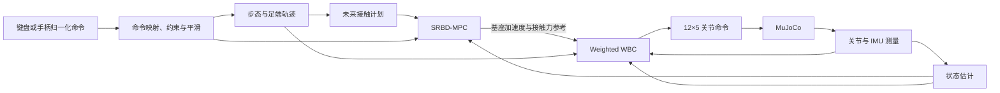
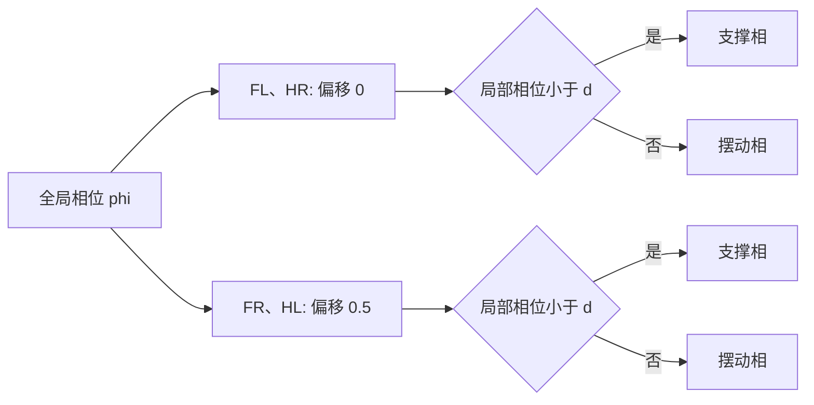
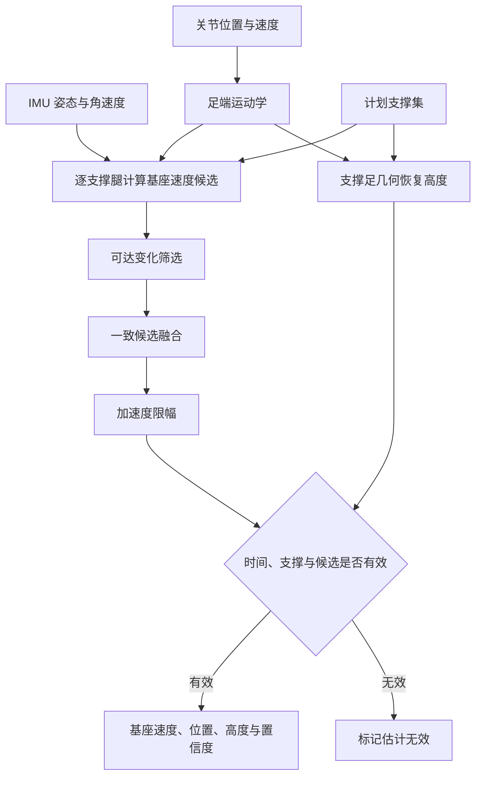
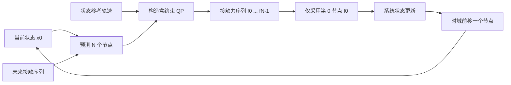
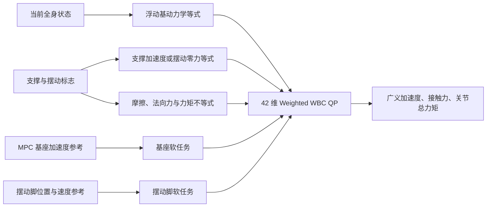
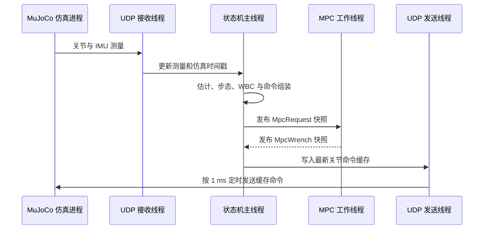

# Lite3 四足机器人 MPC+WBC 运动控制原理与工程实现

## 前言

本文是面向 Lite3 四足机器人的 MPC+WBC 运动控制教程，系统阐述从浮动基多刚体建模、步态与足端轨迹规划、基座状态估计，到单刚体模型预测控制（SRBD-MPC）和加权全身控制（Weighted WBC）的完整方法。文中公式、算法步骤与程序接口均以本工程当前代码为依据，使理论推导能够与具体实现逐项对应。

本文的实现范围是 MuJoCo 平地环境中的对角小跑（trot）。系统接收机体系纵向速度、横向速度和偏航角速度指令，输出 12 个关节的位置增益、目标位置、速度增益、目标速度与前馈力矩。本工程不包含真机驱动、实时总线和真机安全链路，因而文中参数及结论仅适用于当前仿真模型。

### 学习目标

完成本文的学习后，读者应能够：

1. 建立 Lite3 的足端运动学与浮动基全身动力学模型；
2. 解释步态相位、足端轨迹和未来接触序列之间的关系；
3. 理解基于支撑足零速约束的基座状态估计方法；
4. 推导 SRBD-MPC 的离散预测模型、代价函数与接触力约束；
5. 建立 Weighted WBC 的决策变量、硬约束和加权软任务；
6. 沿着本工程的数据流，完成从测量量到关节控制命令的代码阅读与调试。

### 阅读前提与代码范围

读者宜具备线性代数、刚体运动学、多刚体动力学、二次规划和现代控制的基础知识。文中主要对应 `mpc_wbc/00～07`、`state_machine/mpc_control_state.hpp`、C++ 仿真接口以及 Python MuJoCo 仿真程序。数学符号与代码变量的对应关系见附录 B。

---

## 第 1 章 控制问题与系统架构

本章首先定义 Lite3 的浮动基系统特性，然后分析 MPC 与 WBC 在分层控制架构中的功能分工，并给出工程数据流。

### 1.1 浮动基多刚体系统特性

Lite3 有四条腿，每条腿包含 HipX、HipY、Knee 三个主动关节，共 12 个驱动关节。机身在空间中具有 6 个自由度，但没有直接驱动机身的执行器，因此整机属于浮动基系统。

本工程使用的广义速度排列为

$$
\mathbf{v}=
\begin{bmatrix}
{}^{W}\mathbf{v}_B\\
{}^{B}\boldsymbol\omega_B\\
\dot{\mathbf q}
\end{bmatrix}
\in\mathbb R^{18},
$$

其中 ${}^{W}\mathbf v_B$ 是世界系基座线速度，${}^{B}\boldsymbol\omega_B$ 是机体系角速度，$\mathbf q\in\mathbb R^{12}$ 是关节角。相应的广义加速度按

$$
\dot{\mathbf v}=
\begin{bmatrix}
{}^{W}\mathbf a_B\\
{}^{B}\boldsymbol\alpha_B\\
\ddot{\mathbf q}
\end{bmatrix}
$$

排列。“世界系线速度 + 机体系角速度”的混合表达被用于运动学、动力学、状态估计、MPC 与 WBC。各模块必须严格保持坐标表达一致；若需要变换坐标系，必须显式乘以相应的旋转矩阵。

### 1.2 MPC 与 WBC 的功能分工

四足运动控制可以分成两个互补问题：

1. MPC 根据当前质心状态、速度指令和未来接触序列，在有限预测时域内求解支撑脚接触力，使机身的位置、速度、高度与姿态跟踪参考轨迹。
2. WBC 在单个控制周期内引入完整浮动基动力学，将 MPC 生成的基座加速度参考、摆动脚轨迹和接触约束统一表示为二次规划问题，并求解广义加速度、足端接触力以及 12 个关节的总力矩。

该架构形成两个时间尺度：MPC 以较低频率计算中短期运动趋势，WBC 以较高频率处理全身动力学协调和瞬时约束。步态模块为两者生成具有一致时基的足端轨迹与接触序列，状态估计器则提供在线基座状态。

| 对比项 | SRBD-MPC | Weighted WBC |
| --- | --- | --- |
| 主要目标 | 预测未来质心与姿态运动 | 实现当前控制周期的全身协调 |
| 主要模型 | 单刚体动力学 | 完整浮动基多刚体动力学 |
| 决策量 | 未来支撑脚接触力 | 广义加速度、接触力与关节力矩 |
| 时间范围 | $N=10$ 个节点，约 0.5 s | 当前单个控制周期 |
| 默认更新节拍 | 名义频率约 20 Hz | 随新仿真状态更新，约 1 kHz |
| 向下游提供 | 基座加速度和逐脚力参考 | 关节总力矩 |

### 1.3 系统数据流

状态机入口位于 [mpc_control_state.hpp](../state_machine/mpc_control_state.hpp)。该文件完成仿真接口适配、控制状态生命周期管理与线程启停；[07_mpc_wbc_controller.hpp](../mpc_wbc/07_mpc_wbc_controller.hpp) 完成各算法模块的数据组织与调度。

---

## 第 2 章 坐标、关节和接口约定

坐标系、向量排列与单位是多模块控制系统的基础约定。任何隐式的坐标变换或顺序不一致，都可能使数学上正确的控制律产生错误输出。本章给出后续推导和代码实现共同遵循的约定。

### 2.1 坐标系

- 世界系 $W$：固定在地面，$z$ 轴向上。
- 机体系 $B$：固定在机身，$x$ 向前、$y$ 向左、$z$ 向上。
- $\mathbf R_{WB}$：把机体系向量旋转到世界系，即 ${}^{W}\mathbf x=\mathbf R_{WB}{}^{B}\mathbf x$。
- 姿态输入使用 ZYX 欧拉角 $[\mathrm{roll},\mathrm{pitch},\mathrm{yaw}]$。

| 物理量 | 表达坐标系 | 主要使用模块 |
| --- | --- | --- |
| 基座位置 ${}^{W}\mathbf p_B$ | 世界系 | 状态估计、MPC |
| 基座线速度 ${}^{W}\mathbf v_B$ | 世界系 | 状态估计、MPC、WBC |
| 基座角速度 ${}^{B}\boldsymbol\omega_B$ | 机体系 | IMU、MPC、WBC |
| 足端位置 ${}^{B}\mathbf p_{f_i}$ | 机体系 | 正逆运动学、步态规划 |
| 足端接触力 ${}^{W}\mathbf f_i$ | 世界系 | MPC、WBC |

由于偏航角的主值区间为 $[-\pi,\pi]$，直接对主值角求差会在边界处产生近 $2\pi$ 的不连续误差。本实现将偏航角测量展开为连续角，并独立积分偏航角参考，从而保持偏航误差的连续性。

### 2.2 腿和关节顺序

四腿顺序固定为

$$
[\mathrm{FL},\mathrm{FR},\mathrm{HL},\mathrm{HR}],
$$

每腿关节顺序为

$$
[\mathrm{HipX},\mathrm{HipY},\mathrm{Knee}].
$$

整机 12 维关节向量按四腿依次拼接。足端位置、足端速度、接触状态和接触力也必须使用同一腿序。

### 2.3 控制输入和输出

用户输入首先表示为归一化命令，再映射为物理速度

$$
\mathbf u=[v_x,v_y,\omega_z]^T,
$$

其中 $v_x>0$ 为前进，$v_y>0$ 为左移，$\omega_z>0$ 为左转。

控制器向仿真端发送 $12\times5$ 矩阵，每行对应一个关节，五列为

$$
[k_p,\ q_{des},\ k_d,\ \dot q_{des},\ \tau_{ff}].
$$

仿真端按

$$
\tau_{cmd}=k_p(q_{des}-q)+k_d(\dot q_{des}-\dot q)+\tau_{ff}
$$

计算执行器命令，然后由 MuJoCo 执行器范围进行最终限幅。

---

## 第 3 章 Lite3 运动学与全身动力学

本章建立单腿正逆运动学、足端雅可比矩阵与浮动基全身动力学。这些模型是足端轨迹生成、状态估计和 WBC 约束构造的共同基础。对应实现集中在 [00_lite3_model.hpp](../mpc_wbc/00_lite3_model.hpp)。

### 3.1 单腿正运动学

令单腿关节角为

$$
\mathbf q_i=[q_{x,i},q_{y,i},q_{k,i}]^T,
$$

大腿和小腿长度分别为 $l_1,l_2$。在矢状平面内，足端相对髋部的前后和竖直坐标为

$$
\begin{aligned}
x_i &=l_1\sin q_{y,i}+l_2\sin(q_{y,i}+q_{k,i}),\\
z_i &=-l_1\cos q_{y,i}-l_2\cos(q_{y,i}+q_{k,i}).
\end{aligned}
$$

加入左右腿侧向偏置 $s_i d$ 和 HipX 旋转后，球心机体系位置为

$$
{}^{B}\mathbf p_{f_i}
={}^{B}\mathbf p_{h_i}
+\mathbf R_x(-q_{x,i})
\begin{bmatrix}x_i\\s_i d\\z_i\end{bmatrix}.
$$

代码中的 `FootPositionBody()` 实现该计算，返回球足中心而非球足最低接触点。

### 3.2 逆运动学

`InverseKinematics()` 根据目标球心位置求解关节角。求解过程首先在 $y$-$z$ 平面计算 HipX 的两个候选分支，然后将目标位置旋转回腿部矢状平面，并依据余弦定理求解 HipY 与 Knee。

平面两连杆距离为 $\rho$ 时，膝关节满足

$$
\cos q_k=\frac{\rho^2-l_1^2-l_2^2}{2l_1l_2}.
$$

为保证数值可解性，程序将距离和反余弦函数的输入限定在合法区间内，并以前一控制周期的目标关节角作为连续性参考，从两个 HipX 分支中选取距离较小的解。该方法可降低逆运动学分支切换所引起的关节目标不连续；最终结果仍须满足关节位置限制。

### 3.3 足端雅可比

单腿球心速度满足

$$
{}^{B}\dot{\mathbf p}_{f_i}=\mathbf J_i(\mathbf q_i)\dot{\mathbf q}_i.
$$

当前单腿雅可比由正运动学中心差分计算。完整世界系足端速度还包含基座平移和转动：

$$
{}^{W}\mathbf v_{f_i}
={}^{W}\mathbf v_B
-\mathbf R_{WB}[{}^{B}\mathbf p_{f_i}]_\times{}^{B}\boldsymbol\omega_B
+\mathbf R_{WB}\mathbf J_i\dot{\mathbf q}_i.
$$

WBC 使用的是球足最低接触点雅可比。该点相对球心沿世界系 $-z$ 偏移一个足端半径，因此它与规划球心雅可比有明确区别。

### 3.4 浮动基动力学

整机动力学写为

$$
\mathbf M(\mathbf q)\dot{\mathbf v}+\mathbf h(\mathbf q,\mathbf v)
=\mathbf S^T\boldsymbol\tau+\mathbf J_c^T\mathbf f,
$$

其中：

- $\mathbf M\in\mathbb R^{18\times18}$ 为质量矩阵；
- $\mathbf h\in\mathbb R^{18}$ 包含重力、科氏和离心项；
- $\mathbf S=[\mathbf0_{12\times6}\ \mathbf I_{12}]$ 为关节选择矩阵；
- $\boldsymbol\tau\in\mathbb R^{12}$ 为关节总力矩；
- $\mathbf J_c\in\mathbb R^{12\times18}$ 为四个接触点雅可比；
- $\mathbf f\in\mathbb R^{12}$ 为四脚世界系接触力。

`MassMatrix()` 通过累加各刚体质心线动能与转动动能对广义速度的二次型贡献，构造整机质量矩阵。偏置力项 $\mathbf h$ 通过刚体树的速度与加速度递推获得：首先计算各刚体的惯性力和惯性矩，然后将其投影至广义坐标空间。

接触点加速度为

$$
\mathbf a_c=\mathbf J_c\dot{\mathbf v}+\dot{\mathbf J}_c\mathbf v.
$$

`ContactBiasAccel()` 通过沿当前关节速度和机身角速度前后推进极小时间，对接触雅可比做中心差分，计算 $\dot{\mathbf J}_c\mathbf v$。WBC 的支撑约束和摆动任务均同时使用 $\mathbf J_c\dot{\mathbf v}$ 与该偏置项。

### 3.5 整机质心与转动惯量

SRBD-MPC 需要当前整机质心和绕质心惯量。模型按所有刚体质量加权计算机体系质心，并用平行轴定理把各刚体惯量合成为整机惯量，再按姿态旋转到世界系。

---

## 第 4 章 步态调度与足端轨迹

步态调度器决定各腿的支撑相与摆动相，足端轨迹规划器则在相位约束下生成位置和速度参考。对应实现位于 [02_gait_trajectory.hpp](../mpc_wbc/02_gait_trajectory.hpp)。本工程采用对角小跑步态：FL 与 HR 同相，FR 与 HL 同相，两组对角腿之间相差半个步态周期。

### 4.1 相位与接触状态

全局相位可写为

$$
\phi(t)=\operatorname{frac}\left(\frac{t-t_0}{T}\right).
$$

第 $i$ 条腿加入相位偏移 $\delta_i$：

$$
\phi_i=\operatorname{frac}(\phi+\delta_i).
$$

支撑占空比为 $d$ 时，$\phi_i<d$ 判为支撑相，其余为摆动相。未来接触表使用同一相位源生成，供 MPC 预测时域使用，因此当前 WBC 接触集、足端轨迹和 MPC 接触计划保持一致。

对角小跑的相位分组如下表所示。表中“支撑”与“摆动”由各腿局部相位 $\phi_i$ 和占空比 $d$ 判定，并不意味着每相恰好占半个周期。

| 对角腿组 | 腿 | 相位偏移 $\delta_i$ | 局部相位 | 接触判定 |
| --- | --- | ---: | --- | --- |
| A 组 | FL、HR | $0$ | $\phi_i=\operatorname{frac}(\phi)$ | $\phi_i<d$ 时支撑 |
| B 组 | FR、HL | $0.5$ | $\phi_i=\operatorname{frac}(\phi+0.5)$ | $\phi_i<d$ 时支撑 |

### 4.2 分段步态

系统以三轴归一化速度中的最大分量确定主导运动方向，并根据该方向的物理速度选择低速、中速或高速参数。在分段边界附近，系统对参数进行平滑插值。默认闭环参数如下：

| 速度段 | 周期 $T$ | 占空比 $d$ | 抬脚高度 $H$ |
| --- | ---: | ---: | ---: |
| 低速 | 1.20 s | 0.72 | 0.07 m |
| 中速 | 0.75 s | 0.70 | 0.07 m |
| 高速 | 0.44 s | 0.625 | 0.10 m |

分界附近使用平滑插值；改变周期时重新计算起始时间，保持相位连续。完整速度分界和设计范围见 [00_Lite3 四足狗运动控制设计指标.md](<00_Lite3 四足狗运动控制设计指标.md>)。

### 4.3 支撑相与摆动相轨迹

足端标称位置由默认站姿正运动学得到，并整体沿机体系 $x$ 方向调整，以平衡前后腿负载。

给定机体系平移速度 $\mathbf v=[v_x,v_y,0]^T$ 和偏航角速度 $\boldsymbol\omega=[0,0,\omega_z]^T$，位于 $\mathbf p_i$ 的足端相对机身水平速度近似为

$$
\mathbf v_{rel,i}=\mathbf v+\boldsymbol\omega\times\mathbf p_i.
$$

支撑相让足端目标相对机身向后扫，摆动相从后端移动到前端，并使用平滑曲线抬高球心。轨迹模块同时输出目标位置和目标速度，位置用于 IK，位置与速度共同用于 WBC 摆动脚任务。

### 4.4 起步与平滑停步

若从静止状态直接切换到完整步幅，足端参考会产生不连续变化。为此，实现中引入步态运行状态与轨迹缩放系数：

- 起步时由当前实际足位向规划轨迹混合；
- 停步请求出现后逐步缩小水平步幅；
- 等待合适的全支撑相位后退出步态；
- MPC 速度参考使用相同的停步缩放系数，使足端水平轨迹与机身速度参考同步收敛至零。

---

## 第 5 章 基座状态估计

基座位置、速度和姿态是 MPC 与 WBC 的关键反馈量。本工程不直接使用 MuJoCo 提供的基座真值，而是依据 IMU、关节状态与计划支撑腿的运动学约束估计基座速度和高度。对应实现位于 [01_state_estimator.hpp](../mpc_wbc/01_state_estimator.hpp)。

### 5.1 支撑腿零速假设

理想无滑移支撑脚满足

$$
{}^{W}\mathbf v_{f_i}=\mathbf0.
$$

将足端速度公式移项，可以从每条计划支撑腿得到一个基座线速度候选：

$$
{}^{W}\mathbf v_B^{(i)}
=-\left(\mathbf J_{c,i}^{\omega}{}^{B}\boldsymbol\omega_B
+\mathbf J_{c,i}^{q}\dot{\mathbf q}\right).
$$

由于足端滑移、接触切换和模型误差，不同支撑脚得到的速度候选值可能存在明显差异。估计器首先根据相对前一控制周期速度的可达变化范围筛选候选值；随后选取与其他候选值总距离最小的代表值，并融合与该代表值一致的支撑腿结果。

### 5.2 速度限幅和高度恢复

速度变化量限制为

$$
\lVert\Delta\mathbf v_B\rVert\le a_{max}\Delta t.
$$

当速度变化超过上式约束时，估计值沿候选速度方向限幅更新。该处理既可抑制足端触地瞬间引起的速度尖峰，又能保留对持续速度变化的跟踪能力。

平地条件下，第 $i$ 个可靠支撑球心给出的基座高度为

$$
h_i=r_f-\left(\mathbf R_{WB}{}^{B}\mathbf p_{f_i}\right)_z,
$$

其中 $r_f$ 为球足半径。对多个一致支撑腿给出的高度取算术平均，并可选择低通滤波以减小高频波动。世界系 $x,y$ 位置由估计速度积分得到，仅服务于 MPC 的相对运动预测，不具备全局定位功能。

### 5.3 有效性与置信度

估计结果只有在时间增量合法、存在可靠支撑、高度可恢复且速度候选一致时才标记为有效。控制器还记录参与融合的支撑腿数量和置信度。MPC 请求在估计无效或无支撑时不求解，WBC 首次使能也要求有效估计和至少一条可靠支撑腿。

状态估计的数据处理顺序可概括为：

---

## 第 6 章 SRBD-MPC

模型预测控制通过在有限时域内显式预测系统状态，将跟踪性能、接触时序和地面作用力约束统一到优化问题中。本工程的 SRBD-MPC 使用单刚体模型预测质心、姿态和角速度，并以未来各预测节点上的支撑脚接触力作为决策变量。对应实现位于 [05_srbd_mpc.hpp](../mpc_wbc/05_srbd_mpc.hpp)。

### 6.1 单刚体模型

平动动力学为

$$
m\ddot{\mathbf p}=\sum_i\mathbf f_i+m\mathbf g.
$$

绕质心转动动力学为

$$
\mathbf I\dot{\boldsymbol\omega}
+\boldsymbol\omega\times(\mathbf I\boldsymbol\omega)
=\sum_i(\mathbf p_{f_i}-\mathbf p_c)\times\mathbf f_i.
$$

QP 预测使用 12 维状态

$$
\mathbf x=
\begin{bmatrix}
\mathbf p_c & \mathbf v_c & \boldsymbol\Theta & {}^{B}\boldsymbol\omega
\end{bmatrix}^T,
$$

其中 $\boldsymbol\Theta$ 为 ZYX 欧拉角。位置和速度在世界系表达，角速度在机体系表达。接触力矩先在世界系通过世界系惯量得到角加速度，再旋回机体系角速度通道，这是保持坐标一致的关键。

### 6.2 摩擦锥生成变量

在每个预测节点上，算法仅为计划支撑脚建立决策变量。单脚接触力使用四个非负生成系数表示：

$$
\mathbf f_i=\sum_{g=1}^{4}\lambda_{i,g}\mathbf d_g,
\qquad \lambda_{i,g}\ge0,
$$

四个生成方向为

$$
(\mu,0,1),\ (-\mu,0,1),\ (0,\mu,1),\ (0,-\mu,1).
$$

由于 $\lambda_{i,g}\ge 0$，上述生成形式直接保证 $f_z\ge0$ 且接触力位于摩擦金字塔内。每个 $\lambda$ 同时受盒约束上界限制，从而限制单脚法向接触力。摆动脚不建立接触力决策变量，因而其预测接触力为零。

### 6.3 离散预测与目标函数

当前预测节点数 $N=10$，节点间隔 $\Delta t=0.05$ s，对应约 0.5 s 的预测范围。离散系统写为

$$
\mathbf x_{k+1}=\mathbf A\mathbf x_k+\mathbf B_k\boldsymbol\lambda_k+\mathbf c_g.
$$

将所有接触力变量对未来状态的影响递推展开，可得

$$
\mathbf X=\mathbf X_{free}+\mathbf S\boldsymbol\lambda.
$$

参考轨迹由当前状态与指令速度生成：水平质心位置按线速度积分，竖直位置保持目标质心高度，roll 和 pitch 参考设为零，yaw 参考按偏航角速度连续积分。代价函数为

$$
J=\frac12\sum_{k=1}^{N}
(\mathbf x_k-\mathbf x_k^{ref})^T\mathbf W
(\mathbf x_k-\mathbf x_k^{ref})
+\frac12r_\lambda\lVert\boldsymbol\lambda\rVert^2.
$$

代入状态展开后得到盒约束 QP：

$$
\min_{\boldsymbol\lambda}
\frac12\boldsymbol\lambda^T\mathbf H\boldsymbol\lambda
+\mathbf g^T\boldsymbol\lambda,
\qquad
\mathbf l\le\boldsymbol\lambda\le\mathbf u.
$$

[03_box_qp.hpp](../mpc_wbc/03_box_qp.hpp) 负责求解，并使用上一时域按节点移位后的结果作为热启动初值。

图中展示了滚动时域的基本过程。每次求解优化问题都会获得一整段未来接触力序列，但控制器仅使用第一个节点；新状态到达后，预测时域向前移动并重新求解。

### 6.4 MPC 输出

根据滚动时域控制原理，每次求解仅执行预测时域中第 0 个节点的接触力解。控制器由该节点的四脚接触力计算总合力与绕质心合力矩，并换算为 WBC 需要的世界系线加速度和机体系角加速度参考：

$$
{}^{W}\mathbf a_{des}=\frac{\sum_i\mathbf f_i}{m}+\mathbf g,
$$

$$
{}^{B}\boldsymbol\alpha_{des}
=\mathbf R_{WB}^T\mathbf I_W^{-1}
\left(\sum_i\mathbf r_i\times\mathbf f_i
-\text{角动量耦合项}\right).
$$

程序同时保存各足接触力参考。由于当前默认配置将 WBC 的逐脚力跟踪权重设为零，MPC 结果在现行控制配置中主要通过基座加速度参考作用于 WBC。

---

## 第 7 章 Weighted WBC

全身控制的目标是在满足整机动力学与接触物理约束的条件下，协调基座运动、摆动脚跟踪与关节力矩输出。本工程的 Weighted WBC 将全身动力学、接触约束、摩擦条件和力矩限制定义为硬约束，将基座与摆动脚跟踪定义为加权软任务。对应实现位于 [06_weighted_wbc.hpp](../mpc_wbc/06_weighted_wbc.hpp)。

### 7.1 决策变量

QP 决策变量共 42 维：

$$
\mathbf z=
\begin{bmatrix}
\dot{\mathbf v}_{18}\\
\mathbf f_{12}\\
\boldsymbol\tau_{12}
\end{bmatrix}.
$$

决策变量中的 $\boldsymbol\tau$ 表示满足全身动力学的关节总力矩，其物理含义不同于最终 $12\times5$ 命令中的前馈力矩 $\tau_{ff}$。两者的转换关系见第 8.6 节。

| 决策变量块 | 维数 | 物理含义 |
| --- | ---: | --- |
| $\dot{\mathbf v}$ | 18 | 基座 6 维加速度与 12 维关节加速度 |
| $\mathbf f$ | 12 | 4 个足端的三维世界系接触力 |
| $\boldsymbol\tau$ | 12 | 12 个驱动关节的总力矩 |
| **合计** | **42** | WBC QP 的完整决策向量 |

### 7.2 硬等式约束

第一组等式是完整浮动基动力学：

$$
\mathbf M\dot{\mathbf v}-\mathbf J_c^T\mathbf f-\mathbf S^T\boldsymbol\tau=-\mathbf h.
$$

第二组等式按每条腿的接触状态选择：

- 支撑腿满足接触点加速度约束

$$
\mathbf J_{c,i}\dot{\mathbf v}
=-\dot{\mathbf J}_{c,i}\mathbf v
+\mathbf a_{feedback,i};
$$

- 摆动腿满足

$$
\mathbf f_i=\mathbf0.
$$

当前默认配置中，支撑足位置与速度反馈增益均为零，因而 $\mathbf a_{feedback,i}=\mathbf0$，支撑足实际执行刚性零加速度约束。

### 7.3 不等式约束

每条支撑腿的接触力满足摩擦金字塔：

$$
f_z\ge0,
\qquad |f_x|\le\mu f_z,
\qquad |f_y|\le\mu f_z.
$$

同时限制单脚法向力和关节力矩：

$$
f_z\le f_{z,max},
\qquad
-\tau_{max}\le\tau_j\le\tau_{max}.
$$

当前默认 $\mu=0.6$、$\tau_{max}=30$ N·m、单脚法向力上限 200 N。

### 7.4 加权软任务

WBC 目标函数由多项加权最小二乘任务组成：

$$
\min_{\mathbf z}
\frac12\sum_r w_r\lVert\mathbf A_r\mathbf z-\mathbf b_r\rVert^2
+\frac12\epsilon\lVert\mathbf z\rVert^2.
$$

主要任务如下。

基座加速度任务：

$$
\dot{\mathbf v}_{base}^{des}
=\begin{bmatrix}{}^{W}\mathbf a_{des}\\{}^{B}\boldsymbol\alpha_{des}\end{bmatrix}.
$$

摆动脚任务采用笛卡尔 PD 加速度：

$$
\mathbf a_{f_i}^{des}
=K_p(\mathbf p_{f_i}^{des}-\mathbf p_{f_i})
+K_d(\mathbf v_{f_i}^{des}-\mathbf v_{f_i}),
$$

而 QP 中的决策项是 $\mathbf J_i\dot{\mathbf v}$，因此右端必须减去偏置加速度：

$$
\mathbf J_i\dot{\mathbf v}
\approx\mathbf a_{f_i}^{des}-\dot{\mathbf J}_i\mathbf v.
$$

默认参数将基座任务权重设为 1，将摆动脚任务权重设为 100。较大的摆动脚权重用于提高足端轨迹跟踪精度。逐脚力跟踪、关节姿势任务和关节力矩正则项均作为可配置任务保留，在当前默认配置中关闭。

### 7.5 QP 求解与历史解处理

[04_qp_ipm.hpp](../mpc_wbc/04_qp_ipm.hpp) 采用原始—对偶内点法求解同时含有等式与不等式约束的 QP，并允许以前一控制周期的原始解作为初值。若当前周期求解失败，WBC 只在配置的短时有效期内返回历史解；超过有效期后，求解器返回失败状态，上层控制器随即转入关节位置 PD 降级模式并累计连续失败次数。

---

## 第 8 章 整机控制器集成

前述各章定义了建模、规划、估计与优化求解模块。整机控制器还需要完成命令处理、模块调度、线程通信、输出合成和故障降级。[07_mpc_wbc_controller.hpp](../mpc_wbc/07_mpc_wbc_controller.hpp) 实现的是这一控制集成层，并不引入独立的 MPC 或 WBC 数学模型。

### 8.1 进入 MPC 状态

状态机切入 MPC 后，`MPCControlState::OnEnter()` 完成：

1. 读取当前时间和关节角；
2. 调用控制器 `Reset()` 清除估计、步态、故障、WBC 旧解和 MPC 参考；
3. 记录当前关节角作为平滑接管起点；
4. 启动后台 MPC 工作线程；
5. 更新用户输入接口中的当前状态反馈。

控制器在初始 0.30 s 内将关节目标从进入状态时的实际角度平滑过渡至标准站姿，随后保持约 0.20 s 以完成稳定。在接管与稳定阶段，WBC 保持未使能状态。

### 8.2 命令处理

归一化用户输入首先根据步态调度器的全局上限映射为物理速度，随后按以下顺序进行处理：

1. 单轴上限：$|v_x|\le0.60$、$|v_y|\le0.50$、$|\omega_z|\le1.00$；
2. 平移标定补偿 `cmd_vel_trim`；
3. 组合约束 $\sqrt{v_x^2+v_y^2}+0.18|\omega_z|\le0.67$；
4. 一阶低通；
5. 线速度和角速度变化率限制。

处理后的同一速度参考供步态和 MPC 使用，避免两个模块追踪不同目标。

### 8.3 高频控制路径的单周期时序

每当接收到新的仿真时间戳，状态层执行一次高频控制更新，其计算顺序为：

1. 读取 IMU、关节位置和关节速度；
2. 更新命令约束、滤波和步态；
3. 根据当前计划支撑集更新状态估计；
4. 读取最近一次 MPC 快照；
5. 组装并求解当前控制周期的 WBC；
6. 生成 $12\times5$ 关节命令；
7. 写入 `SimulationInterface` 的最新命令缓存。

在同一控制周期内，高频路径调用 `BuildMpcRequest()` 发布 MPC 请求。请求包含最新状态估计、连续偏航角、质心高度参考、滤波后的速度指令与未来接触序列。

### 8.4 MPC 后台线程

后台线程通过序列锁快照读取最新的 `MpcRequest`，调用 `SolveWrench()` 完成优化求解，并发布 `MpcWrench`。默认情况下，线程在每次求解后休眠 0.05 s，因而名义更新频率约为 20 Hz。实际更新周期还包含优化求解耗时与操作系统线程调度延迟。

序列锁使用单写者、单读者的快照模式。写入过程开始时，序列号被置为奇数；写入完成后，序列号变为偶数。读取端分别在复制数据之前和之后读取序列号，仅当两次序列号相同且均为偶数时接受快照。该机制使高频线程无需阻塞等待 MPC，同时可避免读取处于写入中间状态的数据。

下图表示高频控制路径与 MPC 工作线程的异步关系。虚线返回表示快照数据交换，不表示主线程阻塞等待。

### 8.5 MPC 结果时效

高频控制路径优先使用当前有效且未超时的 MPC 结果；若当前求解不可用，则检查最近一次有效缓存。默认最大快照时效为 0.15 s。若不存在满足时效要求的参考，则将基座加速度参考置零；WBC 仍可依据当前硬约束与摆动脚任务继续求解。

### 8.6 从 WBC 总力矩到 12×5 命令

WBC 求得的 $\tau_{wbc}$ 是期望关节总力矩。由于仿真执行端还会计算关节 PD 力矩，控制器按下式计算前馈项：

$$
\tau_{ff}=\tau_{wbc}
-k_p(q_{des}-q)
-k_d(\dot q_{des}-\dot q)
$$

上式使前馈项抵消执行端在同一控制周期中产生的 PD 分量。当 $\tau_{ff}$ 未发生饱和且额外 PD 项关闭时，仿真执行端合成的总力矩等于 $\tau_{wbc}$。由于前馈力矩还受 WBC 关节力矩上限限制，饱和状态下的实际总力矩可能偏离 WBC 最优解。

若 WBC 未使能或当前控制周期求解失败，则令 $\tau_{ff}=0$，并将控制输出降级为关节位置 PD，以防止不可用的优化结果进入执行端。

---

## 第 9 章 状态机、仿真与时间关系

控制算法的动态性能不仅取决于数学模型，还受状态切换、通信节拍、仿真步长和执行端语义的共同影响。本章说明 MPC+WBC 控制器与外层状态机及 MuJoCo 仿真端之间的时序关系。

### 9.1 状态机职责

[state_machine.hpp](../state_machine/state_machine.hpp) 负责各控制状态的生命周期管理和转移判定，不参与 MPC 或 WBC 的数值求解。典型状态序列包括等待站立、站立过程、MPC 或 RL 控制、关节阻尼以及躺下。

MPC 状态中，用户按阻尼键、控制器故障锁存或姿态超过状态保护阈值时，状态机切入关节阻尼。RL 与 MPC 不直接互切，需要先阻尼并重新站立，或躺下后重新开始。

### 9.2 异步仿真通信

Python MuJoCo 仿真以 1 ms 步长推进，并通过 UDP 发送仿真测量。C++ `SimulationInterface` 的命令发送线程同样采用 1 ms 定时周期。若在相邻两次发送之间未生成新的控制命令，发送线程将保持并重复发送最近一条缓存命令。

状态机循环在每次轮询末尾休眠 500 μs，但仅当仿真时间戳更新时才执行当前控制状态。因此，500 μs 表示接收端的轮询间隔，并不表示固定的 2 kHz 控制频率。高频控制更新的实际节拍主要由约 1 kHz 的仿真状态到达频率决定。

### 9.3 MuJoCo 执行端

[mujoco_simulation.py](../interface/robot/simulation/mujoco_simulation.py) 完成以下工作：

- 加载 Lite3 MJCF 和平地环境；
- 在收到第一帧命令前用内部 PD 保持初始站姿；
- 接收 12×5 命令并计算 PD 加前馈力矩；
- 推进 MuJoCo、发送 IMU 和关节测量；
- 提供调试输出、CSV 日志、外力扰动和足端轨迹显示。

仿真器与控制器运行于两个独立进程，两者之间不存在严格的锁步机制，因而一条控制命令不一定与某一帧仿真测量一一对应。在调试与性能评估中，应同时考察优化求解结果、命令时效与单周期计算耗时。

---

## 第 10 章 故障处理与控制边界

优化控制器的输出依赖状态估计、接触计划和数值求解的有效性。工程实现必须对无效输入、超时结果和求解失败给出确定的降级策略。同时，读者需要区分仿真闭环验证结果与真机可部署性结论。

### 10.1 WBC 使能条件

WBC 首次使能要求：接管和稳定阶段结束、状态估计有效、至少存在一条可靠支撑腿、roll/pitch 在使能门限内。使能后允许估计或门控短时失效若干帧，避免接触切换瞬间频繁退出。

### 10.2 求解失败降级

- MPC 求解失败：在时效范围内使用最近有效参考；超出时效后将基座加速度参考置零。
- WBC 单周期求解失败：当前周期转入关节位置 PD 降级模式。
- WBC 连续失败达到阈值：锁存控制器故障，外层状态机转入阻尼。
- 姿态超过控制器故障阈值：锁存故障，保持最近关节目标并等待状态机切入阻尼。

上述“保持最近关节目标”仅是状态机完成降级转移前的短时过渡措施，不具备跌倒后姿态恢复或自主起身功能。

### 10.3 模型和算法近似

当前方法包含以下模型近似与适用边界：

1. MPC 使用单刚体模型，不预测各腿完整多刚体动力学。
2. 状态估计依赖计划支撑脚零速假设；足端滑移或计划接触与实际接触不一致将引入估计误差。
3. 摩擦锥用四边金字塔近似。
4. MPC 线性预测模型未将完整的非线性角动量耦合项直接纳入 QP，相关项仅用于诊断轨迹与输出换算。
5. WBC 使用加权软任务二次规划，各任务之间通过权重折中，未实现严格的层级优先级或零空间投影。
6. 球心轨迹、球足最低接触点和 MuJoCo 实际软接触位置是不同几何量。
7. 当前所有参数和设计指标仅针对本工程 MuJoCo 模型。

---

## 第 11 章 理论与代码的对照阅读

为建立从系统数据流到数值算法细节的认识，建议按以下顺序对照阅读：

| 顺序 | 文件 | 阅读重点 |
| ---: | --- | --- |
| 1 | [state_machine/mpc_control_state.hpp](../state_machine/mpc_control_state.hpp) | 外部测量到控制输入的映射、线程生命周期与命令发送 |
| 2 | [07_mpc_wbc_controller.hpp](../mpc_wbc/07_mpc_wbc_controller.hpp) | 高频控制路径、MPC 请求、降级逻辑与 $12\times5$ 命令组装 |
| 3 | [02_gait_trajectory.hpp](../mpc_wbc/02_gait_trajectory.hpp) | 步态相位、分段参数、足端轨迹和平滑停步 |
| 4 | [01_state_estimator.hpp](../mpc_wbc/01_state_estimator.hpp) | 支撑腿速度融合、基座高度和有效性 |
| 5 | [05_srbd_mpc.hpp](../mpc_wbc/05_srbd_mpc.hpp) | 预测模型、摩擦锥生成变量和盒约束 QP |
| 6 | [06_weighted_wbc.hpp](../mpc_wbc/06_weighted_wbc.hpp) | 42 维 QP、硬约束和软任务 |
| 7 | [00_lite3_model.hpp](../mpc_wbc/00_lite3_model.hpp) | 运动学、质量矩阵、偏置力、接触雅可比和质心惯量 |
| 8 | [03_box_qp.hpp](../mpc_wbc/03_box_qp.hpp)、[04_qp_ipm.hpp](../mpc_wbc/04_qp_ipm.hpp) | 两类 QP 的数值求解 |
| 9 | [simulation_interface.hpp](../interface/robot/simulation/simulation_interface.hpp)、[mujoco_simulation.py](../interface/robot/simulation/mujoco_simulation.py) | UDP 时序和执行器语义 |

工程目录和各文件职责见 [01_Lite3 四足狗运动控制工程结构.md](<01_Lite3 四足狗运动控制工程结构.md>)，速度范围和验收口径见 [00_Lite3 四足狗运动控制设计指标.md](<00_Lite3 四足狗运动控制设计指标.md>)。

---

## 附录 A：核心参数速查

| 参数 | 当前默认值 | 含义 |
| --- | ---: | --- |
| MPC 节点数 $N$ | 10 | 预测节点数量 |
| MPC 节点间隔 | 0.05 s | 预测离散步长 |
| MPC 工作线程休眠 | 0.05 s | 每轮求解后的休眠时间 |
| MPC 快照最大时效 | 0.15 s | 高频控制路径允许使用的 MPC 结果最大时间差 |
| 摩擦系数 $\mu$ | 0.6 | MPC/WBC 摩擦约束 |
| 单脚法向力上限 | 200 N | MPC/WBC 接触力限制 |
| 关节力矩上限 | 30 N·m | WBC 约束及前馈限幅 |
| 位置增益 $k_p$ | 100 | 关节位置 PD |
| 速度增益 $k_d$ | 2.5 | 关节速度 PD |
| WBC 基座任务权重 | 1 | 基座加速度跟踪 |
| WBC 摆动脚任务权重 | 100 | 摆动脚笛卡尔跟踪 |
| 命令低通时间常数 | 0.25 s | 速度指令平滑 |
| 线速度变化率上限 | 0.8 m/s² | 指令变化率限制 |
| 转向变化率上限 | 2.0 rad/s² | 指令变化率限制 |
| 接管时间 | 0.30 s | 当前关节角到站姿的平滑过渡 |
| 接管后稳定时间 | 0.20 s | WBC 使能前的保持时间 |

上表记录文档编写时的默认参数。由于参数可能随控制器标定而调整，进行实验复现与指标验收时，应核对源码中的实际配置、运行日志与 MuJoCo 模型参数。

## 附录 B：符号与代码对应

| 数学符号 | 代码中的主要对应项 |
| --- | --- |
| $\mathbf q,\dot{\mathbf q}$ | `ControllerInput::q`, `ControllerInput::dq` |
| $\mathbf R_{WB}$ | `RpyToRotation(rpy)`、`StateEstimate::R_WB` |
| $\mathbf M,\mathbf h$ | `Lite3Model::MassMatrix()`、偏置力计算 |
| $\mathbf J_c,\dot{\mathbf J}_c\mathbf v$ | `ContactJacobianWorld()`、`ContactBiasAccel()` |
| $\mathbf u=[v_x,v_y,\omega_z]$ | `GaitCommand` |
| 未来接触计划 | `MpcRequest::contact` |
| MPC 接触力变量 | `SrbdMpc::Solve()` 中的 `lambda` |
| MPC 快照 | `MpcWrench` |
| WBC 决策变量 | `[qdd; foot_force; tau]` |
| WBC 输出总力矩 | `WbcOutput::tau`、`ControllerOutput::tau_wbc` |
| 最终关节命令 | `ControllerOutput::joint_cmd` |
