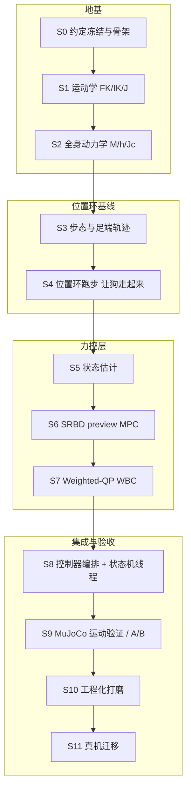

# Lite3 MPC + WBC 实现步骤与里程碑

> 本文是**施工图**：[`03_Lite3_MPC_WBC从理论到实现.md`](./03_Lite3_MPC_WBC从理论到实现.md) 讲清理论，[`02_MPC-WBC算法框架.md`](./02_MPC-WBC算法框架.md) 给出分层设计，本文把它们拆成**可以一步一步执行、每步都能编译和验证**的施工步骤。
> 工作方式：**每次只做一步**。每步必须交付「最小可编译增量 + 测试/对表结果 + 未解决问题」，通过该步的验收门槛后再进入下一步。不得用「仿真能动」跳过模型/估计/约束的数值验证。

---

## 0. 目标、边界与当前事实

### 0.1 目标

让 Lite3 在平地完成前进/后退/左右平移/原地旋转及三轴速度混合运动，采用**基于模型（MPC + WBC）**的控制方案，并与现有 ONNX 策略**互斥**运行：

- 输入：沿用 `interface/user_command/`（键盘/手柄）与 `UserCommand`。
- 输出：沿用 `interface/robot/robot_interface.h` 的 `SetJointCommand()`，即 **12×5** 矩阵，列顺序 `kp, q_des, kd, dq_des, tau_ff`。
- 算法：全部放在 [`mpc_wbc/`](../mpc_wbc/)；线程与机器人接口适配放在新增的 `state_machine/mpc_control_state.hpp`。
- 验证环境：MuJoCo 仿真与 Lite3 真机。

### 0.2 本工程已核对的事实（编写本文时用 MuJoCo 3.2.3 实测）

| 项目 | 实测值 | 影响 |
| --- | --- | --- |
| MJCF 维度 | `nq=19, nv=18, nu=12` | 浮动基 6 + 关节 12；WBC 决策 `qdd(18)+f(12)+τ(12)` |
| 整机质量 | **11.9376 kg** | SRBD/WBC 总质量基准 |
| 关节顺序 | `FL/FR/HL/HR × HipX/HipY/Knee` | 与 `custom_types.h`、SDK 顺序必须核对一致 |
| 电机 `ctrlrange` | 12 个均为 `[-30, 30] N·m` | 仿真力矩上限按 **30 N·m**；`ControlParameters` 的 `40/40/65` 是真机侧值，需另行核定 |
| 腿长（参数文件） | `hip_len=0.0985, thigh=0.20, shank=0.21 m` | 几何以 MJCF 对表结果为准，参数文件数值需逐一核对 |
| 工具链 | g++ 9.4.0（C++17）、CMake 3.16.3、Python `mujoco 3.2.3` | 可用 Python 侧 MuJoCo 做离线对表 oracle |

### 0.3 当前缺口（必须在施工中补上）

1. `mpc_wbc/` 目前只有 `README.md`，**没有任何算法代码或控制线程**。
2. `robot_interface.h` 的 `GetContactForce()` 在仿真与真机两端**均恒为零**；缺少可用基座位置/线速度/实测触地信息 → 需要状态估计器与有效性标志。
3. 现有状态机/接口/ONNX 线程**直接共享可变数据**，接入 MPC 时必须引入完整快照与单一命令写入权。

### 0.4 与参考工程的关系

主要参考：`/home/robot/pengyingjian_amp/fjksrobotics02_mpc-wbc/mpc_wbc/`（Fyscis02 主线为 **16 关节轮足**）。

- **只借鉴分层与算法结构**：`01` 步态调度、`02` 足端轨迹、`03` 运动学、`05` 全身动力学、`07` 质心预览 MPC、`09` Lite3 Weighted-QP WBC。
- **禁止直接移植**（详见 [`02`](./02_MPC-WBC算法框架.md) §8）：轮速/滚动/轮地滑移、Fyscis02 的质量与惯量、`07` 的「只输出净力」写法、`09` 省略 `Jdot·v` 的接触等式、`08_box_qp.hpp`（只能解盒约束 QP，不能承担 WBC）。
- 参考代码里的数值结论**不等于本工程已验证**；所有数值必须在本仓库 MJCF 对表后重新确定。

---

## 1. 施工原则

1. **每步一个最小可编译增量**：先骨架、后填空；任何时刻 `BUILD_SIM=ON` 都能编译，且不破坏 ONNX 路径。
2. **数值对表优先**：运动学/动力学一律以 MuJoCo 的 `mj_forward`/`mj_jacBody`/`mj_fullM`/`mj_rne` 为 oracle，达到 `1e-10` 量级才认可。
3. **单一命令写入权**：同一时刻只有一条运动控制路径（ONNX 或 MPC+WBC）写 `SetJointCommand()`。
4. **故障可降级**：求解失败/超时/NaN 时短期沿用「上次安全解」，超期立即进 `JointDamping`，绝不下发坏命令。
5. **参数显式标注来源**：区分「理论初值」「MuJoCo 标定值」「真机待定值」，不把仿真值当真机值。

---

## 2. 总路线图

文件与模块布局（沿用 [`02`](./02_MPC-WBC算法框架.md) §4 的职责边界）：

| 步骤 | 主要交付文件 | 参考（只借鉴结构） |
| --- | --- | --- |
| S0 | `mpc_wbc/00_lite3_model.hpp`(骨架)、`CMakeLists.txt` | — |
| S1 | `mpc_wbc/00_lite3_model.hpp`（运动学部分）+ 对表脚本 | `03_kinematics.*` |
| S2 | `mpc_wbc/00_lite3_model.hpp`（动力学部分） | `05_whole_body_dynamics.hpp`、附录 E |
| S3 | `mpc_wbc/02_gait_trajectory.hpp` | `01_trotgait_scheduler.*`、`02_trotfoot_trajectory.*` |
| S4 | 位置环接入（S8 前用临时测试入口/离线 harness） | `06_*` 的走路层 |
| S5 | `mpc_wbc/01_state_estimator.hpp` | — |
| S6 | `mpc_wbc/03_srbd_mpc.hpp`、`mpc_wbc/box_qp.hpp` | `07_srbd_mpc.*`、`04_srbd.hpp`、`08_box_qp.hpp` |
| S7 | `mpc_wbc/04_weighted_wbc.hpp/.cpp` | `09_weighted_wbc.*`、附录 D |
| S8 | `mpc_wbc/05_mpc_wbc_controller.hpp`、`state_machine/mpc_control_state.hpp` | `state_machine/mpc_control_state.hpp` |
| S9 | `state_machine/auto_test_runner.hpp`（或等价测试脚本） | 参考工程 `auto_test_runner.hpp` |
| S10 | 各模块参数与频率调整 | — |
| S11 | `interface/robot/hardware/` 核定 | — |

---

## 3. 分步施工清单

### 阶段 A：地基（先有模型，才有力控）

#### S0 约定冻结与骨架搭建（对应 P0）
- **目标**：冻结坐标/顺序/数据契约，搭出 `mpc_wbc/` 骨架并接入 CMake，**不改变 ONNX 行为**。
- **理论对应**：第 1.1 节（坐标约定）、第 3.2 节（广义速度约定）。
- **交付**：
  - `mpc_wbc/00_lite3_model.hpp`：只含常量与声明（关节索引、`nv=18`、`qvel=[v_world(3); ω_body(3); dq(12)]`、`S=[0₁₂ₓ₆ I₁₂]`）。
  - `CMakeLists.txt`：新增 `mpc_wbc` 静态库 target（暂不含实现也可先建空 target）。
  - `mpc_wbc/README.md` 更新为「施工进度」。
- **验收**：`cmake -DBUILD_SIM=ON .. && make` 通过；`rl_deploy` 行为与改动前一致。
- **风险**：关节顺序/坐标系约定一旦错，后面全错 → 本步就把 `nq/nv/nu`、关节名、`ctrlrange` 写进头文件注释并与 MJCF 实测对齐。

#### S1 运动学模型 FK / IK / 雅可比（对应 P1 前半）
- **目标**：实现单腿与全身运动学三件套。
  - FK：`q → feet_body(4×3)`（第 1.2 节）。
  - IK：`feet_body → q(12)`，几何法 + 数值保护裁剪（第 1.3 节：`ρ` 裁剪、`c_k` 裁剪到 `[-1,1]`，失败保留兜底角）。
  - 雅可比：单腿 `J_i(3×3)` 中心差分（第 1.4 节），全身足端雅可比 `J_all(12×18)`。
- **理论对应**：第 1 章。
- **交付**：`00_lite3_model.hpp` 运动学实现 + `mpc_wbc/test/`（或 `support/scripts/`）下的对表脚本。
- **验证方法**：Python MuJoCo 随机取若干「合理位姿」，用 `mj_forward`/`mj_jacBody(FOOT)` 生成 oracle，与 C++ 输出对比。
- **通过条件**：
  - 随机位姿下 FK 误差 `< 1e-9`；雅可比误差 `< 1e-8`。
  - IK：FK(IK(p)) 回代误差 `< 1e-6`；对不可达目标返回失败标志而非 NaN。
- **风险**：HipX 侧摆分支（取 `|q_x|` 较小解）；`*_FOOT` body 原点与球足触地点存在半径差 → 接触雅可比与视觉轨迹参考点分别标注。

#### S2 全身动力学 M(q) / h(q,dq) / Jc（对应 P1 后半）
- **目标**：
  - `M(q)`：逐刚体动能组装（第 3.4 节）。
  - `h(q,dq)`：RNEA（第 3.5 节 + 附录 E），含重力、科氏、离心。
  - `Jc(12×18)`：四脚接触雅可比（第 3.6 节）。
- **理论对应**：第 3 章、附录 E。
- **交付**：`00_lite3_model.hpp` 动力学实现 + 对表脚本。
- **验证方法**：对照 `mj_fullM`、`mj_rne`（`qfrc_bias`）、`mj_jac`。
- **通过条件**：`M` 与 `mj_fullM` 误差 `~1e-10`；`h` 纯重力 `~1e-14`、含速度 `~1e-11`；`M` 对称正定；整机质量 `≈11.9376 kg`。
- **风险（两个历史大坑）**：① 角速度在 body 系，基座列是 `R` 而非单位阵；② 每个量所在坐标系/参考点必须写清。

### 阶段 B：位置环基线（先把「会走」变成测试平台）

#### S3 步态与足端轨迹（对应 P3）
- **目标**：trot 相位、支撑/摆动目标位置、未来接触表。
- **理论对应**：第 2.1、2.2 节。
- **交付**：`mpc_wbc/02_gait_trajectory.hpp`。
- **参数初值**（附录 C，需后续标定）：周期 `T≈0.60 s`、占空比 `d≈0.68`、抬脚 `0.06 m`、步长 `(0.10, 0.035) m`；相位偏移 `FL=HR=0`、`FR=HL=0.5`。
- **通过条件**：
  - 相位 / 当前支撑集 / 未来支撑表三者一致；MPC/WBC/轨迹共用**同一相位源**。
  - 零命令停步（四足静立，不持续踏步）。
  - 六种单轴及混合命令下足目标连续、可达、不越关节限位；摆动相用水平五次曲线 `s(φ)=10φ³−15φ⁴+6φ⁵` + 竖直 `h sin²(πφ)`，起落速度/加速度为 0。
- **风险**：落脚点在机身系「强行匀速后扫」是错的 → 支撑腿锁世界系锚点。

#### S4 位置环跑步（对应 M0/M1，理论 2.3）
- **目标**：用「步态 + 足端轨迹 + IK + 关节 PD」让 Lite3 在 MuJoCo **走起来**，作为可量化基线测试平台。
- **交付**：可运行的位置环运动入口（S8 前可用独立离线/测试入口，不污染 ONNX 路径）。
- **参数初值**：`kp=100, kd=2.5`（运行可 scale `0.4~0.5`）；关节速度限幅 `6 rad/s`；命令死区 `0.06`、斜坡 `2.5 /s`。
- **通过条件**：MuJoCo 平地六方向能走、不跌倒；为后续力控提供对照基线。
- **风险**：位置环不知动力学，强动态会晃 → 这正是 S5–S7 存在的理由。

### 阶段 C：力控层

#### S5 状态估计（对应 P2）
- **目标**：基座速度/高度估计 + 接触可信度。
- **理论对应**：第 2.3、6 章；[`02`](./02_MPC-WBC算法框架.md) §5.1。
- **交付**：`mpc_wbc/01_state_estimator.hpp`。
- **方法**：支撑腿零速假设 `v_foot^W≈0` → `v_base^W` 稳健平均；IMU 加速度短时传播校正；高度由地面 `z=0` 与支撑足 FK 恢复；平面位置短时积分 + 足端世界锚点持续更新。摆动腿不参与零速更新。
- **通过条件**：仿真静立/缓慢移动下与 MuJoCo 真值对比误差可接受；断包/全摆动/滑移能标记 **无效**；真值只进日志，**不进算法分支**。
- **风险**：当前 `GetContactForce()` 恒零 → 初期由「计划支撑相 + 运动学残差」估计接触；MuJoCo 接触真值仅用于对比。

#### S6 SRBD preview MPC（对应 P4，理论第 4 章）
- **目标**：把「单步跟踪」升级成「N 步预测」，输出**逐脚力**（及基座期望加速度）。
- **理论对应**：第 4 章、附录 C/D。
- **交付**：`mpc_wbc/03_srbd_mpc.hpp/.cpp`。
- **形式**：状态 `x=[p_c^W(3), v_c^W(3), 姿态误差(3), ω^B(3)]`，决策为每预测节点四脚世界系接触力 `f_{i,k}^W∈R³`；在当前测量附近线性化/离散化质心动力学。
- **参数初值**：`N=10, Δt=0.05 s`；权重 `q_p_xy=10, q_p_z=200, q_v=10`；求解缓存 `20 Hz`。
- **约束**：摆动足 `f_i=0`；支撑足 `0≤f_z≤f_z,max`、`|f_x|≤μ f_z`、`|f_y|≤μ f_z`；`μ≈0.6`。
- **通过条件**：静立总支撑力 `≈ mg`；摆动足力为零、摩擦/法向约束满足；每帧结果有限且耗时有记录；前/后/侧/转向响应方向正确；失败可报告并短期沿用有效解。
- **风险**：参考 `07` 只做质心 `p/v` 预览并输出**净力**，作为阶段验收可用，但**不能**当成完整姿态 MPC；要接 WBC 必须输出**逐脚力**。

#### S7 Weighted-QP WBC（对应 P5，理论第 5 章 + 附录 D）
- **目标**：单个加权 QP 求 `z=[qdd(18); f(12); τ_total(12)]∈R^42`。
- **理论对应**：第 5 章、附录 D。
- **交付**：`mpc_wbc/04_weighted_wbc.hpp/.cpp`（含求解器适配）。
- **硬约束**：浮动基动力学等式 `M·qdd − J_allᵀ·f − Sᵀ·τ = −h`（固定 18 行）；支撑足无滑 `J_i·qdd + Jdot_i·v = a_contact_des`（**不得省略 `Jdot·v`**）；摆动足 `f_i=0`；摩擦金字塔（每腿 5 行）；总力矩/关节限幅用变量上下界。
- **软任务**：① MPC 第 0 节点逐脚力跟踪（`w_f_ref=0` **默认关**，参考工程实测会拉偏平衡）；② 基座 6D 线/角加速度跟踪（`w_base=1e3`）；③ 摆动足 `a_des + Kp(p_des−p) + Kd(v_des−v)`（`w_swing=1e2, kp_swing=200, kd_swing=10`）；④ 接近名义站姿（`w_posture=0` **默认关**）与小幅力矩正则（`w_tau=0` **默认关**）。**默认关闭的三项都是「抢同一组关节/同一组力」的任务，实测打开会让主任务同时变差**（见 §8 S7 坑 3）。
- **固定行布局**：`18(EoM) + 每腿 3 行等式槽 + 每腿 5 行锥槽 + 4 行法向力上限 + 24 行力矩上下界`，尺寸不随支撑集变化 → 便于将来主动集热启动。
- **求解器选型（已决策）**：自研稠密原-对偶内点法（`mpc_wbc/qp_ipm.hpp`），**不引入 qpOASES**（LGPL-2.1，真机/闭源方向有传染风险）。`08_box_qp.hpp` 只能解盒约束 QP，**不承担 WBC**。代价：不支持热启动（S10 若要 1 kHz 需换主动集，见 §8 S7 边界）。
- **通过条件**：动力学/接触/摩擦残差在容差内；力矩不超过当前环境限值（仿真 `±30 N·m`）；QP 失败可报告且不发送坏命令；`Solve` 耗时有记录。
- **风险**：`τ_total` 与低层执行律 `τ_applied=kp(q_des−q)+kd(dq_des−dq)+tau_ff` 的关系 → 必须用**同一帧实测** `q,dq` 反解 `tau_ff = τ_total − kp(q_des−q) − kd(dq_des−dq)`，避免力矩重复。

### 阶段 D：集成与验收

#### S8 控制器编排 + 状态机线程（对应 P6）
- **目标**：把估计/步态/MPC/WBC 编排成无线程算法对象，并在状态机里加并列的 MPC 状态。
- **交付**：
  - `mpc_wbc/05_mpc_wbc_controller.hpp`：无 `StateBase` 继承、无线程、不直接调 `RobotInterface`；封装参数、IK 到 12×5 命令及故障状态；另含 `SeqLockBox` 快照与 `MpcWorkerThread`（供上层选配）。
  - `state_machine/mpc_control_state.hpp`：继承 `StateBase`，实现 `OnEnter/Run/LoseControlJudge/GetNextStateName/OnExit`，持有独立工作线程、完整快照、唯一 `SetJointCommand()` 写入权。
  - `state_machine/state_machine.hpp`：启动配置选择 `onnx` 或 `mpc_wbc`，把现有 `kRLControl` 路由指向选中状态（首版保留数值 6 与按键含义）。
- **线程契约**：状态估计/步态/WBC/命令发布目标 `500–1000 Hz`；MPC 每 `20–50 ms` 解一次；`MPCControlState::Run()` 发布**同一时间戳**快照，工作线程只处理新序号，拒绝重复/回退/过旧时间戳。`wrench_max_age=0.15 s`：过期即把 `a_des/α_des` 归零（原地保持），不重放旧 wrench。
- **通过条件**：`onnx` 与 `mpc_wbc` 启动选项互斥（选 MPC 时不构造 ONNX）；站起/趴下/阻尼与键盘/手柄仍可用；进入/退出时**无双写、无陈旧命令**（切换先 `join` 原线程再交出写入权）；离线自检（起立退让 / 使能滞回 / 安全退化 / MPC 降级 / 命令平滑 / 1 kHz 路径不阻塞）全绿。
- **风险**：现有 ONNX/接口/键盘线程共享可变数据 → 必须为两条路径都引入快照，不能只给新线程加锁。
- **本步实际边界**：**只保证编排/线程/安全退化与站立闭环**；trot 行走稳定性不作为本步通过条件，带实测数据移交 S9 第一项（见 §8 S8）。

#### S9 MuJoCo 运动验证 / A/B（对应 P7，理论 6.2）
- **目标**：7 段自动 A/B（对照 S4 位置环基线与 ONNX），量化力控收益。
- **交付（试验台已在 S9 第一步搭好）**：
  - 场景库 [`mpc_wbc/test/scenarios/`](../mpc_wbc/test/scenarios/)：`stand`、`axis_fwd/back/left/right`、`axis_fwd_long`、`turn_left/right`、`mix_diag`、`mix_yaw_fwd`、`stop_reverse`、`all_axes`、`heading_90`。文件只含**运动段**（`phase,duration,vx,vy,wz`），起立段由各 harness 自己拼 → 两条路径起点都是站姿、命令序列与时序一致。
  - 场景解析 [`mpc_wbc/apps/scenario_io.hpp`](../mpc_wbc/apps/scenario_io.hpp)，两个 harness 共用（`S8_PHASES=<file>` / `S9_SCENARIO=<file>`），内置预设保持原样以不破坏 S4/S8 已记录的结果。
  - 统一分析器 [`mpc_wbc/test/analyze_s9_run.py`](../mpc_wbc/test/analyze_s9_run.py)：逐段（命令帧内）位移/速度/角速度、姿态、力矩饱和占比、足端滑移、跌倒时刻；MPC 侧附求解侧指标。输出 JSON。
  - 试验台 [`mpc_wbc/test/run_s9_ab.sh`](../mpc_wbc/test/run_s9_ab.sh) + 报告 [`s9_ab_report.py`](../mpc_wbc/test/s9_ab_report.py) → `build/s9/report.md`。
  - 仿真日志扩列（`SIM_LOG`）：逐关节 `tau{i}`（PD+ff 未限幅）/`atau{i}`（限幅后实际力矩）、`fxall/fyall/fzall`（全部接触合力）、逐足接触力与足心位置；`SIM_INIT_YAW` 支持起始航向。**同时关闭 §7 第 5 项决策**（已能同时看到 `data.ctrl` 语义的未限幅值与夹取后实际值）。
- **场景**：平地单轴六方向、混合命令、停步/换向、不同起始航向。
- **通过条件**：不跌倒；速度符号与命令一致；无持续力矩饱和；记录轨迹、姿态、足端滑移、峰值力矩、求解时延，并与基线比较。
- **风险**：必须用**相同起点/地面/命令序列/日志格式**对照，否则比较无意义 —— 已由「共用场景文件 + 同一个仿真 + 同一套分析口径」约束住。
- **第一步（本步已完成）**：把试验台本身做扎实（可复现、可比、能自动出对照表），**行走稳定性的治疗放在下一步**，免得在口径不稳的情况下调参。

#### S10 工程化打磨（对应 M5）
- **目标**：提频、载荷分配、参考系与残余振荡。
- **内容**：
  - 热启动把 WBC 提到 `1 kHz`（参考：`Solve` 均值约 `0.17 ms`）。
  - 载荷分配：把 PD 降到合适（运行可 scale `0.4~0.5`），看 WBC 是否「顶得住」。
  - 参考系 DESREF：摆动脚目标**不跟随机身倾斜**（否则目标跟着歪）。
  - 排查 `fwd` 段 roll 极限环与 tilt 来源。
- **通过条件**：指标单调改善或可解释；无新增失控事件。
- **风险**：调参不改变结构，属「打磨」，必须在 S9 已通过后做。

#### S11 真机迁移（对应 P8）
- **目标**：从仿真走向真机。
- **内容**：核定 SDK 单位/顺序/限幅/实际力矩；保守参数；现场日志；先静立、再小幅运动，逐步扩展六方向与混合。
- **通过条件**：结果可复现、无未解释的限幅/失控事件；**每次试验保留紧急阻尼入口**。
- **风险**：真机限值不能沿用仿真 `±30 N·m` 或参数文件 `40/40/65`；`GetJointTorque()` 语义、IMU 坐标/单位需实测核对。

---

## 4. 关键数值速查（初值，全部待标定）

| 类别 | 量 | 初值 | 来源 |
| --- | --- | --- | --- |
| 机器人 | 自由度 / 质量 | 12 关节 + 6 浮动基 / 11.94 kg | MJCF 实测 |
| 几何 | 大腿 / 小腿 | 0.20 / 0.21 m | 参数文件（待 MJCF 核对） |
| 站立 | 默认站立角 / 高度 | `[0, −0.65, 1.3]×4` / 0.33 m | 文档初值 |
| 走路层 | 周期 / 占空比 | 0.60 s / 0.68 | 附录 C |
| 走路层 | 抬脚 / 步长 | 0.06 m / (0.10, 0.035) m | 附录 C |
| 走路层 | PD 增益 | kp 100 / kd 2.5（可 scale 0.4~0.5） | 附录 C |
| 走路层 | 命令死区 / 斜坡 / 关节速度限幅 | 0.06 / 2.5 per s / 6 rad/s | 附录 C |
| MPC | N / dt / 求解频率 | 10 / 0.05 s / 20 Hz | 附录 C |
| MPC | 权重 q_p_xy / q_p_z / q_v | 10 / 200 / 10 | 附录 C |
| WBC | 决策维度 / 约束行 | 42 / 50（18+4×3+4×5） | 附录 C |
| WBC | 任务权重 w_base / w_swing | 1e3 / 1e2 | 附录 C |
| WBC | 摆动脚 kp / kd | 200 / 10 | 附录 C |
| WBC | τ 限幅（真机参考） | HipX/HipY ±30、Knee ±60 N·m | 附录 C |
| 环境 | 摩擦系数 μ | 0.6 | 附录 C（待标定） |
| 仿真 | 电机 `ctrlrange` | ±30 N·m | MJCF 实测 |

> 说明：**仿真的有效力矩上限按更严格的 ±30 N·m 运行**；`ControlParameters` 的 `40/40/65` 只在真机核对后使用。

---

## 5. 验证基础设施（随 S1 一起建立）

1. **MuJoCo oracle 脚本**：加载 `robot_models/.../Lite3_flat.xml`，随机「合理位姿」导出 `mj_forward`/`mj_jacBody`/`mj_fullM`/`mj_rne` 结果到 JSON/CSV。
2. **C++ 对表程序**：读同一批位姿，输出本工程 FK/IK/J/M/h，逐项算误差并打印。
3. **闭环 A/B runner**：同一命令序列跑「位置环基线 / 力控 / ONNX」，输出统一格式日志与指标表。
4. **日志字段**（[`02`](./02_MPC-WBC算法框架.md) §6）：时间戳/序号、原始与限速后三轴命令、机身估计与有效性、四足计划/估计接触、足端目标/实际、MPC 逐脚力及耗时、WBC 力矩及残差、发送的 `kp,q_des,kd,dq_des,tau_ff`、估计/实际电机力矩与限幅事件。

---

## 6. 进度看板

| 步骤 | 内容 | 依赖 | 状态 |
| --- | --- | --- | --- |
| S0 | 约定冻结与骨架搭建 | — | ✅ 约定冻结 + CMake target 接入 |
| S1 | 运动学 FK/IK/雅可比 + 对表 | S0 | ✅ 通过（见 §8） |
| S2 | 全身动力学 M/h/Jc + 对表 | S1 | ✅ 通过（见 §8） |
| S3 | 步态与足端轨迹 | S2 | ✅ 通过（见 §8） |
| S4 | 位置环跑步（基线平台） | S3 | ✅ 通过（见 §8） |
| S5 | 状态估计 | S2,S4 | ✅ 通过（见 §8） |
| S6 | SRBD preview MPC | S3,S5 | ✅ 通过（见 §8） |
| S7 | Weighted-QP WBC | S2,S5,S6 | ✅ 通过（见 §8） |
| S8 | 控制器编排 + 状态机线程 | S4,S6,S7 | ✅ 通过（编排/线程/安全退化/站立；行走稳定性移交 S9，见 §8） |
| S9 | MuJoCo 运动验证 / A/B | S8 | 🟨 进行中（试验台已就绪：场景库 + 统一分析器 + `build/s9/report.md`；下一步治 trot 行走稳定性） |
| S10 | 工程化打磨 | S9 | ⬜ 未开始 |
| S11 | 真机迁移 | S9,S10 | ⬜ 未开始 |

> 状态图例：⬜ 未开始 / 🟨 进行中 / ✅ 已通过 / ⛔ 阻塞。每步完成后在此表更新，并记录「未解决问题」。

---

## 7. 待决策项（进入对应步骤前必须定）

1. **QP 求解器**（S7 前）：~~qpOASES / OSQP / ProxQP 的许可证、依赖、构建、ARM 可用性；`support/third_party/` 需新增哪一个。~~ → **已定：自研稠密原-对偶内点法**（`mpc_wbc/qp_ipm.hpp`，零第三方依赖）。理由：qpOASES 是 LGPL-2.1，本工程要往真机/闭源方向走，源码直链有传染风险；而 WBC 的 QP 只有 42 变量、30 等式 + 48 不等式，内点法每帧 ~10 次迭代、单帧 mean `0.39 ms`，够用。**代价**：内点法不支持热启动，S10 若要 1 kHz 需改成主动集 + 工作集缓存（见 §8 S7 边界）。
2. **接触估计来源**（S5 前）：计划支撑相 + 运动学残差是否足够；是否需要为 MuJoCo 增加向后兼容的真值诊断通道。
3. **姿态通道级别**（S6 前）：~~先做「只预测质心 p/v」的验收版，还是直接上「质心 + 姿态」完整版。~~ → **已定：直接上完整版**（状态 `[p,v,rpy,ω]`，输出逐脚力 + 净力/净力矩），见 §8 S6。
4. **状态/按键复用**（S8 前）：是否保留 `RLControlMode=6` 数值与按键语义（首版建议保留）。
5. **仿真力矩语义**（S7/S9 前）：~~记录 `data.ctrl` 与限幅后 `actuator_force`/`qfrc_actuator`，确认实际输出力矩。~~ → **已解决**（S9 试验台）：`SIM_LOG` 同时记录逐关节 `tau{i}`（`kp(qd−q)+kd(dq_d−dq)+τ_ff` 的未限幅计算值）与 `atau{i}`（`data.actuator_force`，即 `ctrlrange ±30` 夹取后**真正作用**的力矩），并另记 `fxall/fyall/fzall` 与逐足接触力/足心位置。实测站立段两者一致（`|τ|max = 6.8 N·m`，未触限）。注意 `SimulationInterface::GetJointTorque()` 回传的是**指令**力矩（仿真把 `input_tq` 原样塞回数据包，`mujoco_simulation.py` 的 `_send_robot_state`），不是实测值，所以判限幅只能用日志里的 `atau{i}`。
6. **trot 行走不稳的切入路线**（S9 第一项，须先定）：候选按「先排除外因、再动结构」排序 —— ① 支撑集时变：估计 `num_support` 在 1↔4 间抖动，先查是步态接触计划与测量不符、还是估计器残差阈值太松（S5 的已知缺口：`GetContactForce()` 恒零）；② 落脚点/抬脚高度（`抬脚 0.06 m`、`duty 0.68`）是否够避开落足冲击；③ MPC 退化点（`BoxQp` 2100 次迭代、残差 6e-5）如何保证「宁可不说」——失败时的降级策略已定为归零 `a_des`，但要确认归零本身是否成为激励源；④ 落足冲击 × 无滑硬约束的冲突（参考工程遗留同类问题）。

---

## 8. 步骤记录

### S8 控制器编排 + 状态机线程（✅ 通过；行走稳定性已带数据移交 S9）

- **交付**：
  - [`mpc_wbc/05_mpc_wbc_controller.hpp`](../mpc_wbc/05_mpc_wbc_controller.hpp)：`MpcWbcController`（不继承 `StateBase`、不建线程、不碰 `RobotInterface`）+ `SeqLockBox<T>`（单写单读无锁快照）+ `MpcWorkerThread`（MPC 独立线程）。对外 `Reset/Step(in,wrench)/Step(in)/BuildMpcRequest/SolveWrench`。
  - [`mpc_wbc/apps/mpc_wbc_sim.cpp`](../mpc_wbc/apps/mpc_wbc_sim.cpp)：离线整机 harness（UDP ↔ `mujoco_simulation.py`），复刻 `StandUpState` 两阶段起立，输出相位表 + 32 列诊断 CSV；`S8_PHASES=stand|walk` 等环境变量可调参。
  - [`mpc_wbc/test/lite3_controller_test.cpp`](../mpc_wbc/test/lite3_controller_test.cpp) + [`mpc_wbc/test/run_s8_mpc_wbc.sh`](../mpc_wbc/test/run_s8_mpc_wbc.sh)：8 段离线确定性自检（不需要 MuJoCo）；CTest `mpc_wbc_controller`。
  - [`state_machine/mpc_control_state.hpp`](../state_machine/mpc_control_state.hpp)：`MPCControlState` = 1 kHz `Run()` 唯一 `SetJointCommand()` 写入权 + MPC 工作线程 + `LoseControlJudge`/`GetNextStateName`（→ `kLieDown`/`kRLControl`）；[`state_machine.hpp`](../state_machine/state_machine.hpp) 增加 `LITE3_CONTROL_PATH=mpc_wbc` 选路，且 **onnx 与 mpc_wbc 互斥构造**。
- **线程契约（实装）**：`Run()` 采快照 → `BuildMpcRequest()`（纯赋值，不做求解）→ 读最近一次 `MpcWrench`（seqlock）→ `Step(in, wrench)` 算 12×5 命令。MPC 线程只读请求、只写 wrench；`wrench_max_age=0.15 s`，过期即把 `a_des/α_des` 归零（原地保持，比重放旧 wrench 安全）。退出时先 `join` 工作线程再交出写入权。
- **通过条件逐条取证**：
  1. **启动互斥**：`LITE3_CONTROL_PATH=mpc_wbc` 时不构造 ONNX 状态（原先无条件构造 → 缺 `policy.onnx` 直接 abort）。
  2. **离线自检 8/8 段 PASS**（`run_s8_mpc_wbc.sh`）：起立退让（τ_ff 恒 0，同时 PD 项 max 30 N·m 证明在出力）；使能滞回（关门后保持 40 帧再退回位置环）；安全退化（tilt > 0.8 → fault、故障帧不发前馈、Reset 清零）；MPC 降级（wrench 过期 → `a_des` 归零）；命令平滑（0.2 s 阶跃：0.1103 vs 理论 0.1101，稳态 0.2000）；**1 kHz 路径不被 MPC 阻塞**（MPC 线程故意塞 20 ms 睡眠，1000 帧内 p50 0.533 / max 3.241 ms）；`τ_ff` 反解（`|τ_applied − τ_wbc|max = 2.5e-6 N·m`，float 量化内）；连续失败兜底（30 帧极端输入 → 19 帧 fault）。
  3. **站立 20 s ×4 全 PASS**：max tilt 0.6/0.7/0.6/0.6°，min bz 0.340（目标 0.3485 m）。
  4. **状态机路径**：`idle → standup → mpc_wbc_control` 切换正常；站立 6 s（bz 0.349、tilt≈0）；前进 1.4 m（pitch < 2°）；超限自动 `→ joint_damping → idle`。
- **接管质量（harness 新增打印）**：交棒瞬间关节误差 0.017–0.018 rad、tilt 0.2°；接管 0.2 s 后估计高度 0.3402–0.3405 m、置信度 1.00、支撑腿 4。
- **实测量（站立 20 s，1 kHz 路径）**：

| 项 | 实测 | 说明 |
| --- | --- | --- |
| `step_ms` | mean 0.501–0.509 / p50 0.49–0.52 / p99 0.58–0.74 / max 4.6–15.3 | > 1 ms 的帧 0.17–0.21%（34–41/19620），max 是 OS 抢占，非算法 |
| MPC 线程 `mpc_ms` | mean 2.67–2.76 / max 3.05 | 20 Hz，完全在旁路 |
| `wrench_age` | mean 29.6 ms / max 57 ms | 阈值 150 ms；站立时 `num_support` 恒 4 |
| 硬约束残差 | eom ≤ 2.8e-14 / contact ≤ 3.4e-16 / cone = 0 | WBC QP（内点）|
| 力矩 / 法向力 | τ 峰值 4.5 N·m（限 30）/ `Σfz` mean 117 N | `mg = 11.9376×9.81 = 117.1 N` |
| WBC 激活率 | 99.8% | 计入 0.5 s 起立接管窗 |

- **踩坑（按发生顺序，均为实测定位）**：
  1. **`τ_ff` 在 WBC 未使能时必须为 0**：`τ_ff = τ_total − PD` 若在未使能时照样下发，等于把 PD 反向叠加一次，再被 `±30` 夹住 → 起立段凭空多出 `−30 N·m`，直接顶翻。
  2. **起立不能靠控制器斜坡**：从趴地姿势直接插值到站姿会翻（实测两种结局：站起 / 后仰 46° 坐倒）。分工定为：真机路径交给 `StandUpState` 两阶段（收腿到 `pre_height=0.12` → 按高度映射抬到 `stand_height=0.33`），harness 复刻同一套 `HipYByHeight/KneeByHeight`；控制器的 `stand_ramp_time/stand_settle_time` 只是接管后的平滑。
  3. **MPC 抖动必须离开 1 kHz 线程**：`BoxQp` 在退化点会跑 2100 次迭代（残差 9e-4、单次 10–48 ms）。搬到 `MpcWorkerThread` 后 1 kHz 路径 p99 由 1.24 ms 降到 0.53 ms，站立 20 s 零帧超 1 ms（当时配置）。
  4. **WBC 使能滞回**：估计有效位逐帧抖动会让 WBC 一开一关（切换同时改 PD×2 与 τ_ff，比撑着跑更糟）。`wbc_enable_hold_frames=40`；姿态门 `wbc_enable_tilt` 也应落在滞回窗内（`tilt ∈ (0.35, 0.8]` 是「还想试一把」区），只有超 `tilt_limit=0.8` 才立即失效 —— 离线自检最初 4 个 failure 里就有这一条。
  5. **命令平滑必须「先低通后限幅」**：先限幅再低通 = 两个滞后串联，命令 0.2 s 只爬到 0.0006 m/s（会被误判成"平滑没用/阶跃照旧"）；改为先一阶低通（`tau=0.25 s`）后变化率限幅（`0.8 m/s²`、`2.0 rad/s²`）后与理论值 0.1101 对上（实测 0.1103）。另：`dt ≤ 0` 的帧不推进平滑器（早期版本会瞬间取目标，平滑形同虚设）。
  6. **质心高度命令要软启动**：`com_height_slew=0.06 m/s`。否则 engage 瞬间 MPC 看到 0.3 m 高度差会要 ~30 m/s² 竖直加速度，τ 顶到 28.7 N·m，偶发顶翻。
  7. **harness 交棒不能只看时间**：某次起立慢半拍（交棒时 bz 0.162 m vs 站姿 0.346 m），控制器在半蹲状态被启用 → 必翻，却被误读成"控制律不稳"。改为**条件交棒**（关节误差 < 0.15 rad、tilt < 0.2 rad；超 1.5 s 宽限则报「起立未收敛」退出），修改后 4 次交棒误差均为 0.017–0.018 rad。**注意真机路径仍是按时间交棒**（见下边界）。
- **边界 / 未解决问题（全部移交 S9）**：
  - **trot 行走仍不稳（本步唯一未通过项）**：条件交棒后再跑 4 次全 FAIL，但失败点已分成两类：`walk_e` 前进段干净（0.493 m，roll 1.0°/pitch 1.3°）→ 在 `stop1`（命令回零）0.54 s 后翻；`walk_a/c/d` 前进 0.49–0.77 m 后（进入 `walk_fwd` 1.8–2.6 s）pitch/roll 发散（tilt 46–155°）。修复前的对照是 1 PASS / 2 FAIL，说明**波动来自行走层而非编排层**。
  - **失稳前后的实测特征（`walk_e`，交棒后到 fault）**：MPC `iters` 由站立时的 0（命中「无约束解已可行」快速返回）涨到 mean 75 / max 2100，`qp_residual` 1e-14 → 6.1e-5，`mpc_ms` max 33 ms；`Σfz` 峰值 224 N（≈1.9 mg）；`|a_des_z|` 11.1 m/s²、`|alpha_des_y|` 12.3 rad/s²；`|τ_ff|` 打到 30 N·m 上限；估计 `num_support` 一度掉到 1。
  - 参考工程 docs/03 §12.4/§12.5 记录过同类未解决问题（fwd 段 roll 极限环，疑为触地冲击 × 无滑硬约束耦合）——本工程复现了同一现象，故不再在 S8 内继续试参数。
  - **状态机路径的起立→MPC 交棒是按时间**（[`standup_state.hpp:140`](../state_machine/standup_state.hpp:140) 的 `2*stand_duration_`），没有收敛判据，与坑 7 同类；S9 一并处理。
  - `w_base/w_swing`、PD scale、步态 `T/duty/抬脚` 均未在闭环整定；1 kHz 单帧仍有 0.17–0.21% 帧超时（OS 抢占，真机需 RT 优先级）。

### S9 MuJoCo 运动验证 / A/B（🟨 试验台 ✅ 就绪，第一次全场景测量已出）

- **交付**：
  - 场景库 [`mpc_wbc/test/scenarios/`](../mpc_wbc/test/scenarios/) + 解析 [`mpc_wbc/apps/scenario_io.hpp`](../mpc_wbc/apps/scenario_io.hpp)（两个 harness 共用）：`stand`、`axis_fwd/back/left/right`、`axis_fwd_long`、`turn_left/right`、`mix_diag`、`mix_yaw_fwd`、`stop_reverse`、`all_axes`、`heading_90`。
  - 统一分析器 [`analyze_s9_run.py`](../mpc_wbc/test/analyze_s9_run.py)、试验台 [`run_s9_ab.sh`](../mpc_wbc/test/run_s9_ab.sh)、报告 [`s9_ab_report.py`](../mpc_wbc/test/s9_ab_report.py)。
  - 仿真侧（`mujoco_simulation.py`）：日志扩列（逐关节未限幅 `tau{i}` / 限幅后 `atau{i}` / 全部接触合力 / 逐足接触力与足心位置）+ `SIM_INIT_YAW`；关掉 §7 第 5 项决策（力矩语义）。
- **比较口径（"比较有意义"的前提）**：同一份场景文件、每条试验单独起停同一个仿真（`SIM_DURATION` 按场景算、`SIM_INIT_YAW` 控起始航向）、同一套分析器按**命令帧**比对（世界位移/速度按段起始偏航旋转到机体系，与起始航向无关）。分析器只看 `phases.csv` 里第 N 行之后的运动段（基线 3 行 / MPC 4 行），**按行号**跳过起立段而不是按名字（两边起立段名字与时长都不同）。日志可离线重分析（改口径不用重跑仿真）。
- **判据**：跌倒（`tilt > 25°` 或 `bz < 0.15`）、方向符号、速度/角速度跟踪（`max(0.08, 40%)`）、停步段速度衰减（后 1/3 平均 |v| ≤ 0.12 m/s）、力矩饱和帧占比（`|τ| ≥ 0.95·30`，> 10% 记问题）、足端滑移（几何接触判据）。MPC 侧附 `step_ms/mpc_ms/迭代数/a_des 被清零占比/支撑数`。
- **第一次全场景测量（各跑一次；`build/s9/report.md`）**：

| 场景 | baseline（S4 位置环） | MPC+WBC | MPC 侧首个问题 |
| --- | --- | --- | --- |
| stand | PASS | PASS | — |
| axis_fwd | PASS（0.212 m，tilt 2.2°，v_err 0.07） | **FAIL** | 走 0.526 m 后跌（tilt 70°，v_err 0.22） |
| axis_back | PASS | **FAIL** | 跌（tilt 51°） |
| axis_left | PASS | PASS | — |
| axis_right | PASS | PASS | — |
| axis_fwd_long（6 s） | PASS（0.451 m） | PASS（0.754 m，tilt 21.6°） | — |
| turn_left | **FAIL**（偏航速率误差 0.12 rad/s） | PASS | — |
| turn_right | PASS | PASS | — |
| mix_diag | **FAIL** | PASS（两段各 0.3 m，tilt ≤ 1.5°） | 基线起立段 tilt 45° |
| mix_yaw_fwd | PASS | **FAIL** | `stop` 段停不住（|v|=1.16 m/s）、力矩饱和 70% |
| stop_reverse | PASS | **FAIL** | `stop_a` 停不住（|v|=0.54 m/s） |
| all_axes | PASS | **FAIL** | `walk_fwd` 跌（tilt 61°） |

  合计：baseline 10 PASS / 2 FAIL，MPC+WBC 6 PASS / 6 FAIL。
- **本次测量给出的可执行结论（下一步治 trot 的入口）**：
  1. **SRBD-MPC 在行走中大量退化**：站立时 `mpc_iters = 0`（命中「无约束解已可行」快速返回）、`a_des` 清零帧 0%；一走路就变成 `mpc_iters` 打到上限 2100、`mpc_ms` max 约 32 ms、**`a_des` 被清零的帧占 2.6%–32%**、`num_support` 掉到 1。力参考断续 = WBC 在"有力参考"和"只靠 PD/姿态"之间来回切，这是最可疑的失稳根因（先修它，再谈参数）。
  2. **停步/换向是 MPC 侧最脆弱的时刻**：`stop_reverse`、`mix_yaw_fwd` 的零命令段出现停不住 + 力矩饱和（70%），而 baseline 在同样段落 PASS。
  3. **跟踪与稳定性的取舍**：MPC 侧走得更快更远（`axis_fwd` 3 s：0.526 m ≈ 0.17 m/s；baseline 只 0.212 m ≈ 0.07 m/s）却更容易翻——不是"走不动"，是"走过头"。
  4. **单次 PASS/FAIL 不足为凭**：`axis_fwd`（3 s）失败、`axis_fwd_long`（6 s，同命令同起点）成功 → 属边际稳定。后续治疗必须**多次重复**（试验台已支持同一场景重复跑），把 PASS 率作为指标。
  5. baseline 自身也有短板（`mix_diag` 起立段 tilt 45°、`turn_left` 偏航速率误差），所以 A/B 结论要按相位看，不能整体下"谁更好"。

### S1 运动学 FK / IK / 雅可比（✅ 已通过）

- **交付**：[`mpc_wbc/00_lite3_model.hpp`](../mpc_wbc/00_lite3_model.hpp)（FK / IK / 单腿雅可比 / 全身足端雅可比 / 四元数转旋转），[`mpc_wbc/test/`](../mpc_wbc/test/)（MuJoCo oracle 生成 + 对表 + 一键脚本）。
- **对表方式**：`mpc_wbc/test/run_kinematics_test.sh 500`，500 个随机位姿（浮动基随机位姿 + 关节角在真实范围内随机），真值来自 MuJoCo `mj_forward` / `mj_jacBody`。

| 项 | 误差 | 阈值 | 结果 |
| --- | --- | --- | --- |
| FK（机体系） | `3.3e-16` | `< 1e-9` | ✅ |
| 单腿雅可比（机体系） | `8.5e-11` | `< 1e-7` | ✅ |
| 全身足端雅可比（世界系） | `7.7e-11` | `< 1e-7` | ✅ |
| IK 回代 `FK(IK(p))` | `1.7e-16` | `< 1e-9` | ✅ |
| IK 带种子恢复关节角 | `2.2e-14` | `< 1e-9` | ✅ |
| IK 不可达目标数 | `0 / 2000` | `= 0` | ✅ |

- **过程记录（两个关键坑）**：
  1. HipX 侧摆解 `cos(psi+qx)=s·L/A` 有**两个分支**；候选角必须折叠到 `(-π, π]`，否则会漏掉 `-phi-psi+2π` 分支（真解可能落在那里），导致 IK 解出另一个有效但不同的构型。修复后带种子恢复误差降到 `2e-14`。
  2. 不可达判据应为 `√(r_y²+r_z²) < L`（数学上恒有 `A≥L`），而非 `< L+ε`；否则会误判近退化的可达目标。
- **与原计划数值的差异（以 MJCF 为准）**：MJCF 实测 `shank_len=0.21012`（参数文件 `0.21`）、`hip_lateral=0.09735`（参数文件 `hip_len_=0.0985`）；`HipX` 轴 `(-1,0,0)`、`HipY/Knee` 轴 `(0,-1,0)`，因此关节角符号约定与 `docs/03` §1.2 的 HipX 写法不同，本实现以 MJCF 为准。
- **未解决问题**：
  - `FootPositionBody()` 返回 `FOOT` body 原点（球足球心），真实触地点在球心下方 `foot_radius=0.022 m`；接触雅可比与轨迹参考点的偏移在 S5/S7 处理。
  - 触地/接触雅可比要求“接触点”位置，当前 `J_all` 是球心的雅可比，S5/S7 需按需换算。
- **构建**：对表已纳入 CMake（见 S0），可用 `ctest -R mpc_wbc` 运行。

### S2 全身动力学 M(q) / h(q,qvel) / Jc（✅ 已通过）

- **交付**：`mpc_wbc/00_lite3_model.hpp` 新增 `MassMatrix`、`BiasForce`、`ContactJacobianWorld`、`TotalMass`，以及刚体树参数（`BodyParams`，源自 `Lite3.xml` 的 `<inertial>`）；`mpc_wbc/test/` 新增动力学 oracle 与对表。
- **实现要点**：
  - `M(q)`：逐刚体动能组装 `M = Σ mᵢ·Jp_comᵢᵀ·Jp_comᵢ + Jrᵢᵀ·Iᵢᵂ·Jrᵢ`（第 3.4 节）。
  - `h(q,qvel)`：Newton-Euler（qdd=0，重力作为基座虚拟加速度），`h = Σ Jp_comᵀ(m·a_com) + Jrᵀ(Iᵂ·α + ω×Iᵂω)`（第 3.5 节 + 附录 E）。
  - `Jc`：球足最低点接触雅可比 `Jc = Jp_center − Skew(d)·Jr`，`d=(0,0,−foot_radius)`。
- **对表方式**：`mpc_wbc/test/run_dynamics_test.sh 200`，200 个「随机位姿 + 随机广义速度」，真值来自 `mj_fullM` / `qfrc_bias` / `mj_jacBody`。

| 项 | 误差 | 阈值 | 结果 |
| --- | --- | --- | --- |
| 质量矩阵 `M(q)` | `7.2e-16` | `< 1e-9` | ✅ |
| bias `h(q,qvel)` | `5.7e-14` | `< 1e-9` | ✅ |
| 接触雅可比 `Jc` | `5.0e-16` | `< 1e-9` | ✅ |
| `M` 左上 3×3 = `m_total·I`（11.9376） | `0` | `< 1e-9` | ✅ |
| `M` 不对称度 | `0` | `< 1e-9` | ✅ |
| `M` 最小特征值 | `1.27e-3` | `> 0` | ✅ |

- **过程记录（两个坑）**：
  1. 固定刚体（`FOOT`）没有关节，遍历时若不判断 `joint_col < 0` 会对关节角数组做 `q(-1)` 越界访问 → 已在 `ComputeBodyJacobians` 用 `joint_col >= 0 ? q(col) : 0` 修正。
  2. 最初用「球足**几何最低点**位置差分」自检 `Jc`，与模型不符：几何最低点是世界系固定偏移，速度为 `v_center`；而无滑接触约束需要的是**材料点**速度 `v_center + ω×d`。改用 `mj_jacBody` 换算的 `Jc = jacp − Skew(d)·jacr` 作为 oracle 后一致到 `5e-16`。
- **边界/待办**：
  - 重力作为参数传入（MuJoCo 默认 `(0,0,-9.81)`；`common_types.h` 为 `9.815`，接入时须统一）。
  - `Jc` 只对平地法向成立；WBC 需要 `Jdot·v`，S7 补。

### S3 步态与足端轨迹（✅ 已通过）

- **交付**：`mpc_wbc/02_gait_trajectory.hpp`（`GaitParams` / `GaitCommand` / `LegGaitState` / `GaitTrajectory`）；`mpc_wbc/test/lite3_gait_trajectory_test.cpp` 自检（无需 MuJoCo）。
- **实现要点**（理论第 2 章）：
  - 相位 `θ(t)=frac((t-t0)/T)`、`φ_i=frac(θ+δ_i)`、`c_i=φ_i<d`；trot 偏移 `FL=HR=0, FR=HL=0.5`。
  - 相内进度 `ξ`：支撑 `φ/d`、摆动 `(φ-d)/(1-d)`。
  - 支撑足机体系后扫 `p = p0 + (1/2−ξ)Δp`；摆动足 `s(ξ)=10ξ³−15ξ⁴+6ξ⁵` + 抬脚 `h(ξ)=H/2(1−cos2πξ)`。
  - 行走/停步滞回：归一化速度超 `start_threshold` 起步（`t_start` 使 θ=0，四足同时接触，可从静立平稳起走），低于 `stop_threshold` 停步并回到名义足位。
  - `ContactSchedule<N>` 供 MPC/WBC 使用同一相位源。
- **与文档的差异（更贴合物理一致性）**：步长用 stance 时长折算 `Δp = T_stance·(v + ω×p_foot)`，`T_stance = T·d`；docs/03 §2.2 用整周期 `T` 且旋转项用髋位置 `r_hip`，本实现用名义足位 `p_foot`（支撑足机体系速度恰为 `-(v+ω×p_foot)`，自检误差 `7.4e-12`）。

| 检查 | 结果 |
| --- | --- |
| 零命令停步（四足静立、足位 = 名义） | ✅ |
| 起步/停步滞回 | ✅ |
| 六种单轴 + 混合命令：足目标可达、无越限 | ✅ |
| 足端位置全程连续（每步 `<1.13e-4`） | ✅ |
| 支撑相机体系速度 = `-(v+ω×p0)` | ✅ |
| 未来支撑表与逐点接触一致 | ✅ |
| 摆动曲线端点性质（`s(0)=0,s(1)=1,s'(0)=s'(1)=0,h(0)=h(1)=0`） | ✅ |

- **过程记录（一个坑）**：最初在「所有腿都处于支撑相」的假设下检查支撑速度，但 `t=0.3 T_stance` 时后半周期腿（`FR/HL`）已进入摆动；改为按每条腿各自的支撑相中段取样后通过。
- **边界/待办**：支撑相为机体系开环后扫（世界锚点锁定待 S5 后有基座速度估计再做）；停步为立即回名义足位（未做收步过渡）；摆动起落点与支撑相速度存在已知跳变（位置连续）。

### S7 Weighted-QP WBC（✅ 已通过）

- **交付**：[`mpc_wbc/qp_ipm.hpp`](../mpc_wbc/qp_ipm.hpp)（自研稠密 QP：原-对偶内点 + Mehrotra 预测-校正）、[`mpc_wbc/04_weighted_wbc.hpp`](../mpc_wbc/04_weighted_wbc.hpp)（`WbcParams/Input/Output`、`WeightedWbc::Solve/SolveOnce/BuildQp`）、测试 [`test/qp_ipm_test.cpp`](../mpc_wbc/test/qp_ipm_test.cpp) + [`test/lite3_wbc_test.cpp`](../mpc_wbc/test/lite3_wbc_test.cpp) + [`test/gen_mujoco_contact_accel_cases.py`](../mpc_wbc/test/gen_mujoco_contact_accel_cases.py) + [`test/check_wbc_hover_mujoco.py`](../mpc_wbc/test/check_wbc_hover_mujoco.py) + `run_wbc_test.sh`；`00_lite3_model.hpp` 补 `ContactBiasAccel`（`Jdot·v`）并修 `IntegrateBodyRotation` 的负 `dt` 守卫。
- **理论对应**：docs/03 第 5 章 + §11、附录 D。
- **决策变量与行布局（固定）**：`x = [q̈(18); f(12); τ(12)] ∈ R^42`；等式 30 行 = `18(EoM: M q̈ − Jᵀf − Sᵀτ = −h) + 4×3`（支撑腿 `Jc_i q̈ = −Jdotc_i v`、摆动腿 `f_i=0`）；不等式 48 行 = `4×5` 摩擦金字塔 + `4` 法向力上限 + `24` 力矩上下界。行数不随支撑集变化（摆动腿留空行 `0 ≥ −1`），便于将来换主动集热启动。
- **软任务**：① 基座 6D 加速度（`w_base=1e3`）；② 摆动足任务空间 PD（`w_swing=1e2`，`kp=200/kd=10`）；③ 站姿任务（`w_posture=0` **默认关**）；④ MPC 逐脚力参考（`w_f_ref=0` **默认关**）；⑤ 力矩努力正则（`w_tau=0` **默认关**）。**③④⑤ 默认关闭是实测结论，不是偷懒**（见下「抢权重」一节）。
- **验证**：`mpc_wbc/test/run_wbc_test.sh`（= CTest 的 `mpc_wbc_qp_ipm` + `mpc_wbc_wbc` + `mpc_wbc_wbc_mujoco`），全部 0 failures。

| 项 | 结果 | 判定 |
| --- | --- | --- |
| QP 单测（解析解 / 与盒约束 QP 交叉 / 40 组随机 KKT / 退化 NNLS / 冗余等式 / 无不等式 / 不可行识别） | 0 failures，交叉最大差 `6.5e-10` | ✅ |
| 接触偏置加速度 `Jdot·v` 对表 MuJoCo（100 随机工况） | max `1.6e-9` | ✅ |
| 静立悬停（四脚支撑） | `Σfz=117.1079 N = mg`（误差 `0.0000%`），EoM `1.4e-14`，接触 `3.9e-18`，锥违反 `0`，`|τ|max=3.86` | ✅ |
| 基座 6D 跟踪（±x/±y/偏航；四脚支撑无摆动腿） | 误差 `~5e-9`（相对 `1e-9`）→ **无竞争任务时基座任务精确** | ✅ |
| 摆动腿任务（对角支撑 + `qvel≠0`） | 残差 `0.033 m/s²`；关闭任务时 `15.07` → **降 455 倍** | ✅ |
| 摆动脚受力恒为 0 | `< 1e-17` | ✅ |
| 支撑承重（两脚对角支撑，静止） | `Σfz = (M q̈ + h)_z` 精确到 `1e-6 N`；与 `mg` 差 `0.11%` | ✅ |
| 加权最优性证书（`BuildQp` + `SolveQpIpm` 取乘子） | 驻点 `7.2e-8`、互补 `6.9e-8`、`min z=1.4e-12` | ✅ |
| 权重敏感性 | `w_base↑ ⇒ 基座误差↓`、`w_swing↑ ⇒ 摆动残差↓`（单调） | ✅ |
| 极限工况（`a_des=(6,4,0)`, `α_des=(0,0,5)`） | 锥违反 `8.7e-10`、`|τ|max=24.8 < 30`、EoM `7e-15` | ✅ |
| 与 SRBD-MPC 串联 | 竖直力误差 `1.40%`；开力参考任务后偏差 `2.46 N`（关 `2.93 N`） | ✅ |
| 求解耗时（200 帧 trot） | mean `0.39 ms` / max `0.58 ms`，0 失败帧 | ✅ |
| 失败兜底 | 未过期 → `kStale`；过期/从未成功 → `kFailed`；全摆动 → `kFailed` | ✅ |
| 低层 PD 反解 | `tau_ff = τ_wbc − kp(q_des−q) − kd(dq_des−dq)` 复现误差 `4.4e-16 N·m` | ✅ |
| **MuJoCo 独立复核**（`check_wbc_hover_mujoco.py`：`ctrl=τ` + `mj_applyFT` 施加逐脚接触力 → `mj_forward`） | `max|qacc − qdd| = 1.8e-12`、支撑接触点加速度 `5.6e-11`、摆动 `f=8e-17` | ✅ |

- **过程记录（按踩坑顺序）**：
  1. **`IntegrateBodyRotation` 的负 `dt` 守卫写错**：`if (n*dt < 1e-12) return R;` 对负 `dt` 恒真 → 向后积分永远返回单位旋转。改 `std::fabs(n*dt)`。只影响向后积分，S1–S6 结果未受影响。
  2. **自研内点法的四个数值坑**（都在 `qp_ipm.hpp`，已修，`qp_ipm_test` 全部覆盖）：① Eigen `LDLT` 对**对称不定 KKT** 会给出错误符号（实测 `dy` 反号→发散）→ 用 `PartialPivLU`（失败回退 `FullPivLU`）；② 起点松弛量取 `s = max(Gx−h, 1)`（整体平移到 `1e-3` 会把对偶变量顶到 `1e20`）；③ `Δz` 必须含**向心项** `+comp/s`（漏掉则互补性永不收敛、迭代冻结）；④ 步长不能写成 `min(step_scale, −s/ds)`（会把 `s` 打到恰好 0 → 下轮 `z/s = 0/0 = NaN`；且无约束限制时也乘 `0.995` 会退化成几何收敛）→ 先算最大可行步 `max_p`，`alpha = (max_p>=1) ? 1.0 : step_scale*max_p`；另有一处化简推导里 `comp/s` 的符号必须是 `t_i = (z/s)·r_ge − comp/s`。
  3. **「打架的软任务」要删不要调**（对齐参考工程 `09_weighted_wbc`）：对角支撑 + `qvel≠0` 实测——`w_posture=1` 时摆动任务残差 `3.92 m/s²`、基座误差 `0.745`；`w_posture=0` 时降到 `0.033` / `0.193`（**两项同时变好**）。原因是站姿任务 `q̈_j = kp(q_nom−q)` 作用在摆动腿的同一组关节上，与摆动足笛卡尔任务直接抢权重。同理 `w_tau=1e-3` 会把无竞争的基座任务从 `q̈_x=0.5000` 拉到 `0.4999869`（`w_tau=0` 时 `4.2e-9`），因为它让「跟准基座」与「省力矩」在同一组接触力/力矩上折中。参考工程 `09_weighted_wbc` 的任务集**只有**基座 6D + 摆动足，且 `w_tau=0`，`w_f_ref`（力参考任务）在 docs/03 §11.3 里被整条删除（「会拉偏平衡」）。
  4. **软任务只承诺「加权最优」，不是「都精确」**：这不只是措辞——`[4]` 原本断言「摆动残差 `< 1e-2`」是**错的验收口径**。改为：硬约束精确（EoM/接触/锥/τ）+ **KKT 最优性证书** + 「打开任务后残差比关闭时降 ≥50 倍」+ 权重单调性。另外用 scipy/SLSQP 独立求解 dump 出来的同一个 QP：cost 一致到 `3.6e-12`、`x` 完全相同，证明「两项都没精确满足」是真最优折中而不是求解器没收敛。
  5. **`Σfz = m·g` 只在「没有摆动腿」时成立**：`qvel≠0` 时 EoM 的 z 行含四肢科氏/离心偏置，且腿部加速度经 `M` 的非对角块耦合进基座 z 行；即使 `qvel=0`，只要存在摆动腿任务（`Jc_swing q̈ = 0`），它也会把基座 z 加速度拉到 `−0.008 m/s²`（实测 `Σfz=116.97 N` vs `mg=117.11 N`）。正确口径：静态四脚无摆动 → `Σfz = mg`（`[2]`，误差 `0.0000%`）；一般情形 → `Σfz = (M q̈ + h)_z`（模型独立复算，精确到 `1e-6 N`）。
  6. **MuJoCo 复核脚本的两个坑**：① `data.xfrc_applied` 在 MuJoCo ≥3.0 里**不被 `mj_forward` 消费**（只在 `mj_step` 生效），照旧写法会得到「外力凭空消失」的假失败 → 改用 `mj_applyFT` 累加进 `data.qfrc_applied`；② **球足踩平地面的接触点 = 球心 + 世界系 `(0,0,−r_foot)`**（不是机体系 `-z` 乘 `R_foot`）；按体坐标系旋转偏移会让 `Jᵀf` 的关节分量差 `0.36 N·m`，`qacc` 假失败到 `~1e2 rad/s²`。另：导出 CSV 必须 `setprecision(17)`，6 位有效数字的 `f/τ` 会被腿的小惯量放大成 `~1e-3 rad/s²` 的假误差。
- **边界/待办**：
  - **内点法不支持热启动**：单帧 mean `0.39 ms` 够 `250 Hz`（WBC 目标 20–50 Hz 富余大），但 S10 若要 1 kHz 必须换主动集 + 工作集缓存；行布局已按「固定行数」设计好。
  - 站姿任务 / 力参考任务 / 力矩正则三个开关**保留但默认关**：需要时（例如想让 WBC 复现 MPC 的力分配）可显式打开，代价是基座跟踪变差。
  - 法向力上限 `foot_force_max=200 N` 是软性保护（不是 MJCF 来的）；`tau_max=30 N·m` 取自 MJCF `ctrlrange`（12 个关节统一 ±30）。
  - `w_base=1e3 / w_swing=1e2` 是**参考工程的整定值**，本工程还没在闭环里整定（S9/S10 用 7 段 A/B）。参考工程实测：`w_base` 1000 平衡 tilt/平滑、5000 反劣化；`w_swing` 100→20 要么无改善要么失稳。
  - 摆动足任务用的是**接触点**雅可比（世界系），而摆动目标位置来自 `FootPositionBody`（球心）；两者差 `foot_radius` 的定值偏移，S9 接入轨迹层时需统一标注参考点。
  - 支撑无滑用的是完整 `J q̈ = −Jdot q̇`（参考工程 `09_weighted_wbc` 用的是简化 `J q̈ = 0`）；本工程保留完整式，`Jdot·v` 已对表 MuJoCo。

### S6 SRBD 预测时域 MPC（✅ 已通过）

- **交付**：[`mpc_wbc/03_srbd_mpc.hpp`](../mpc_wbc/03_srbd_mpc.hpp)（`SrbdMpcParams` / `SrbdMpcInput` / `SrbdMpcOutput` / `SrbdPreviewMpc`）、[`mpc_wbc/box_qp.hpp`](../mpc_wbc/box_qp.hpp)（盒约束 QP）、[`mpc_wbc/test/lite3_srbd_mpc_test.cpp`](../mpc_wbc/test/lite3_srbd_mpc_test.cpp) + `run_srbd_mpc_test.sh`；`00_lite3_model.hpp` 补 `CompositeComBody/World`、`CompositeInertiaBody/World`（并在 S2 对表里新增两项 MuJoCo 校验）。
- **理论对应**：docs/03 第 4 章 + §10.2。状态 `x=[p_com(3); v_com(3); rpy(3); ω_body(3)]`，等步长离散；命令为质心速度/偏航角速度/质心高度。
- **决策与约束**：决策是「每支撑脚 × 每节点 × 4 个锥生成方向」的 `λ ≥ 0`（`f_i = Σ_j λ_j d_j`，`d_j=(μcosφ_j, μsinφ_j, 1)`）。摆动脚在该节点**不生成变量** → 受力结构性为 0；`Σλ = f_z` 上界取每方向 `f_z,max/4` → 单脚法向力 ≤ `f_z,max`；四棱锥与 §5.5 的 5 行金字塔判据等价。
- **求解**：把每个 `λ` 的冲激响应拼成灵敏度矩阵 `S`（12N×V），代价化为 `½λᵀ(SᵀWS+R)λ + (SᵀW·e_free)ᵀλ`，再解盒约束 QP。**顺序必须是「先用齐次 A 前推一步，再叠加该步的 B·λ」**（docs/03 §10.2 的坑），重力只进自由轨迹。
- **验证**（离线，不需要 MuJoCo）：`mpc_wbc/test/run_srbd_mpc_test.sh`，57 项检查全过。

| 项 | 结果 | 判定 |
| --- | --- | --- |
| 静立悬停净力 | `117.1081 N` vs `mg=117.10786 N`（`0.0002%`） | ✅ |
| 静立净力矩 / 水平足力 | `1.2e-7 N·m` / `< 1e-4 N` | ✅ |
| 静立预测高度漂移（0.5 s） | `3.6e-6 m` | ✅ |
| 速度响应（前/后/横移 0.1–0.3 m/s） | 方向正确、随命令单调、末端速度误差 `<1e-3 m/s` | ✅ |
| 刹车 `0.3→0` | `F0.x=−64.4 N`，末端 `vx=−2e-4 m/s` | ✅ |
| 偏航 `±0.6 rad/s` | `M_z=±4.71 N·m`，末端 `ω_z=0.60 rad/s` | ✅ |
| 接触计划（trot，k=0 摆动 FL/HR） | 摆动脚力恒 `0`，两支撑腿合计 `117.10 N` | ✅ |
| 摩擦锥 / 法向力上限 | 全部满足 | ✅ |
| 姿态恢复（roll/pitch 0.1 rad、ω_y=0.5） | 恢复/阻尼力矩反向，预测姿态被拉回 | ✅ |
| QP（100 帧 trot） | 全收敛（残差 `≤1e-13`），mean `0.53 ms` / max `0.71 ms` | ✅ |
| 失败兜底 | 未过期 → `kStale` 沿用旧解；过期 → `kFailed` | ✅ |
| 闭环（SRBD 模型当对象，200 步） | `vx→0.3000 m/s`、高度误差 `0`、roll `0` | ✅ |

- **过程记录（三个坑）**：
  1. **灵敏度递推顺序**：先 `s=A·s` 再叠加 `B·λ`，重力只放在自由轨迹里；顺序搞反静载荷会错（docs/03 §10.2 记的 `F0.z≈26 N` 就是这么来的）。本实现按此顺序，悬停直接得 `m·g`。
  2. **`λ` 正则化不能乱选**：`r_lambda=1e-3` 与跟踪权重同量级，会为了压小 `λ` 而把承重拉偏 `0.25%`（预测高度漂移 4 mm）。改 `1e-6` 后误差降到 `2e-7`。**判断依据**：把 `r` 从 `1e-3` 调到 `1e-9`，承重误差从 0.25% 变到机器精度 → 定位到是正则项而非模型错误。
  3. **盒约束 QP 的收敛性**：先写「按当前点重算 free 集 + 精确 α 截断」，在 λ 贴 0 的边界附近会一个约束爬一步、甚至 α=0 卡死（残差停在 `1e-2`，兜底投影梯度也救不回来）。最终做成三级：① 无约束解（落在盒内即全局最优，一次 LDLT，多数帧走这条）→ ② 主动集投影牛顿（乘子检查逐个移出）→ ③ 带盒截断的坐标下降兜底，并取目标最优者。这样 100 帧 trot 全收敛，mean `0.53 ms`。
- **边界/待办**：姿态通道用「冻结的 ZYX 欧拉角速率矩阵」线性化并忽略 `ω×Iω` 时变（预测用当前值近似），只在 `±10°`/`ω<2 rad/s` 包线内可信；足端作用点在时域内视为不动（标准 SRBD 假设）；权重是初值，S9/S10 用 7 段 A/B 整定；`SrbdMpcOutput` 目前只输出第 0 节点逐脚力（节点 1..N-1 的 λ 仅用于热启动，未对外暴露）。

### S5 状态估计（✅ 已通过）

- **交付**：`mpc_wbc/01_state_estimator.hpp`（`EstimatorParams` / `EstimatorInput` / `StateEstimate` / `StateEstimator`）；`mpc_wbc/test/gen_estimator_rollout.py`（离线 MuJoCo 小跑 rollout）+ `lite3_state_estimator_test.cpp` + `run_state_estimator_test.sh`。
- **方法**（docs/02 §5.1、docs/03 第 2.3/6 章）：
  - 支撑腿零速反解 `v_B^W = −(J_all,i[:,3:6]·ω_B + J_all,i[:,6:18]·dq)`；
  - **medoid + 一致子集** 稳健选择支撑腿（避免单个误标接触的腿污染结果）；
  - 高度 `p_B.z = r − (R_WB·p_foot^B).z`，直接用支撑足 FK 恢复；
  - 水平位置仅在速度可信时短时积分；姿态/角速度直接用 IMU；
  - `valid` 需满足时间连续、有支撑、且一致支撑 ≥2（或仅 1 条支撑腿）。
- **验证**：离线 MuJoCo 小跑 10 s 回放（计划接触作为输入，真值来自 MuJoCo）。

| 项 | 误差 | 阈值 | 结果 |
| --- | --- | --- | --- |
| 有效步占比 | `99.9%`（978/979） | `≥80%` | ✅ |
| 基座高度 | max `1.2 mm` | `< 20 mm` | ✅ |
| 基座速度 | max `0.144 m/s` | `< 0.20 m/s` | ✅ |
| 基座水平位置（10 s 积分） | max `0.066 m` | `< 0.15 m` | ✅ |
| 全摆动 / 丢包 → 无效 | — | 必须无效 | ✅ |

- **过程记录（三个坑）**：
  1. 生成器最初用「几何最低点」回放与单腿抬起场景：单腿抬起在准静态下**临界失稳**（CoM 落在支撑三角形边上），机器人真的翻倒，属场景问题而非估计器问题；改为真实对角小跑 rollout。
  2. 均值+剔除的稳健性不够：一个误标接触的腿会把均值带偏并反过来把好腿剔除；改用 **medoid + 一致子集**。
  3. 生成器的 MuJoCo 时间步用了 MJCF 默认 `0.002 s`（仿真脚本实际是 `0.001 s`），导致接触/驱动数值震荡（`|dq|` 高达 20 rad/s）；改为 `0.001 s` 后 `|dq|` 降到 ~5 rad/s，估计误差随之正常。
- **边界/待办**：不融合 IMU 加速度（含重力约定待核对）；接触输入用计划支撑集，落地提前/延迟与滑移会带来误差；水平位置为开环积分、会长期漂移。

### S4 位置环跑步基线（✅ 已通过）

- **交付**：`mpc_wbc/apps/position_loop_sim.cpp`（位置环控制器，UDP 连仿真）；`BUILD_MPC_WBC_SIM` 选项；`mpc_wbc/test/run_s4_position_loop.sh` + `analyze_s4_log.py` 验收脚本。为支持无头验收，`mujoco_simulation.py` 增加后向兼容的 `MUJOCO_VIEWER` / `SIM_DEBUG` / `SIM_LOG` / `SIM_DURATION` 环境变量；`SimulationInterface::Stop()` 实现线程停止与 `join`（原为空实现，导致程序退出时 `std::thread` 仍 joinable 而 abort）。
- **控制律**：`q_des = IK(步态足端目标)`，下发 `{kp=100, q_des, kd=2.5, 0, 0}`；时间线 = 静落 → 站立斜坡（关节空间 smoothstep）→ 保持 → 前进/后退/左移/转向（各段间停步）。
- **验收**（无头 MuJoCo 24 s，`mpc_wbc/test/run_s4_position_loop.sh 24`）：

| 阶段 | Δx (m) | Δy (m) | Δyaw | max tilt | min base z |
| --- | --- | --- | --- | --- | --- |
| walk_fwd | `+0.186` | `0.005` | `2.2°` | `1.0°` | `0.331` |
| walk_back | `-0.340` | `-0.013` | `-0.7°` | `2.0°` | `0.332` |
| walk_left | `-0.137` | `+0.252` | `3.6°` | `1.5°` | `0.332` |
| turn | `-0.127` | `-0.047` | `+34.1°` | `1.2°` | `0.332` |

  站立后机身最大倾斜 `3.2°`、最低机身高 `0.331 m`，全程未跌倒、程序干净退出。
- **过程记录**：程序首次运行在退出时 `abort`（`terminate called without an active exception`）——`SimulationInterface` 的收发线程可 join 却在析构时未回收。按 docs/02 §6 的「退出时停止并 join 工作线程」实现 `Stop()` 后解决。
- **边界/待办**：位置环为开环、无姿态/力反馈，侧移段有少量前向漂移（`-0.137 m`）；这正是 S5–S7 要解决的问题。本步不接入 `state_machine/`，不改动 ONNX 路径。

### S0 约定冻结与骨架（✅ 已完成）

- 坐标约定、`nv=18`、`qvel` 顺序、`S` 矩阵、关节顺序等已冻结在 `00_lite3_model.hpp` 头部注释与常量中。
- **构建接入**：
  - `mpc_wbc/CMakeLists.txt`：提供 `mpc_wbc` INTERFACE 库（`00_lite3_model.hpp` 为 header-only）与对表测试 target。
  - 根 `CMakeLists.txt`：新增选项 `BUILD_MPC_WBC_TESTS`（默认 **OFF**），并 `add_subdirectory(mpc_wbc)`；测试 ON 时调用 `enable_testing()`。
  - 测试用 CTest fixture 组织：`mpc_wbc_gen_kinematics_cases`→`mpc_wbc_kinematics`、`mpc_wbc_gen_dynamics_cases`→`mpc_wbc_dynamics`。
- **验收**：
  - `cmake -S . -B build -DBUILD_MPC_WBC_TESTS=ON && cmake --build build -j && cd build && ctest -R mpc_wbc` 4 个测试通过。
  - 默认配置（不传该选项）下 `ctest -N` 为 0 个测试、无 `lite3_*_test` target，`rl_deploy` 正常构建 → **ONNX 路径不变**。

