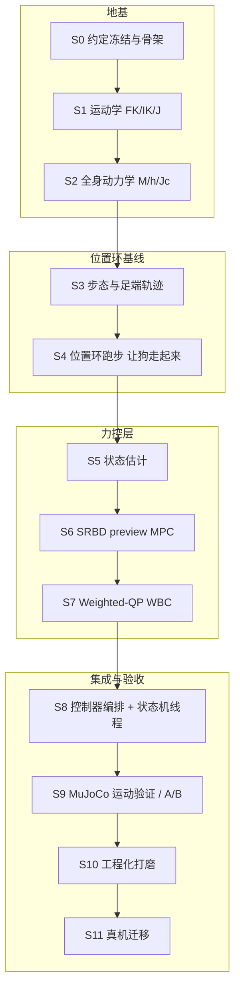

# Lite3 MPC + WBC 实现步骤与里程碑

> 本文是**施工图**：[`03_Lite3_MPC_WBC从理论到实现.md`](./03_Lite3_MPC_WBC从理论到实现.md) 讲清理论，[`02_MPC-WBC算法框架.md`](./02_MPC-WBC算法框架.md) 给出分层设计，本文把它们拆成**可以一步一步执行、每步都能编译和验证**的施工步骤。
> 工作方式：**每次只做一步**。每步必须交付「最小可编译增量 + 测试/对表结果 + 未解决问题」，通过该步的验收门槛后再进入下一步。不得用「仿真能动」跳过模型/估计/约束的数值验证。

---

## 0. 目标、边界与当前事实

### 0.1 目标

让 Lite3 在平地完成前进/后退/左右平移/原地旋转及三轴速度混合运动，采用**基于模型（MPC + WBC）**的控制方案，并与现有 ONNX 策略**互斥**运行：

- 输入：沿用 `interface/user_command/`（键盘/手柄）与 `UserCommand`。
- 输出：沿用 `interface/robot/robot_interface.h` 的 `SetJointCommand()`，即 **12×5** 矩阵，列顺序 `kp, q_des, kd, dq_des, tau_ff`。
- 算法：全部放在 [`mpc_wbc/`](../mpc_wbc/)；线程与机器人接口适配放在新增的 `state_machine/mpc_control_state.hpp`。
- 验证环境：MuJoCo 仿真与 Lite3 真机。

### 0.2 本工程已核对的事实（编写本文时用 MuJoCo 3.2.3 实测）

| 项目 | 实测值 | 影响 |
| --- | --- | --- |
| MJCF 维度 | `nq=19, nv=18, nu=12` | 浮动基 6 + 关节 12；WBC 决策 `qdd(18)+f(12)+τ(12)` |
| 整机质量 | **11.9376 kg** | SRBD/WBC 总质量基准 |
| 关节顺序 | `FL/FR/HL/HR × HipX/HipY/Knee` | 与 `custom_types.h`、SDK 顺序必须核对一致 |
| 电机 `ctrlrange` | 12 个均为 `[-30, 30] N·m` | 仿真力矩上限按 **30 N·m**；`ControlParameters` 的 `40/40/65` 是真机侧值，需另行核定 |
| 腿长（参数文件） | `hip_len=0.0985, thigh=0.20, shank=0.21 m` | 几何以 MJCF 对表结果为准，参数文件数值需逐一核对 |
| 工具链 | g++ 9.4.0（C++17）、CMake 3.16.3、Python `mujoco 3.2.3` | 可用 Python 侧 MuJoCo 做离线对表 oracle |

### 0.3 当前缺口（必须在施工中补上）

1. `mpc_wbc/` 目前只有 `README.md`，**没有任何算法代码或控制线程**。
2. `robot_interface.h` 的 `GetContactForce()` 在仿真与真机两端**均恒为零**；缺少可用基座位置/线速度/实测触地信息 → 需要状态估计器与有效性标志。
3. 现有状态机/接口/ONNX 线程**直接共享可变数据**，接入 MPC 时必须引入完整快照与单一命令写入权。

### 0.4 与参考工程的关系

主要参考：`/home/robot/pengyingjian_amp/fjksrobotics02_mpc-wbc/mpc_wbc/`（Fyscis02 主线为 **16 关节轮足**）。

- **只借鉴分层与算法结构**：`01` 步态调度、`02` 足端轨迹、`03` 运动学、`05` 全身动力学、`07` 质心预览 MPC、`09` Lite3 Weighted-QP WBC。
- **禁止直接移植**（详见 [`02`](./02_MPC-WBC算法框架.md) §8）：轮速/滚动/轮地滑移、Fyscis02 的质量与惯量、`07` 的「只输出净力」写法、`09` 省略 `Jdot·v` 的接触等式、`08_box_qp.hpp`（只能解盒约束 QP，不能承担 WBC）。
- 参考代码里的数值结论**不等于本工程已验证**；所有数值必须在本仓库 MJCF 对表后重新确定。

---

## 1. 施工原则

1. **每步一个最小可编译增量**：先骨架、后填空；任何时刻 `BUILD_SIM=ON` 都能编译，且不破坏 ONNX 路径。
2. **数值对表优先**：运动学/动力学一律以 MuJoCo 的 `mj_forward`/`mj_jacBody`/`mj_fullM`/`mj_rne` 为 oracle，达到 `1e-10` 量级才认可。
3. **单一命令写入权**：同一时刻只有一条运动控制路径（ONNX 或 MPC+WBC）写 `SetJointCommand()`。
4. **故障可降级**：求解失败/超时/NaN 时短期沿用「上次安全解」，超期立即进 `JointDamping`，绝不下发坏命令。
5. **参数显式标注来源**：区分「理论初值」「MuJoCo 标定值」「真机待定值」，不把仿真值当真机值。

---

## 2. 总路线图

文件与模块布局（沿用 [`02`](./02_MPC-WBC算法框架.md) §4 的职责边界）：

| 步骤 | 主要交付文件 | 参考（只借鉴结构） |
| --- | --- | --- |
| S0 | `mpc_wbc/00_lite3_model.hpp`(骨架)、`CMakeLists.txt` | — |
| S1 | `mpc_wbc/00_lite3_model.hpp`（运动学部分）+ 对表脚本 | `03_kinematics.*` |
| S2 | `mpc_wbc/00_lite3_model.hpp`（动力学部分） | `05_whole_body_dynamics.hpp`、附录 E |
| S3 | `mpc_wbc/02_gait_trajectory.hpp` | `01_trotgait_scheduler.*`、`02_trotfoot_trajectory.*` |
| S4 | 位置环接入（S8 前用临时测试入口/离线 harness） | `06_*` 的走路层 |
| S5 | `mpc_wbc/01_state_estimator.hpp` | — |
| S6 | `mpc_wbc/03_srbd_mpc.hpp/.cpp` | `07_srbd_mpc.*`、`04_srbd.hpp` |
| S7 | `mpc_wbc/04_weighted_wbc.hpp/.cpp` | `09_weighted_wbc.*`、附录 D |
| S8 | `mpc_wbc/05_mpc_wbc_controller.hpp`、`state_machine/mpc_control_state.hpp` | `state_machine/mpc_control_state.hpp` |
| S9 | `state_machine/auto_test_runner.hpp`（或等价测试脚本） | 参考工程 `auto_test_runner.hpp` |
| S10 | 各模块参数与频率调整 | — |
| S11 | `interface/robot/hardware/` 核定 | — |

---

## 3. 分步施工清单

### 阶段 A：地基（先有模型，才有力控）

#### S0 约定冻结与骨架搭建（对应 P0）
- **目标**：冻结坐标/顺序/数据契约，搭出 `mpc_wbc/` 骨架并接入 CMake，**不改变 ONNX 行为**。
- **理论对应**：第 1.1 节（坐标约定）、第 3.2 节（广义速度约定）。
- **交付**：
  - `mpc_wbc/00_lite3_model.hpp`：只含常量与声明（关节索引、`nv=18`、`qvel=[v_world(3); ω_body(3); dq(12)]`、`S=[0₁₂ₓ₆ I₁₂]`）。
  - `CMakeLists.txt`：新增 `mpc_wbc` 静态库 target（暂不含实现也可先建空 target）。
  - `mpc_wbc/README.md` 更新为「施工进度」。
- **验收**：`cmake -DBUILD_SIM=ON .. && make` 通过；`rl_deploy` 行为与改动前一致。
- **风险**：关节顺序/坐标系约定一旦错，后面全错 → 本步就把 `nq/nv/nu`、关节名、`ctrlrange` 写进头文件注释并与 MJCF 实测对齐。

#### S1 运动学模型 FK / IK / 雅可比（对应 P1 前半）
- **目标**：实现单腿与全身运动学三件套。
  - FK：`q → feet_body(4×3)`（第 1.2 节）。
  - IK：`feet_body → q(12)`，几何法 + 数值保护裁剪（第 1.3 节：`ρ` 裁剪、`c_k` 裁剪到 `[-1,1]`，失败保留兜底角）。
  - 雅可比：单腿 `J_i(3×3)` 中心差分（第 1.4 节），全身足端雅可比 `J_all(12×18)`。
- **理论对应**：第 1 章。
- **交付**：`00_lite3_model.hpp` 运动学实现 + `mpc_wbc/test/`（或 `support/scripts/`）下的对表脚本。
- **验证方法**：Python MuJoCo 随机取若干「合理位姿」，用 `mj_forward`/`mj_jacBody(FOOT)` 生成 oracle，与 C++ 输出对比。
- **通过条件**：
  - 随机位姿下 FK 误差 `< 1e-9`；雅可比误差 `< 1e-8`。
  - IK：FK(IK(p)) 回代误差 `< 1e-6`；对不可达目标返回失败标志而非 NaN。
- **风险**：HipX 侧摆分支（取 `|q_x|` 较小解）；`*_FOOT` body 原点与球足触地点存在半径差 → 接触雅可比与视觉轨迹参考点分别标注。

#### S2 全身动力学 M(q) / h(q,dq) / Jc（对应 P1 后半）
- **目标**：
  - `M(q)`：逐刚体动能组装（第 3.4 节）。
  - `h(q,dq)`：RNEA（第 3.5 节 + 附录 E），含重力、科氏、离心。
  - `Jc(12×18)`：四脚接触雅可比（第 3.6 节）。
- **理论对应**：第 3 章、附录 E。
- **交付**：`00_lite3_model.hpp` 动力学实现 + 对表脚本。
- **验证方法**：对照 `mj_fullM`、`mj_rne`（`qfrc_bias`）、`mj_jac`。
- **通过条件**：`M` 与 `mj_fullM` 误差 `~1e-10`；`h` 纯重力 `~1e-14`、含速度 `~1e-11`；`M` 对称正定；整机质量 `≈11.9376 kg`。
- **风险（两个历史大坑）**：① 角速度在 body 系，基座列是 `R` 而非单位阵；② 每个量所在坐标系/参考点必须写清。

### 阶段 B：位置环基线（先把「会走」变成测试平台）

#### S3 步态与足端轨迹（对应 P3）
- **目标**：trot 相位、支撑/摆动目标位置、未来接触表。
- **理论对应**：第 2.1、2.2 节。
- **交付**：`mpc_wbc/02_gait_trajectory.hpp`。
- **参数初值**（附录 C，需后续标定）：周期 `T≈0.60 s`、占空比 `d≈0.68`、抬脚 `0.06 m`、步长 `(0.10, 0.035) m`；相位偏移 `FL=HR=0`、`FR=HL=0.5`。
- **通过条件**：
  - 相位 / 当前支撑集 / 未来支撑表三者一致；MPC/WBC/轨迹共用**同一相位源**。
  - 零命令停步（四足静立，不持续踏步）。
  - 六种单轴及混合命令下足目标连续、可达、不越关节限位；摆动相用水平五次曲线 `s(φ)=10φ³−15φ⁴+6φ⁵` + 竖直 `h sin²(πφ)`，起落速度/加速度为 0。
- **风险**：落脚点在机身系「强行匀速后扫」是错的 → 支撑腿锁世界系锚点。

#### S4 位置环跑步（对应 M0/M1，理论 2.3）
- **目标**：用「步态 + 足端轨迹 + IK + 关节 PD」让 Lite3 在 MuJoCo **走起来**，作为可量化基线测试平台。
- **交付**：可运行的位置环运动入口（S8 前可用独立离线/测试入口，不污染 ONNX 路径）。
- **参数初值**：`kp=100, kd=2.5`（运行可 scale `0.4~0.5`）；关节速度限幅 `6 rad/s`；命令死区 `0.06`、斜坡 `2.5 /s`。
- **通过条件**：MuJoCo 平地六方向能走、不跌倒；为后续力控提供对照基线。
- **风险**：位置环不知动力学，强动态会晃 → 这正是 S5–S7 存在的理由。

### 阶段 C：力控层

#### S5 状态估计（对应 P2）
- **目标**：基座速度/高度估计 + 接触可信度。
- **理论对应**：第 2.3、6 章；[`02`](./02_MPC-WBC算法框架.md) §5.1。
- **交付**：`mpc_wbc/01_state_estimator.hpp`。
- **方法**：支撑腿零速假设 `v_foot^W≈0` → `v_base^W` 稳健平均；IMU 加速度短时传播校正；高度由地面 `z=0` 与支撑足 FK 恢复；平面位置短时积分 + 足端世界锚点持续更新。摆动腿不参与零速更新。
- **通过条件**：仿真静立/缓慢移动下与 MuJoCo 真值对比误差可接受；断包/全摆动/滑移能标记 **无效**；真值只进日志，**不进算法分支**。
- **风险**：当前 `GetContactForce()` 恒零 → 初期由「计划支撑相 + 运动学残差」估计接触；MuJoCo 接触真值仅用于对比。

#### S6 SRBD preview MPC（对应 P4，理论第 4 章）
- **目标**：把「单步跟踪」升级成「N 步预测」，输出**逐脚力**（及基座期望加速度）。
- **理论对应**：第 4 章、附录 C/D。
- **交付**：`mpc_wbc/03_srbd_mpc.hpp/.cpp`。
- **形式**：状态 `x=[p_c^W(3), v_c^W(3), 姿态误差(3), ω^B(3)]`，决策为每预测节点四脚世界系接触力 `f_{i,k}^W∈R³`；在当前测量附近线性化/离散化质心动力学。
- **参数初值**：`N=10, Δt=0.05 s`；权重 `q_p_xy=10, q_p_z=200, q_v=10`；求解缓存 `20 Hz`。
- **约束**：摆动足 `f_i=0`；支撑足 `0≤f_z≤f_z,max`、`|f_x|≤μ f_z`、`|f_y|≤μ f_z`；`μ≈0.6`。
- **通过条件**：静立总支撑力 `≈ mg`；摆动足力为零、摩擦/法向约束满足；每帧结果有限且耗时有记录；前/后/侧/转向响应方向正确；失败可报告并短期沿用有效解。
- **风险**：参考 `07` 只做质心 `p/v` 预览并输出**净力**，作为阶段验收可用，但**不能**当成完整姿态 MPC；要接 WBC 必须输出**逐脚力**。

#### S7 Weighted-QP WBC（对应 P5，理论第 5 章 + 附录 D）
- **目标**：单个加权 QP 求 `z=[qdd(18); f(12); τ_total(12)]∈R^42`。
- **理论对应**：第 5 章、附录 D。
- **交付**：`mpc_wbc/04_weighted_wbc.hpp/.cpp`（含求解器适配）。
- **硬约束**：浮动基动力学等式 `M·qdd − J_allᵀ·f − Sᵀ·τ = −h`（固定 18 行）；支撑足无滑 `J_i·qdd + Jdot_i·v = a_contact_des`（**不得省略 `Jdot·v`**）；摆动足 `f_i=0`；摩擦金字塔（每腿 5 行）；总力矩/关节限幅用变量上下界。
- **软任务**：① MPC 第 0 节点逐脚力跟踪；② 基座 6D 线/角加速度跟踪；③ 摆动足 `a_des + Kp(p_des−p) + Kd(v_des−v)`（`kp_swing=200, kd_swing=10`）；④ 接近名义站姿与小幅力矩正则。权重 `w_base=1e3, w_swing=1e2`。
- **固定行布局**：`18(EoM) + 每腿 3 行等式槽 + 每腿 5 行锥槽`，尺寸不随支撑集变化 → 可热启动。
- **求解器选型（待决策）**：本工程 `support/third_party/` 目前**没有** qpOASES/OSQP；需评估 qpOASES/OSQP/ProxQP 的**许可证、依赖、构建方式、ARM 可用性**。`08_box_qp.hpp` 只能解盒约束 QP，**不能单独承担 WBC**。
- **通过条件**：动力学/接触/摩擦残差在容差内；力矩不超过当前环境限值（仿真 `±30 N·m`）；QP 失败可报告且不发送坏命令；`Solve` 耗时有记录。
- **风险**：`τ_total` 与低层执行律 `τ_applied=kp(q_des−q)+kd(dq_des−dq)+tau_ff` 的关系 → 必须用**同一帧实测** `q,dq` 反解 `tau_ff = τ_total − kp(q_des−q) − kd(dq_des−dq)`，避免力矩重复。

### 阶段 D：集成与验收

#### S8 控制器编排 + 状态机线程（对应 P6）
- **目标**：把估计/步态/MPC/WBC 编排成无线程算法对象，并在状态机里加并列的 MPC 状态。
- **交付**：
  - `mpc_wbc/05_mpc_wbc_controller.hpp`：无 `StateBase` 继承、无线程、不直接调 `RobotInterface`；封装参数、IK 到 12×5 命令及故障状态。
  - `state_machine/mpc_control_state.hpp`：继承 `StateBase`，实现 `OnEnter/Run/LoseControlJudge/GetNextStateName/OnExit`，持有独立工作线程、完整快照、唯一 `SetJointCommand()` 写入权。
  - `state_machine/state_machine.hpp`：启动配置选择 `onnx` 或 `mpc_wbc`，把现有 `kRLControl` 路由指向选中状态（首版保留数值 6 与按键含义）。
- **线程契约**：状态估计/步态/WBC/命令发布目标 `500–1000 Hz`；MPC 每 `20–50 ms` 解一次；`MPCControlState::Run()` 发布**同一时间戳**快照，工作线程只处理新序号，拒绝重复/回退/过旧时间戳。
- **通过条件**：`onnx` 与 `mpc_wbc` 启动选项互斥（选 MPC 时不构造 ONNX）；站起/趴下/阻尼与键盘/手柄仍可用；进入/退出时**无双写、无陈旧命令**（切换先 `join` 原线程再交出写入权）。
- **风险**：现有 ONNX/接口/键盘线程共享可变数据 → 必须为两条路径都引入快照，不能只给新线程加锁。

#### S9 MuJoCo 运动验证 / A/B（对应 P7，理论 6.2）
- **目标**：7 段自动 A/B（对照 S4 位置环基线与 ONNX），量化力控收益。
- **交付**：测试脚本/runner（如 `state_machine/auto_test_runner.hpp` 或等价 Python 脚本）。
- **场景**：平地单轴六方向、混合命令、停步/换向、不同起始航向。
- **通过条件**：不跌倒；速度符号与命令一致；无持续力矩饱和；记录轨迹、姿态、足端滑移、峰值力矩、求解时延，并与基线比较。
- **风险**：必须用**相同起点/地面/命令序列/日志格式**对照，否则比较无意义。

#### S10 工程化打磨（对应 M5）
- **目标**：提频、载荷分配、参考系与残余振荡。
- **内容**：
  - 热启动把 WBC 提到 `1 kHz`（参考：`Solve` 均值约 `0.17 ms`）。
  - 载荷分配：把 PD 降到合适（运行可 scale `0.4~0.5`），看 WBC 是否「顶得住」。
  - 参考系 DESREF：摆动脚目标**不跟随机身倾斜**（否则目标跟着歪）。
  - 排查 `fwd` 段 roll 极限环与 tilt 来源。
- **通过条件**：指标单调改善或可解释；无新增失控事件。
- **风险**：调参不改变结构，属「打磨」，必须在 S9 已通过后做。

#### S11 真机迁移（对应 P8）
- **目标**：从仿真走向真机。
- **内容**：核定 SDK 单位/顺序/限幅/实际力矩；保守参数；现场日志；先静立、再小幅运动，逐步扩展六方向与混合。
- **通过条件**：结果可复现、无未解释的限幅/失控事件；**每次试验保留紧急阻尼入口**。
- **风险**：真机限值不能沿用仿真 `±30 N·m` 或参数文件 `40/40/65`；`GetJointTorque()` 语义、IMU 坐标/单位需实测核对。

---

## 4. 关键数值速查（初值，全部待标定）

| 类别 | 量 | 初值 | 来源 |
| --- | --- | --- | --- |
| 机器人 | 自由度 / 质量 | 12 关节 + 6 浮动基 / 11.94 kg | MJCF 实测 |
| 几何 | 大腿 / 小腿 | 0.20 / 0.21 m | 参数文件（待 MJCF 核对） |
| 站立 | 默认站立角 / 高度 | `[0, −0.65, 1.3]×4` / 0.33 m | 文档初值 |
| 走路层 | 周期 / 占空比 | 0.60 s / 0.68 | 附录 C |
| 走路层 | 抬脚 / 步长 | 0.06 m / (0.10, 0.035) m | 附录 C |
| 走路层 | PD 增益 | kp 100 / kd 2.5（可 scale 0.4~0.5） | 附录 C |
| 走路层 | 命令死区 / 斜坡 / 关节速度限幅 | 0.06 / 2.5 per s / 6 rad/s | 附录 C |
| MPC | N / dt / 求解频率 | 10 / 0.05 s / 20 Hz | 附录 C |
| MPC | 权重 q_p_xy / q_p_z / q_v | 10 / 200 / 10 | 附录 C |
| WBC | 决策维度 / 约束行 | 42 / 50（18+4×3+4×5） | 附录 C |
| WBC | 任务权重 w_base / w_swing | 1e3 / 1e2 | 附录 C |
| WBC | 摆动脚 kp / kd | 200 / 10 | 附录 C |
| WBC | τ 限幅（真机参考） | HipX/HipY ±30、Knee ±60 N·m | 附录 C |
| 环境 | 摩擦系数 μ | 0.6 | 附录 C（待标定） |
| 仿真 | 电机 `ctrlrange` | ±30 N·m | MJCF 实测 |

> 说明：**仿真的有效力矩上限按更严格的 ±30 N·m 运行**；`ControlParameters` 的 `40/40/65` 只在真机核对后使用。

---

## 5. 验证基础设施（随 S1 一起建立）

1. **MuJoCo oracle 脚本**：加载 `robot_models/.../Lite3_flat.xml`，随机「合理位姿」导出 `mj_forward`/`mj_jacBody`/`mj_fullM`/`mj_rne` 结果到 JSON/CSV。
2. **C++ 对表程序**：读同一批位姿，输出本工程 FK/IK/J/M/h，逐项算误差并打印。
3. **闭环 A/B runner**：同一命令序列跑「位置环基线 / 力控 / ONNX」，输出统一格式日志与指标表。
4. **日志字段**（[`02`](./02_MPC-WBC算法框架.md) §6）：时间戳/序号、原始与限速后三轴命令、机身估计与有效性、四足计划/估计接触、足端目标/实际、MPC 逐脚力及耗时、WBC 力矩及残差、发送的 `kp,q_des,kd,dq_des,tau_ff`、估计/实际电机力矩与限幅事件。

---

## 6. 进度看板

| 步骤 | 内容 | 依赖 | 状态 |
| --- | --- | --- | --- |
| S0 | 约定冻结与骨架搭建 | — | ✅ 约定冻结 + CMake target 接入 |
| S1 | 运动学 FK/IK/雅可比 + 对表 | S0 | ✅ 通过（见 §8） |
| S2 | 全身动力学 M/h/Jc + 对表 | S1 | ⬜ 未开始 |
| S3 | 步态与足端轨迹 | S2 | ⬜ 未开始 |
| S4 | 位置环跑步（基线平台） | S3 | ⬜ 未开始 |
| S5 | 状态估计 | S2,S4 | ⬜ 未开始 |
| S6 | SRBD preview MPC | S3,S5 | ⬜ 未开始 |
| S7 | Weighted-QP WBC | S2,S5,S6 | ⬜ 未开始 |
| S8 | 控制器编排 + 状态机线程 | S4,S6,S7 | ⬜ 未开始 |
| S9 | MuJoCo 运动验证 / A/B | S8 | ⬜ 未开始 |
| S10 | 工程化打磨 | S9 | ⬜ 未开始 |
| S11 | 真机迁移 | S9,S10 | ⬜ 未开始 |

> 状态图例：⬜ 未开始 / 🟨 进行中 / ✅ 已通过 / ⛔ 阻塞。每步完成后在此表更新，并记录「未解决问题」。

---

## 7. 待决策项（进入对应步骤前必须定）

1. **QP 求解器**（S7 前）：qpOASES / OSQP / ProxQP 的许可证、依赖、构建、ARM 可用性；`support/third_party/` 需新增哪一个。
2. **接触估计来源**（S5 前）：计划支撑相 + 运动学残差是否足够；是否需要为 MuJoCo 增加向后兼容的真值诊断通道。
3. **姿态通道级别**（S6 前）：先做「只预测质心 p/v」的验收版，还是直接上「质心 + 姿态」完整版。
4. **状态/按键复用**（S8 前）：是否保留 `RLControlMode=6` 数值与按键语义（首版建议保留）。
5. **仿真力矩语义**（S7/S9 前）：记录 `data.ctrl` 与限幅后 `actuator_force`/`qfrc_actuator`，确认实际输出力矩。

---

## 8. 步骤记录

### S1 运动学 FK / IK / 雅可比（✅ 已通过）

- **交付**：[`mpc_wbc/00_lite3_model.hpp`](../mpc_wbc/00_lite3_model.hpp)（FK / IK / 单腿雅可比 / 全身足端雅可比 / 四元数转旋转），[`mpc_wbc/test/`](../mpc_wbc/test/)（MuJoCo oracle 生成 + 对表 + 一键脚本）。
- **对表方式**：`mpc_wbc/test/run_kinematics_test.sh 500`，500 个随机位姿（浮动基随机位姿 + 关节角在真实范围内随机），真值来自 MuJoCo `mj_forward` / `mj_jacBody`。

| 项 | 误差 | 阈值 | 结果 |
| --- | --- | --- | --- |
| FK（机体系） | `3.3e-16` | `< 1e-9` | ✅ |
| 单腿雅可比（机体系） | `8.5e-11` | `< 1e-7` | ✅ |
| 全身足端雅可比（世界系） | `7.7e-11` | `< 1e-7` | ✅ |
| IK 回代 `FK(IK(p))` | `1.7e-16` | `< 1e-9` | ✅ |
| IK 带种子恢复关节角 | `2.2e-14` | `< 1e-9` | ✅ |
| IK 不可达目标数 | `0 / 2000` | `= 0` | ✅ |

- **过程记录（两个关键坑）**：
  1. HipX 侧摆解 `cos(psi+qx)=s·L/A` 有**两个分支**；候选角必须折叠到 `(-π, π]`，否则会漏掉 `-phi-psi+2π` 分支（真解可能落在那里），导致 IK 解出另一个有效但不同的构型。修复后带种子恢复误差降到 `2e-14`。
  2. 不可达判据应为 `√(r_y²+r_z²) < L`（数学上恒有 `A≥L`），而非 `< L+ε`；否则会误判近退化的可达目标。
- **与原计划数值的差异（以 MJCF 为准）**：MJCF 实测 `shank_len=0.21012`（参数文件 `0.21`）、`hip_lateral=0.09735`（参数文件 `hip_len_=0.0985`）；`HipX` 轴 `(-1,0,0)`、`HipY/Knee` 轴 `(0,-1,0)`，因此关节角符号约定与 `docs/03` §1.2 的 HipX 写法不同，本实现以 MJCF 为准。
- **未解决问题**：
  - `FootPositionBody()` 返回 `FOOT` body 原点（球足球心），真实触地点在球心下方 `foot_radius=0.022 m`；接触雅可比与轨迹参考点的偏移在 S5/S7 处理。
  - 触地/接触雅可比要求“接触点”位置，当前 `J_all` 是球心的雅可比，S5/S7 需按需换算。
- **构建**：对表已纳入 CMake（见 S0），可用 `ctest -R mpc_wbc` 运行。

### S0 约定冻结与骨架（✅ 已完成）

- 坐标约定、`nv=18`、`qvel` 顺序、`S` 矩阵、关节顺序等已冻结在 `00_lite3_model.hpp` 头部注释与常量中。
- **构建接入**：
  - `mpc_wbc/CMakeLists.txt`：提供 `mpc_wbc` INTERFACE 库（`00_lite3_model.hpp` 为 header-only）与对表测试 target。
  - 根 `CMakeLists.txt`：新增选项 `BUILD_MPC_WBC_TESTS`（默认 **OFF**），并 `add_subdirectory(mpc_wbc)`；测试 ON 时调用 `enable_testing()`。
  - 测试用 CTest fixture 组织：`mpc_wbc_gen_cases`（生成 MuJoCo 真值）→ `mpc_wbc_kinematics`（对表）。
- **验收**：
  - `cmake -S . -B build -DBUILD_MPC_WBC_TESTS=ON && cmake --build build -j && cd build && ctest -R mpc_wbc` 两个测试通过。
  - 默认配置（不传该选项）下 `ctest -N` 为 0 个测试、无 `lite3_kinematics_test` target，`rl_deploy` 正常构建 → **ONNX 路径不变**。

