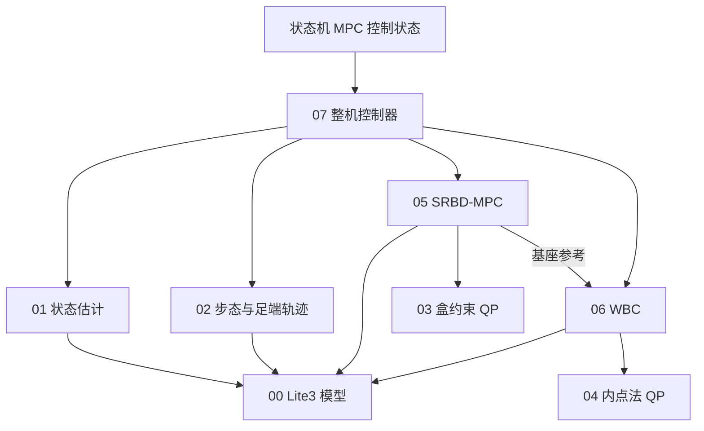

# Lite3 MPC + WBC 核心算法

`mpc_wbc/` 包含 Lite3 在 MuJoCo 中运动控制所需的 8 个算法头文件，使用 C++17 和 Eigen。
实现全部位于头文件中，`CMakeLists.txt` 通过 `mpc_wbc` 接口库向主程序提供它们。
核心算法说明集中在本文；`mpc_wbc/` 仅保留 8 个算法头文件和 `CMakeLists.txt`。

## 1. 文件编号与职责

按基础模型、状态与轨迹、数值求解器、MPC/WBC、整机控制器的依赖顺序编号。
编号用于阅读和维护；两个 QP 求解器在 MPC/WBC 求解时被调用。

| 文件 | 用途 |
| --- | --- |
| [00_lite3_model.hpp](../mpc_wbc/00_lite3_model.hpp) | 坐标与关节约定、运动学、雅可比、全身动力学、质心惯量 |
| [01_state_estimator.hpp](../mpc_wbc/01_state_estimator.hpp) | 根据 IMU、关节和支撑信息估计基座速度、高度与有效性 |
| [02_gait_trajectory.hpp](../mpc_wbc/02_gait_trajectory.hpp) | 速度分段、trot 相位、足端轨迹和未来接触表 |
| [03_box_qp.hpp](../mpc_wbc/03_box_qp.hpp) | 盒约束 QP 求解器，供 SRBD-MPC 使用 |
| [04_qp_ipm.hpp](../mpc_wbc/04_qp_ipm.hpp) | 含等式及不等式约束的 QP 内点法求解器，供 WBC 使用 |
| [05_srbd_mpc.hpp](../mpc_wbc/05_srbd_mpc.hpp) | 单刚体预测控制，调用 03 求解接触力并生成基座参考 |
| [06_weighted_wbc.hpp](../mpc_wbc/06_weighted_wbc.hpp) | 全身动力学与任务 QP，调用 04 求解加速度和接触力，并恢复关节力矩 |
| [07_mpc_wbc_controller.hpp](../mpc_wbc/07_mpc_wbc_controller.hpp) | 控制参数、模块编排、12×5 关节命令、故障处理，以及 MPC 工作线程和快照交换 |

`03` 和 `04` 处理的约束形式不同，MPC 和 WBC 分别使用对应的求解器。

## 2. 主程序如何调用

入口是 [state_machine/mpc_control_state.hpp](../state_machine/mpc_control_state.hpp)，它包含
`07_mpc_wbc_controller.hpp`，负责把机器人测量和用户速度命令送入算法，再把关节命令交给仿真接口。



状态机线程在收到新仿真状态后执行约 1 kHz 的测量处理、WBC 和关节命令计算；
MPC 工作线程默认每 0.05 s 求解一次，状态机使用最近的有效结果。

这 8 个头文件构成算法核心。完整运行还依赖目录外的状态机、控制参数、用户输入、
C++ UDP 仿真接口、Python MuJoCo 仿真、机器人模型，以及公共类型和工具。

## 3. 构建主控制程序

以下命令在工程根目录执行：

```bash
cmake -S . -B build
cmake --build build --target mpc_control rl_control -j2
```

两个程序使用同一套状态机。键盘站立后按 `v` 选择 MPC；USB 手柄站立后按 `Y` 选择 MPC。
输入映射及仿真启动方式见 [工程 README](../README.md)。

## 4. 速度约束与历史验收

指标已达标（详见 [docs/00 §5](00_设计指标.md)）：

- 单轴：$v_x$ 0.10–0.60 m/s、$v_y$ 0.10–0.50 m/s、$\omega_z$ 0.10–1.00 rad/s；
- 组合：一条线性归一化 $v_{xy}+0.18\lvert\omega_z\rvert\le0.67$（超限同比缩比）；
- 全部工况倾角 ≤8.6°，无翻车；实测失稳点 $\omega_z\approx2.5$ rad/s、$v_y\approx0.80$ m/s。

**本项目只面向 MuJoCo 仿真，不做真机部署**（边界见 [docs/00 §7](00_设计指标.md)）。

独立调参程序、自动验收脚本及场景已删除。以上数据为历史实测记录；调参过程见 [优化日志](05_优化日志.md)。
